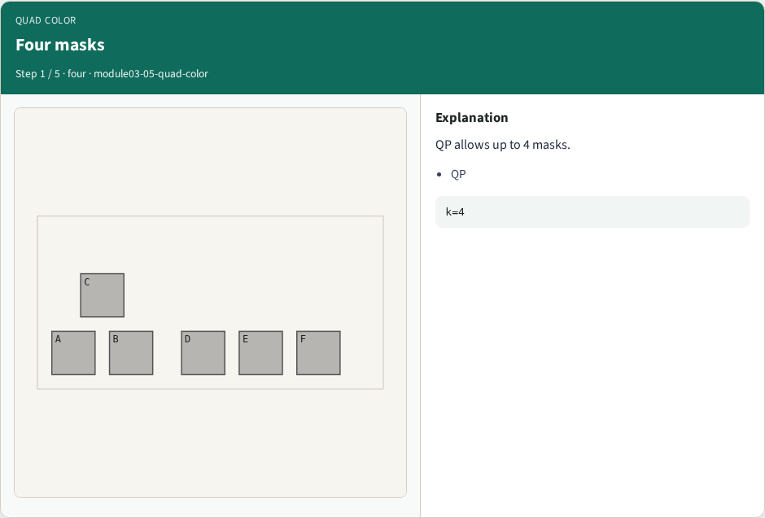
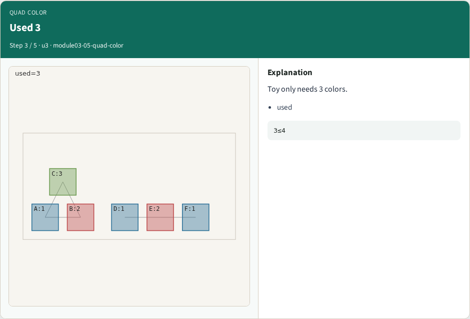
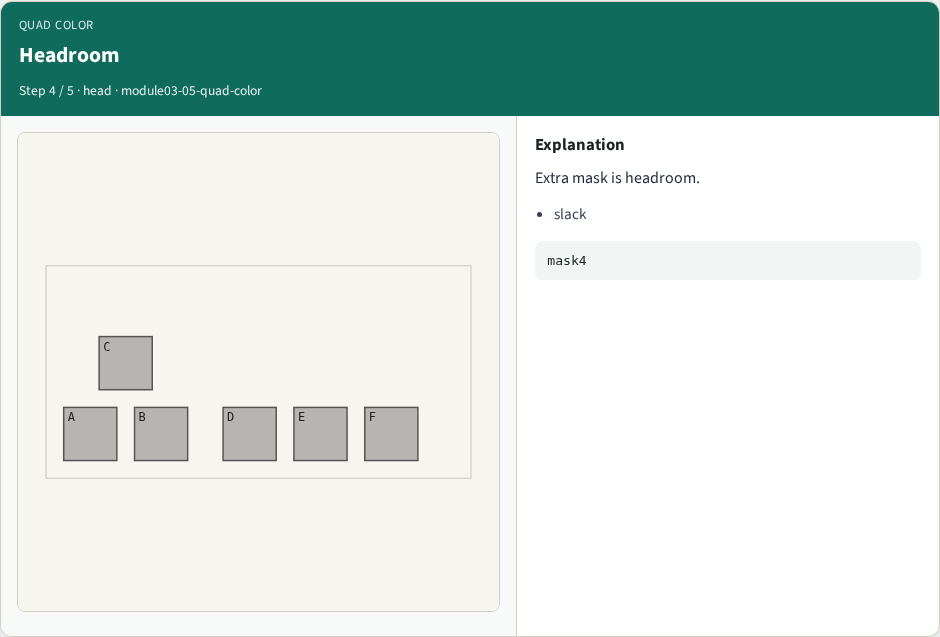
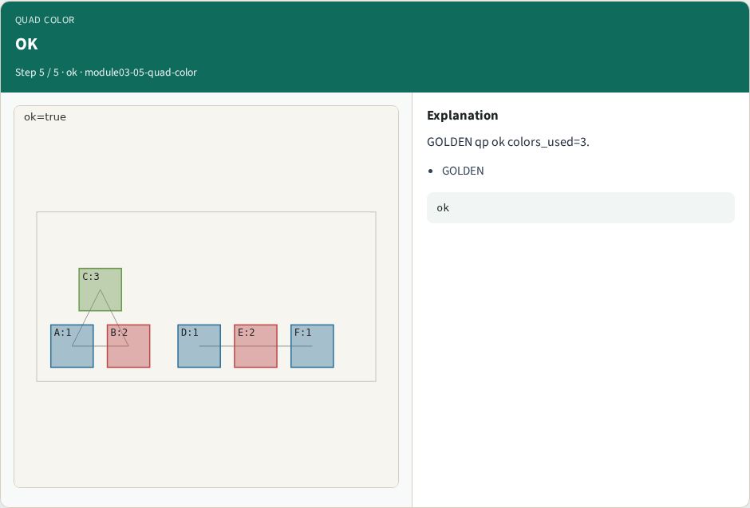
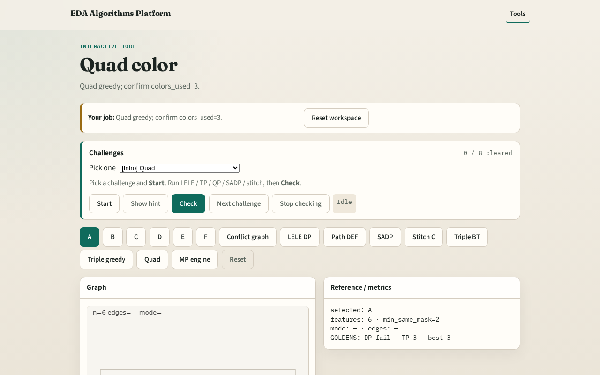

# Quad patterning (4-color greedy)

**Module id:** module03-05-quad-color
**Lab:** quad-color
**Tracks:** A (implement) · B (browser lab)

## Slide 1 — Quad patterning

Quad patterning reserves four masks; greedy coloring shows headroom when fewer suffice.

## Slide 2 — The idea

GOLDEN: colors_used=3, k=4, ok=True on tiny_mp.

<!-- algorithm-walkthrough -->

## Slide 3 — Four masks

QP allows up to 4 masks.

## Slide 4 — Greedy

Greedy 4-color the graph.

## Slide 5 — Used 3

Toy only needs 3 colors.

## Slide 6 — Headroom

Extra mask is headroom.

## Slide 7 — OK

GOLDEN qp ok colors_used=3.

<!-- /algorithm-walkthrough -->

## Slide 8 — Browser lab track

Open **quad-color**. Run quad greedy; confirm colors_used=3.

## Slide 9 — Implement track

Call quad_pattern(method='greedy'); assert ok and colors_used==3.

## Slide 10 — Pitfalls

Requiring all four masks used. Confusing QP with TP.

## Slide 11 — Your turn

Next: multi-patterning engine pass.
