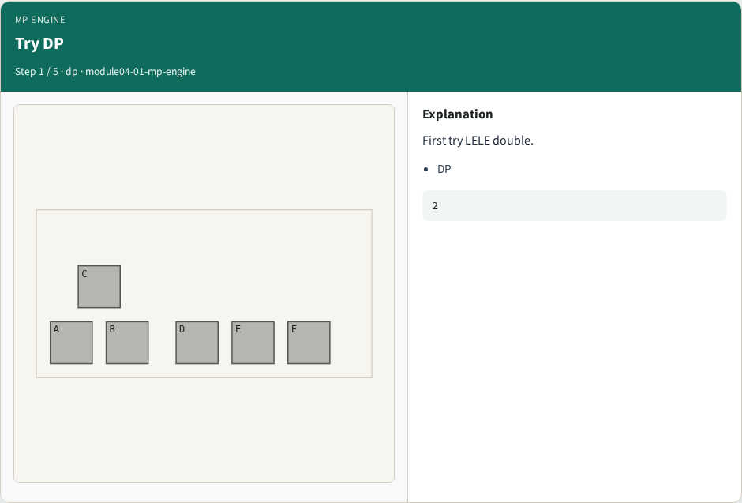
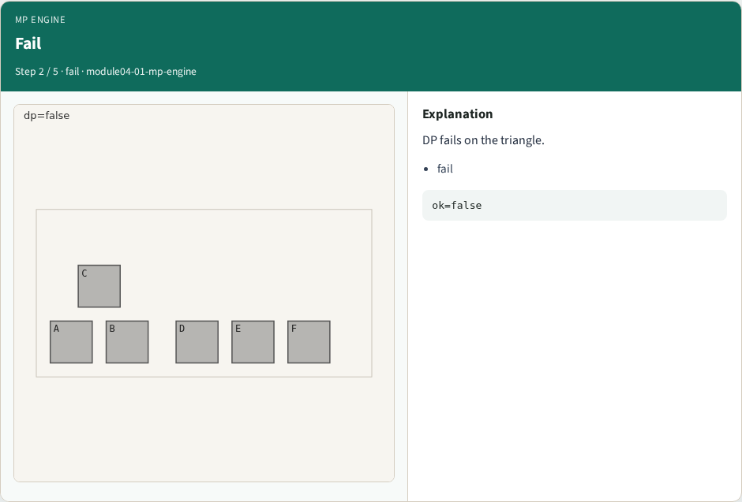
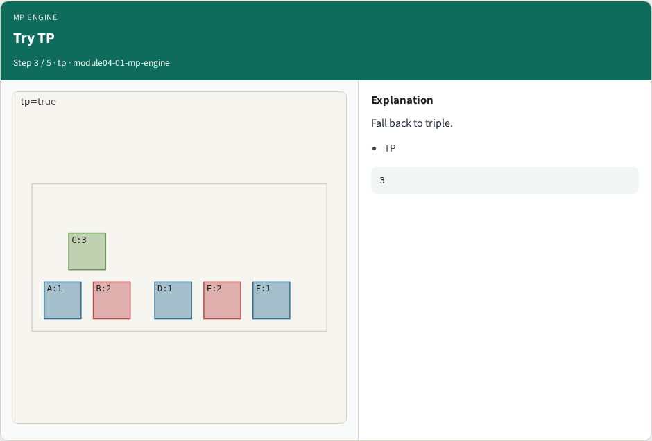
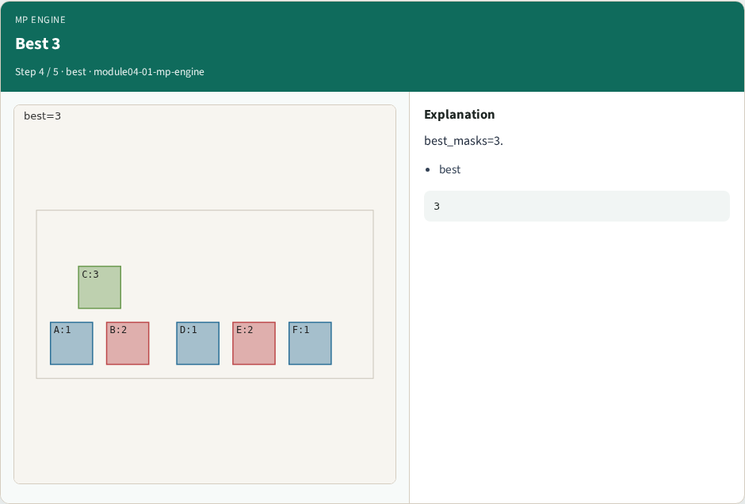
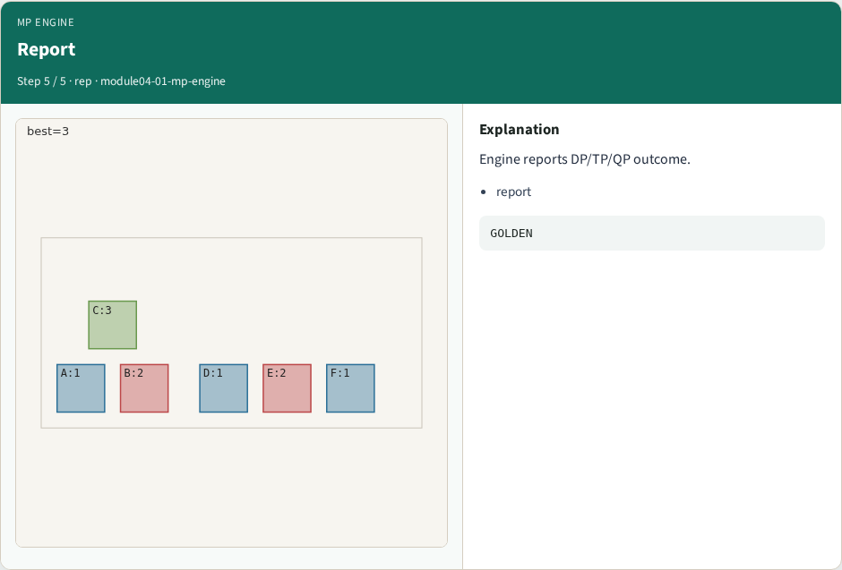
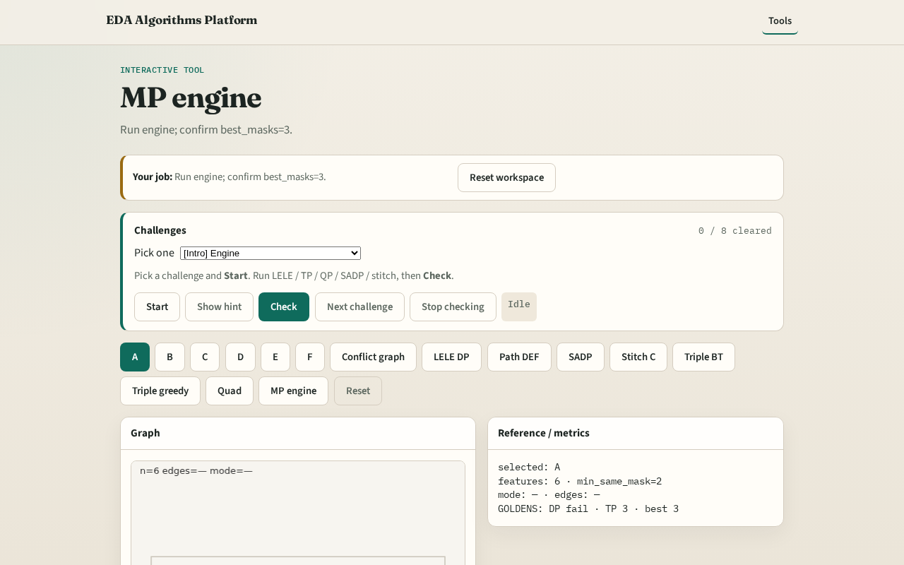

# Multi-patterning engine

**Module id:** module04-01-mp-engine
**Lab:** mp-engine
**Tracks:** A (implement) · B (browser lab)

## Slide 1 — MP engine

A tiny MP engine picks the minimum mask count that succeeds on the layout.

## Slide 2 — The idea

GOLDEN: best_masks=3, dp_ok=False, tp_ok=True.

<!-- algorithm-walkthrough -->

## Slide 3 — Try DP

First try LELE double.

## Slide 4 — Fail

DP fails on the triangle.

## Slide 5 — Try TP

Fall back to triple.

## Slide 6 — Best 3

best_masks=3.

## Slide 7 — Report

Engine reports DP/TP/QP outcome.

<!-- /algorithm-walkthrough -->

## Slide 8 — Browser lab track

Open **mp-engine**. Run engine; confirm best_masks=3.

## Slide 9 — Implement track

Call mp_engine(); assert best_masks==3 and dp_ok is False and tp_ok is True.

## Slide 10 — Pitfalls

Stopping after DP failure. Reporting QP when TP already succeeds.

## Slide 11 — Your turn

Next: offline benchmark compare, then wrap.
