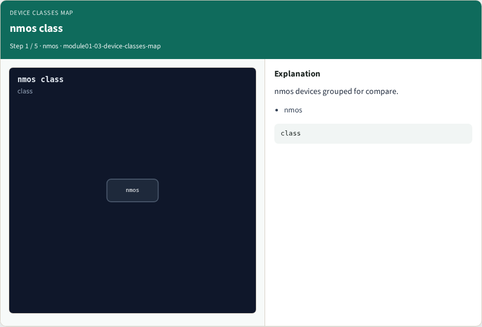
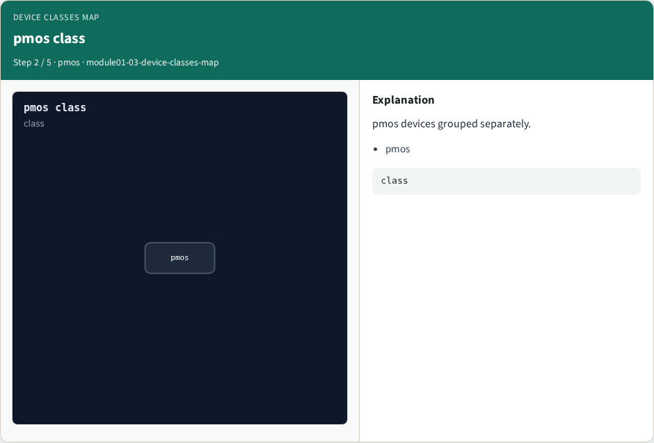
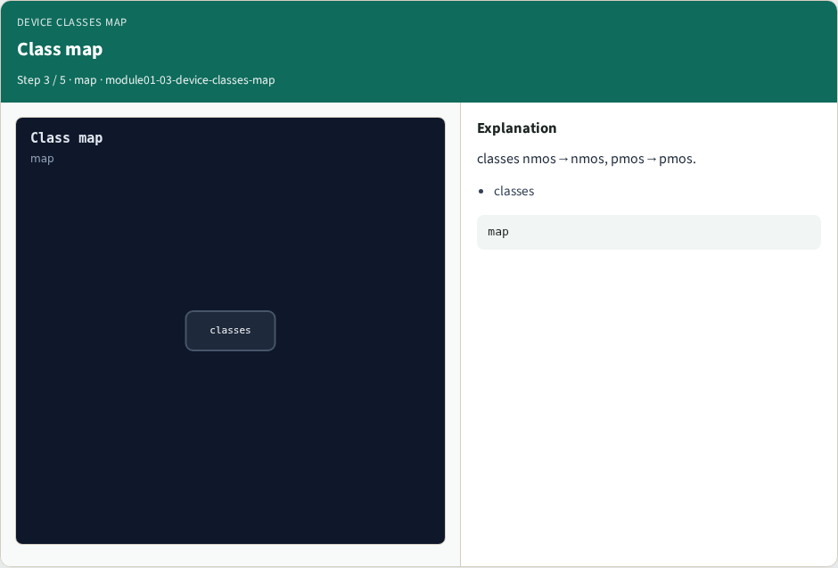
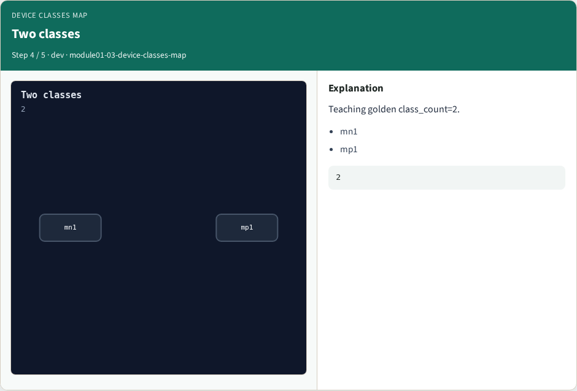

# Why Device

Map nmos/pmos device classes for compare groups

---

## The idea
- GOLDEN: classes=2 (nmos, pmos)

---

## nmos class


---

## pmos class


---

## Class map


---

## Two classes


---

## Golden


---

## Browser lab track
- Open **device-classes-map**
- Run the stage buttons and Check the goldens

---

## Implement track
- From common/, run solvers.py and confirm NETGEN_PARTA_OK

---

## Pitfalls
- Confusing schematic SPICE with layout extract
- Forgetting permute on source/drain

---

## Try these
- From the common folder, run the Netgen map self-test

---

## Try these — try these

```
cd courses/learn_netgen/common
python3 solvers.py
```

---

## Pseudocode
- Here is the check in plain steps

---

## Pseudocode — try these

```
classes=2 (nmos, pmos).
ok if goldens match
```

---

## Next
- Complete the quiz for this part
- Continue the Netgen Part A map, then the real CLI track

