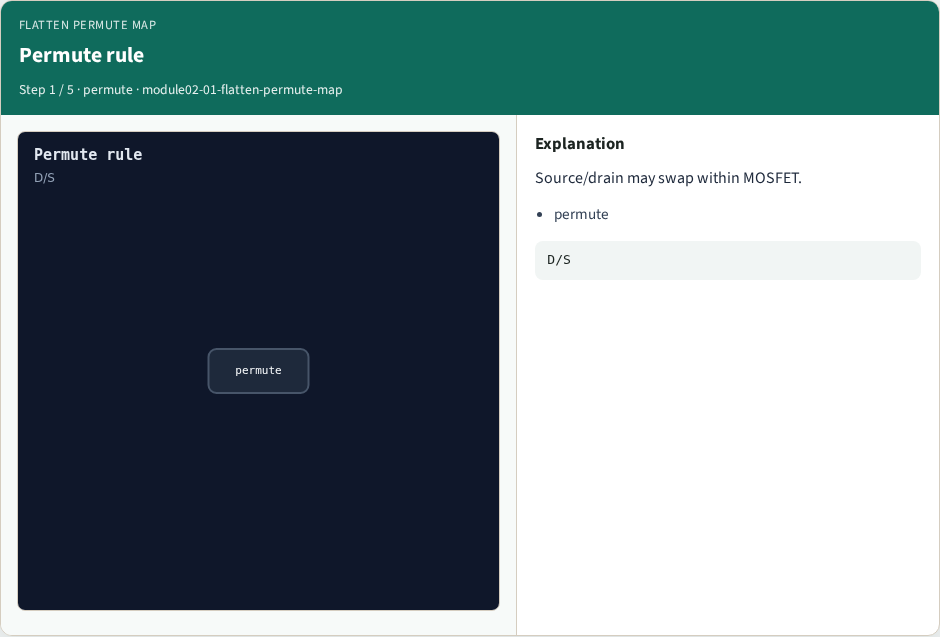
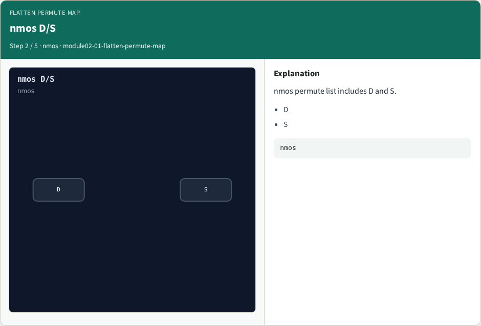
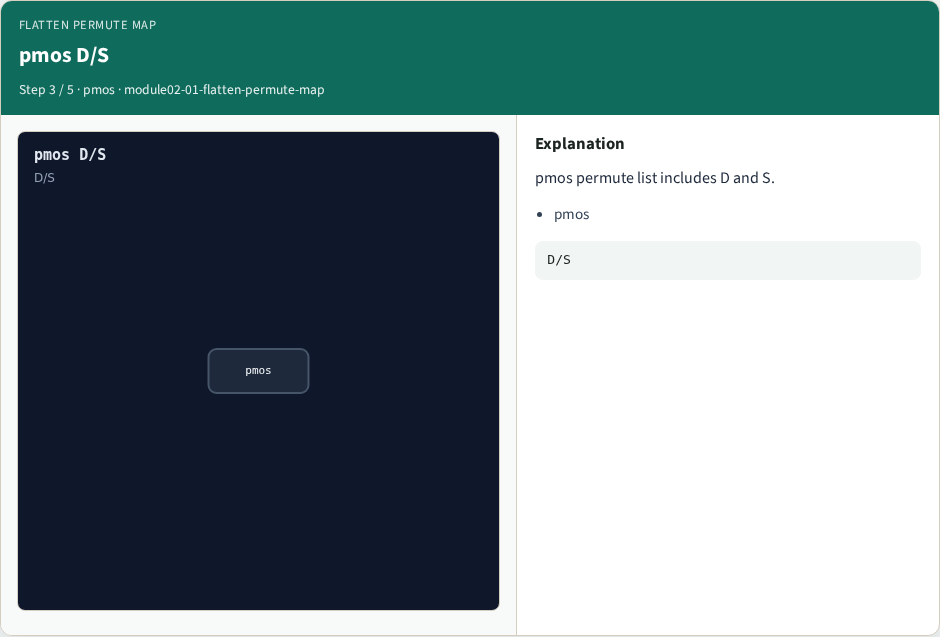

# Flatten permute map

**Module id:** module02-01-flatten-permute-map
**Lab:** flatten-permute-map
**Tracks:** A (implement) · B (browser lab)

## Slide 1 — Why Flatten

Source/drain pins may permute within a MOSFET class.

## Slide 2 — The idea

GOLDEN: permute D/S on nmos/pmos.

<!-- algorithm-walkthrough -->

## Slide 3 — Permute rule



Source/drain may swap within MOSFET.

## Slide 4 — nmos D/S



nmos permute list includes D and S.

## Slide 5 — pmos D/S



pmos permute list includes D and S.

## Slide 6 — Gate fixed


Gate pin G does not permute.

## Slide 7 — Golden


GOLDEN: permute_ok=True.

<!-- /algorithm-walkthrough -->


## Slide 8 — Browser lab track

Open **flatten-permute-map**. Run the stage buttons and Check the goldens.

## Slide 9 — Implement track

From common/, run solvers.py and confirm NETGEN_PARTA_OK.

## Slide 10 — Pitfalls

Confusing schematic SPICE with layout extract. Forgetting permute on source/drain.

## Slide 11 — Try these

From the common folder, run the Netgen map self-test.

```bash
cd courses/learn_netgen/common
python3 solvers.py
```

## Slide 12 — Pseudocode

Here is the check in plain steps.

```text
permute D/S on nmos/pmos.
ok if goldens match
```

## Slide 13 — Next

Continue the Netgen Part A map, then the real CLI track.
