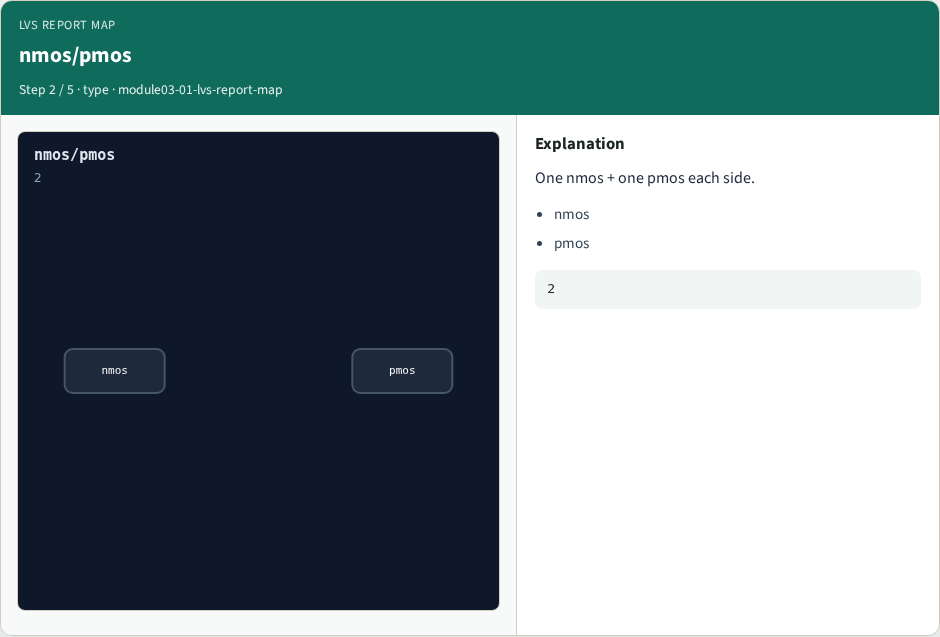
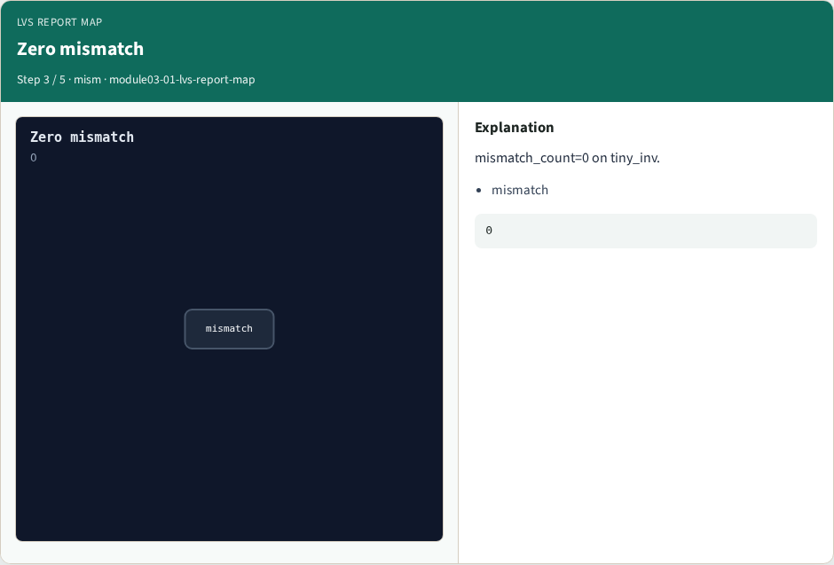
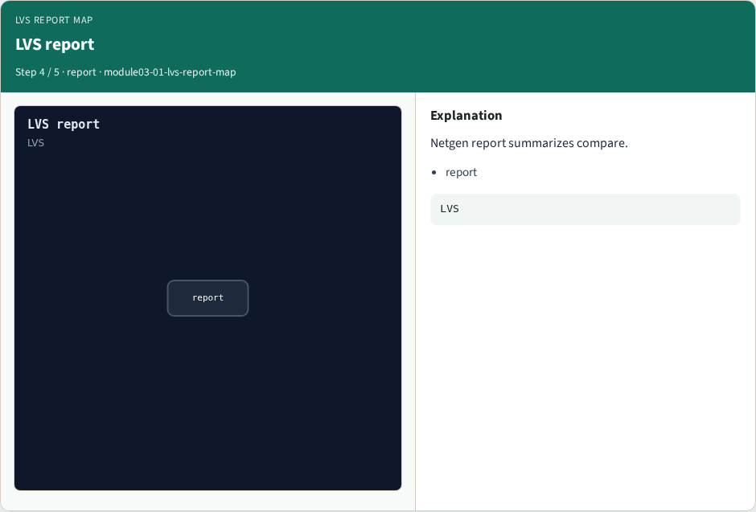

# Why LVS

LVS report: matched devices and mismatches

---

## The idea
- GOLDEN: matched_devices=2; mismatch=0

---

## Device match


---

## nmos/pmos


---

## Zero mismatch


---

## LVS report


---

## Golden


---

## Browser lab track
- Open **lvs-report-map**
- Run the stage buttons and Check the goldens

---

## Implement track
- From common/, run solvers.py and confirm NETGEN_PARTA_OK

---

## Pitfalls
- Confusing schematic SPICE with layout extract
- Forgetting permute on source/drain

---

## Try these
- From the common folder, run the Netgen map self-test

---

## Try these — try these

```
cd courses/learn_netgen/common
python3 solvers.py
```

---

## Pseudocode
- Here is the check in plain steps

---

## Pseudocode — try these

```
matched_devices=2; mismatch=0.
ok if goldens match
```

---

## Next
- Complete the quiz for this part
- Continue the Netgen Part A map, then the real CLI track

