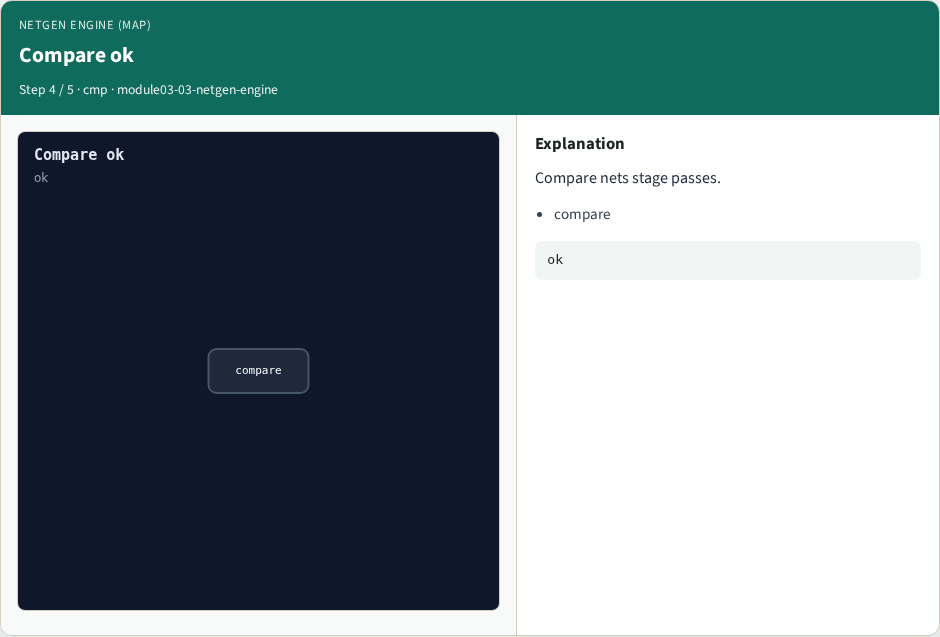
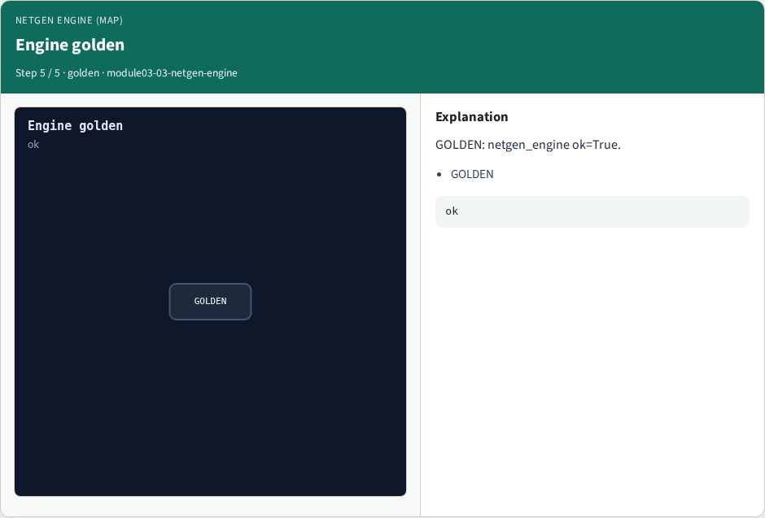

# Netgen engine (map) — step-by-step (for slides / transcript)

**Module:** `module03-03-netgen-engine`  
**Lab / algo:** `netgen-engine`  
**Viewer:** `/tools/algorithm-walkthrough/?algo=netgen-engine&step=1`

Use each **Caption** as spoken prose (or a shortened slide note).
Use **Bullets** on the PPT; pair with the PNG in `assets/steps/`.

## Step 1 — Read ok


**Caption (transcript):** Read netlists stage passes.

**Slide bullets:**

- read

**On-screen metrics:**

```
ok
```

## Step 2 — Classes ok


**Caption (transcript):** Device classes stage passes.

**Slide bullets:**

- classes

**On-screen metrics:**

```
ok
```

## Step 3 — Permute ok


**Caption (transcript):** Flatten permute stage passes.

**Slide bullets:**

- permute

**On-screen metrics:**

```
ok
```

## Step 4 — Compare ok



**Caption (transcript):** Compare nets stage passes.

**Slide bullets:**

- compare

**On-screen metrics:**

```
ok
```

## Step 5 — Engine golden



**Caption (transcript):** GOLDEN: netgen_engine ok=True.

**Slide bullets:**

- GOLDEN

**On-screen metrics:**

```
ok
```

