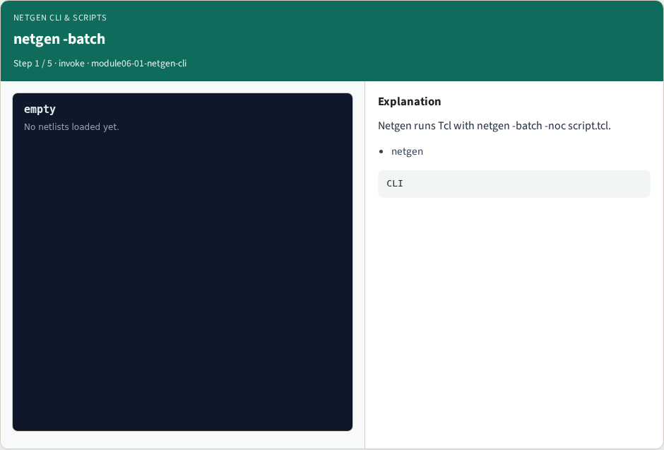
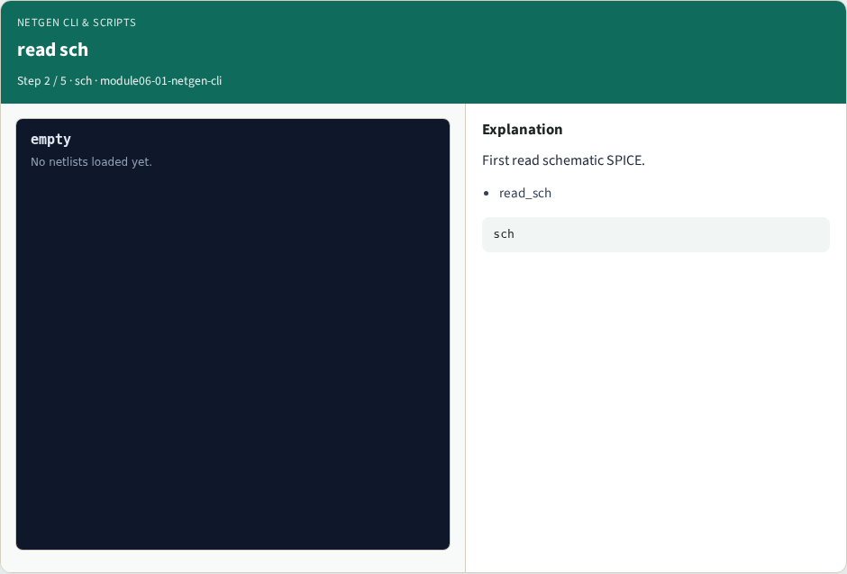

# Netgen CLI & scripts

**Module id:** module06-01-netgen-cli
**Lab:** netgen-cli

## Slide 1 — Why real Netgen

Invoke netgen -batch script.tcl; recipe starts read_sch→read_lay.

## Slide 2 — The idea

GOLDEN: First two cmds: read_sch, read_lay.

<!-- algorithm-walkthrough -->

## Slide 3 — netgen -batch



Netgen runs Tcl with netgen -batch -noc script.tcl.

## Slide 4 — read sch



First read schematic SPICE.

## Slide 5 — read lay


Then read layout/extract SPICE.

## Slide 6 — compare


Compare nets and devices.

## Slide 7 — Golden


GOLDEN: recipe prefix read_sch→read_lay.

<!-- /algorithm-walkthrough -->


## Slide 8 — Browser lab

Open **netgen-cli**.

## Slide 9 — Implement track

Run real_solvers.py — REAL_NETGEN_OK.

## Slide 10 — Pitfalls

Editing goldens without re-running scripts.

## Slide 11 — Try these

From the common folder, run the real Netgen self-test.

```bash
cd courses/learn_netgen/common
python3 real_solvers.py
```

## Slide 12 — Pseudocode

Here is the check in plain steps.

```text
First two cmds: read_sch, read_lay.
ok if goldens match
```

## Slide 13 — Next

Continue Part B evidence track.
