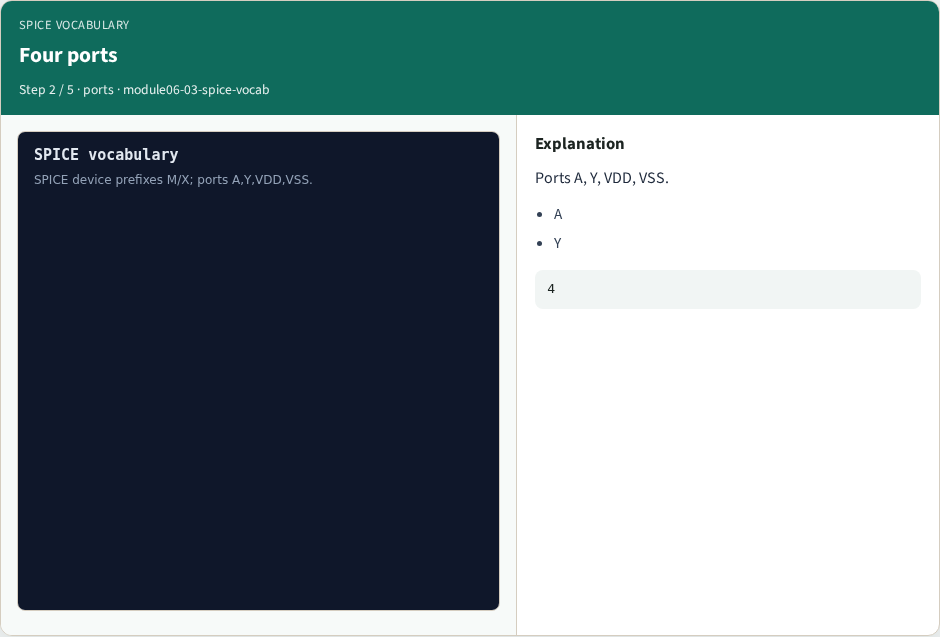
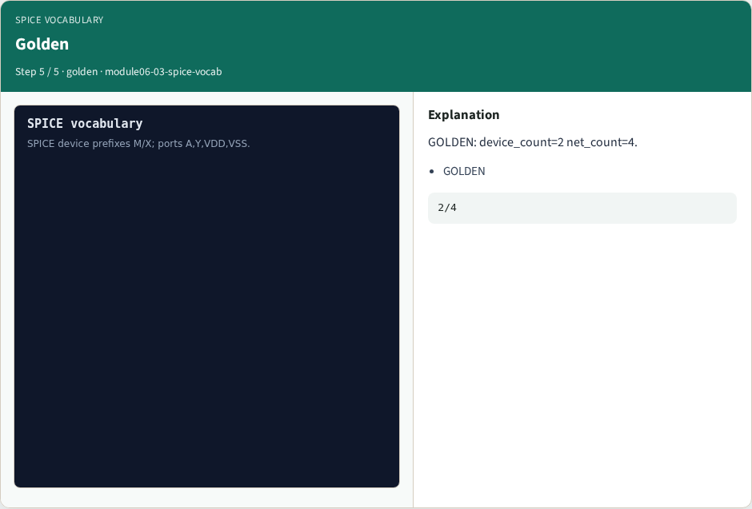

# SPICE vocabulary — step-by-step (for slides / transcript)

**Module:** `module06-03-spice-vocab`  
**Lab / algo:** `spice-vocab`  
**Viewer:** `/tools/algorithm-walkthrough/?algo=spice-vocab&step=1`

Use each **Caption** as spoken prose (or a shortened slide note).
Use **Bullets** on the PPT; pair with the PNG in `assets/steps/`.

## Step 1 — M/X prefixes


**Caption (transcript):** SPICE devices use M or X prefixes.

**Slide bullets:**

- M
- X

**On-screen metrics:**

```
dev
```

## Step 2 — Four ports



**Caption (transcript):** Ports A, Y, VDD, VSS.

**Slide bullets:**

- A
- Y

**On-screen metrics:**

```
4
```

## Step 3 — G,D,S pins


**Caption (transcript):** MOSFET pins gate, drain, source.

**Slide bullets:**

- G
- D
- S

**On-screen metrics:**

```
pins
```

## Step 4 — Classes


**Caption (transcript):** nmos and pmos device classes.

**Slide bullets:**

- nmos
- pmos

**On-screen metrics:**

```
2
```

## Step 5 — Golden



**Caption (transcript):** GOLDEN: device_count=2 net_count=4.

**Slide bullets:**

- GOLDEN

**On-screen metrics:**

```
2/4
```

