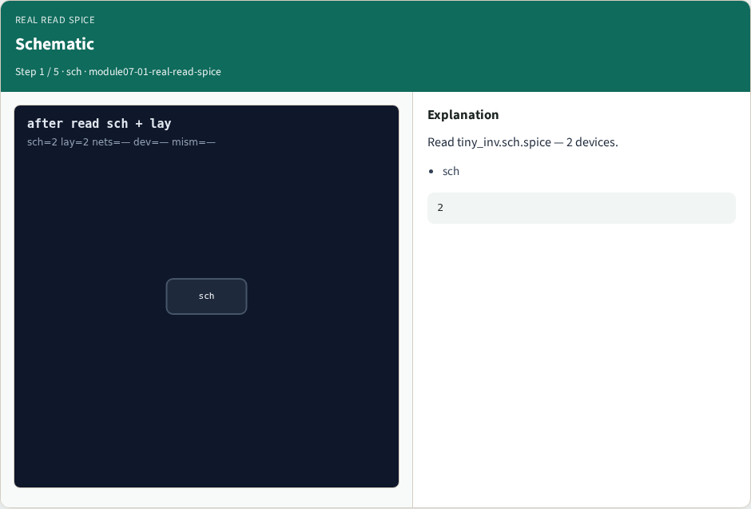
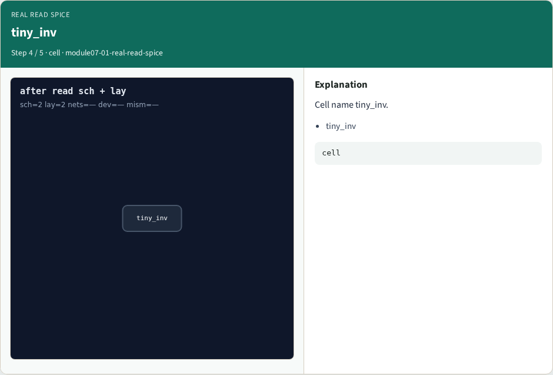

# Real read SPICE

**Module id:** module07-01-real-read-spice
**Lab:** real-read-spice

## Slide 1 — Why real Netgen

Read tiny_inv schematic and layout SPICE.

## Slide 2 — The idea

GOLDEN: sch_devices=2; lay_devices=2; nets=4.

<!-- algorithm-walkthrough -->

## Slide 3 — Schematic



Read tiny_inv.sch.spice — 2 devices.

## Slide 4 — Layout


Read tiny_inv.lay.spice — 2 devices.

## Slide 5 — Four nets


Four nets on each side.

## Slide 6 — tiny_inv



Cell name tiny_inv.

## Slide 7 — Golden


GOLDEN: sch/lay devices=2 nets=4.

<!-- /algorithm-walkthrough -->


## Slide 8 — Browser lab

Open **real-read-spice**.

## Slide 9 — Implement track

Run real_solvers.py — REAL_NETGEN_OK.

## Slide 10 — Pitfalls

Editing goldens without re-running scripts.

## Slide 11 — Try these

From the common folder, run the real Netgen self-test.

```bash
cd courses/learn_netgen/common
python3 real_solvers.py
```

## Slide 12 — Pseudocode

Here is the check in plain steps.

```text
sch_devices=2; lay_devices=2; nets=4.
ok if goldens match
```

## Slide 13 — Next

Continue Part B evidence track.
