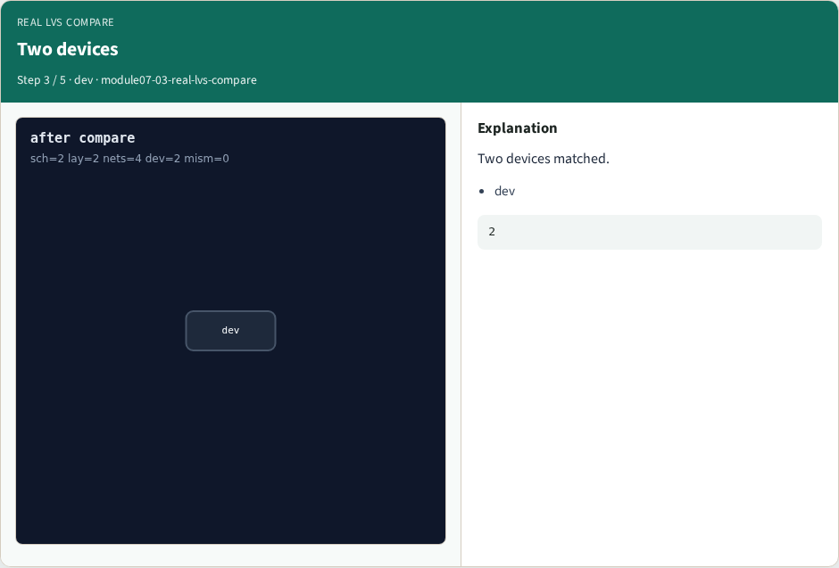
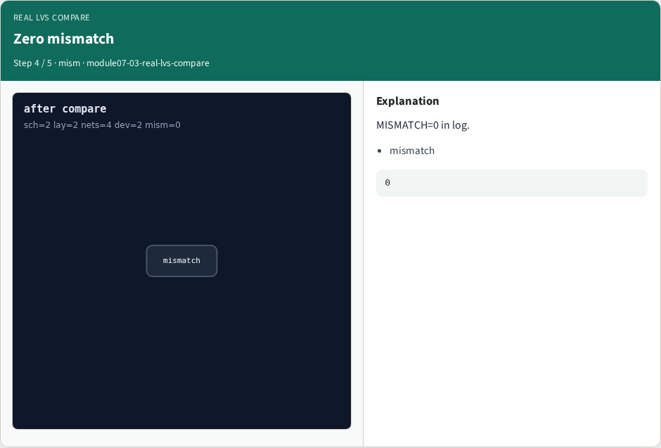
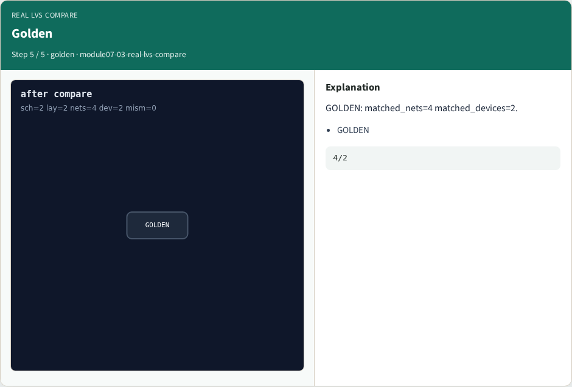

# Real LVS compare — step-by-step (for slides / transcript)

**Module:** `module07-03-real-lvs-compare`  
**Lab / algo:** `real-lvs-compare`  
**Viewer:** `/tools/algorithm-walkthrough/?algo=real-lvs-compare&step=1`

Use each **Caption** as spoken prose (or a shortened slide note).
Use **Bullets** on the PPT; pair with the PNG in `assets/steps/`.

## Step 1 — compare


**Caption (transcript):** Netgen compare matches nets/devices.

**Slide bullets:**

- compare

**On-screen metrics:**

```
cmd
```

## Step 2 — Four nets


**Caption (transcript):** Four nets matched.

**Slide bullets:**

- nets

**On-screen metrics:**

```
4
```

## Step 3 — Two devices



**Caption (transcript):** Two devices matched.

**Slide bullets:**

- dev

**On-screen metrics:**

```
2
```

## Step 4 — Zero mismatch



**Caption (transcript):** MISMATCH=0 in log.

**Slide bullets:**

- mismatch

**On-screen metrics:**

```
0
```

## Step 5 — Golden



**Caption (transcript):** GOLDEN: matched_nets=4 matched_devices=2.

**Slide bullets:**

- GOLDEN

**On-screen metrics:**

```
4/2
```

