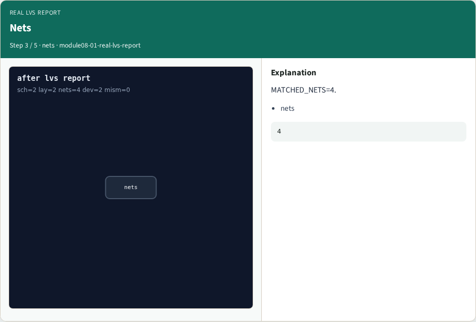
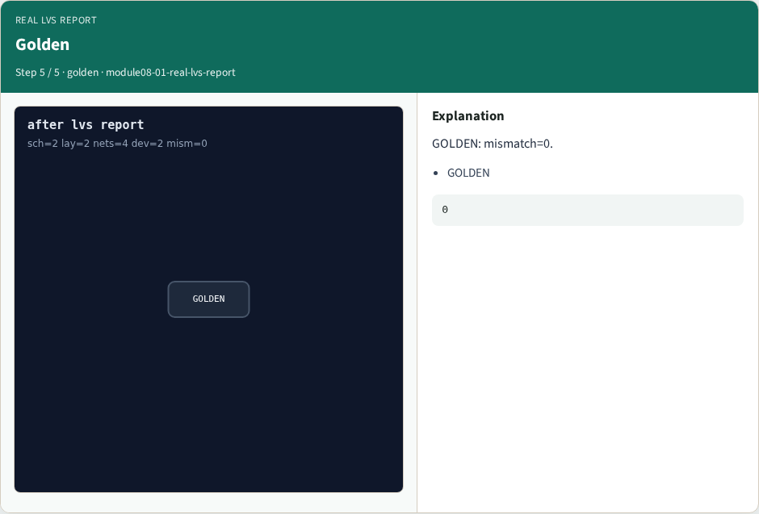

# Why real Netgen

LVS report with class count

---

## The idea
- GOLDEN: matched=2/4; mismatch=0; classes=2

---

## report cmd


---

## Devices


---

## Nets


---

## Classes


---

## Golden


---

## Browser lab
- Open **real-lvs-report**

---

## Implement track
- Run real_solvers.py , REAL_NETGEN_OK

---

## Pitfalls
- Editing goldens without re-running scripts

---

## Try these
- From the common folder, run the real Netgen self-test

---

## Try these — try these

```
cd courses/learn_netgen/common
python3 real_solvers.py
```

---

## Pseudocode
- Here is the check in plain steps

---

## Pseudocode — try these

```
matched=2/4; mismatch=0; classes=2.
ok if goldens match
```

---

## Next
- Complete the quiz for this part
- Continue Part B evidence track

