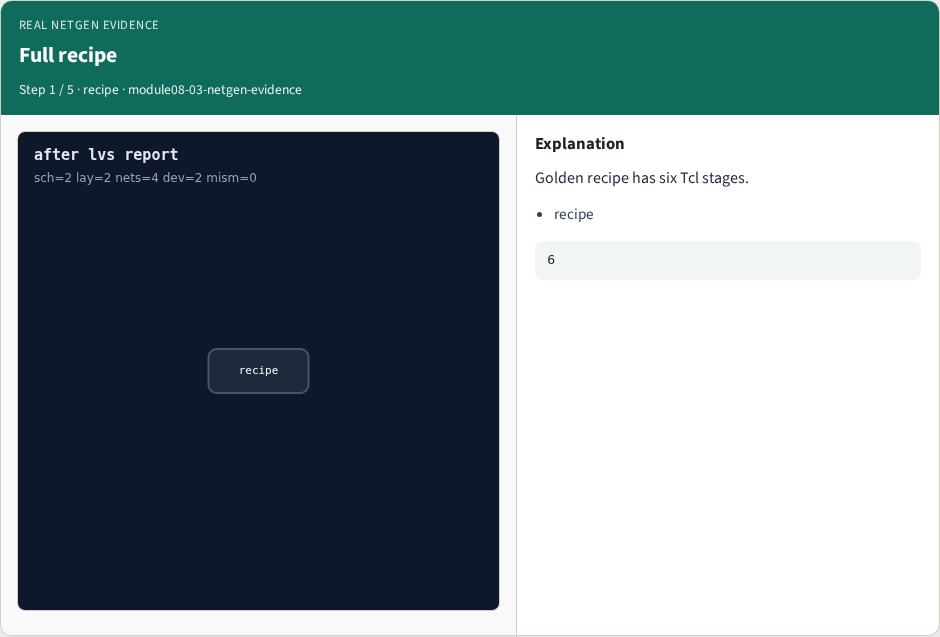
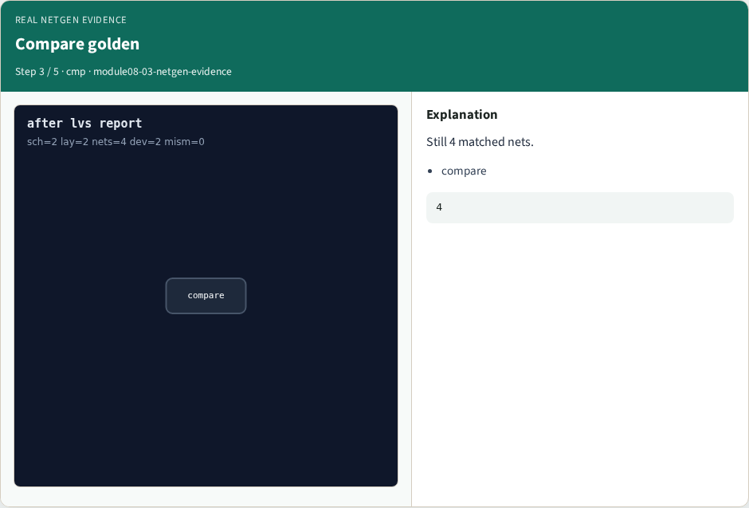
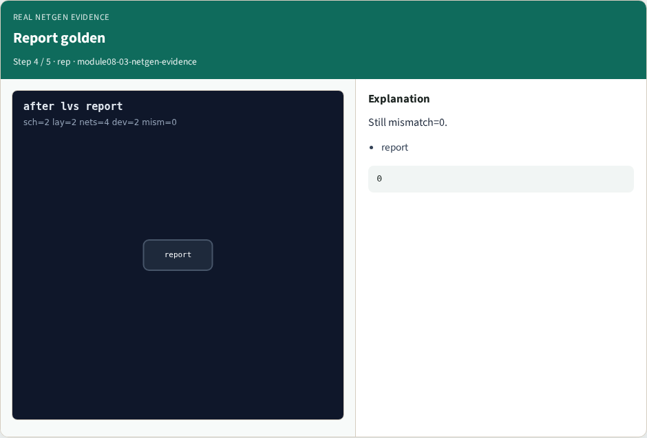

# Real Netgen evidence — step-by-step (for slides / transcript)

**Module:** `module08-03-netgen-evidence`  
**Lab / algo:** `netgen-evidence`  
**Viewer:** `/tools/algorithm-walkthrough/?algo=netgen-evidence&step=1`

Use each **Caption** as spoken prose (or a shortened slide note).
Use **Bullets** on the PPT; pair with the PNG in `assets/steps/`.

## Step 1 — Full recipe



**Caption (transcript):** Golden recipe has six Tcl stages.

**Slide bullets:**

- recipe

**On-screen metrics:**

```
6
```

## Step 2 — Read golden


**Caption (transcript):** Still 2 sch + 2 lay devices.

**Slide bullets:**

- read

**On-screen metrics:**

```
2/2
```

## Step 3 — Compare golden



**Caption (transcript):** Still 4 matched nets.

**Slide bullets:**

- compare

**On-screen metrics:**

```
4
```

## Step 4 — Report golden



**Caption (transcript):** Still mismatch=0.

**Slide bullets:**

- report

**On-screen metrics:**

```
0
```

## Step 5 — Engine


**Caption (transcript):** GOLDEN: real_netgen_engine ok=True.

**Slide bullets:**

- GOLDEN

**On-screen metrics:**

```
ok
```

