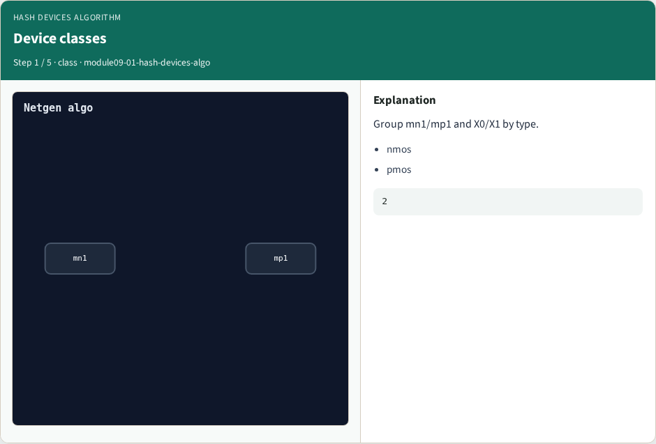
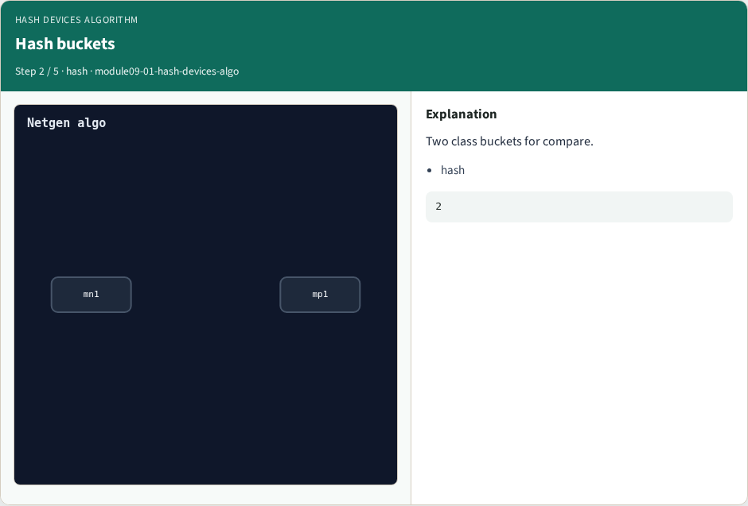
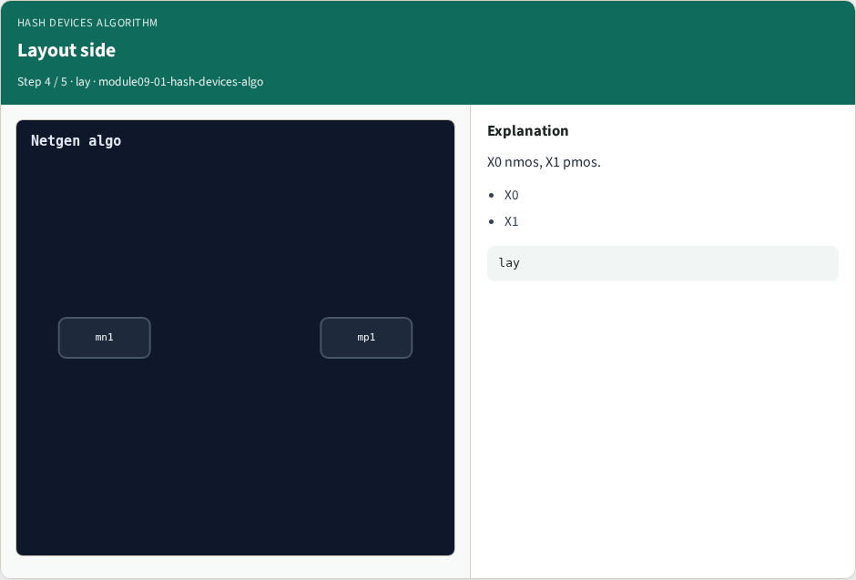
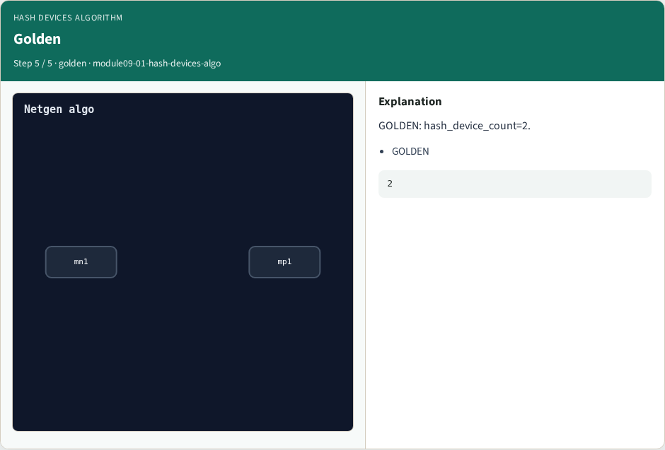

# Hash devices algorithm

**Module id:** module09-01-hash-devices-algo
**Lab:** hash-devices-algo

## Slide 1 — Why algorithms

Hash devices by nmos/pmos class for compare.

## Slide 2 — The idea

GOLDEN: hash_device_count=2.

<!-- algorithm-walkthrough -->

## Slide 3 — Device classes



Group mn1/mp1 and X0/X1 by type.

## Slide 4 — Hash buckets



Two class buckets for compare.

## Slide 5 — Schematic side


mn1 nmos, mp1 pmos.

## Slide 6 — Layout side



X0 nmos, X1 pmos.

## Slide 7 — Golden



GOLDEN: hash_device_count=2.

<!-- /algorithm-walkthrough -->


## Slide 8 — Browser lab

Open **hash-devices-algo**.

## Slide 9 — Implement track

Run algo_solvers.py and partc_bind.py.

## Slide 10 — Pitfalls

Changing tiny_algo_netgen without updating Part B goldens.

## Slide 11 — Try these

From the common folder, run the Part C self-tests.

```bash
cd courses/learn_netgen/common
python3 algo_solvers.py
python3 partc_bind.py
```

## Slide 12 — Pseudocode

Here is the check in plain steps.

```text
hash_device_count=2.
ok if goldens match and bind
```

## Slide 13 — Next

Continue Part C, then internals.
