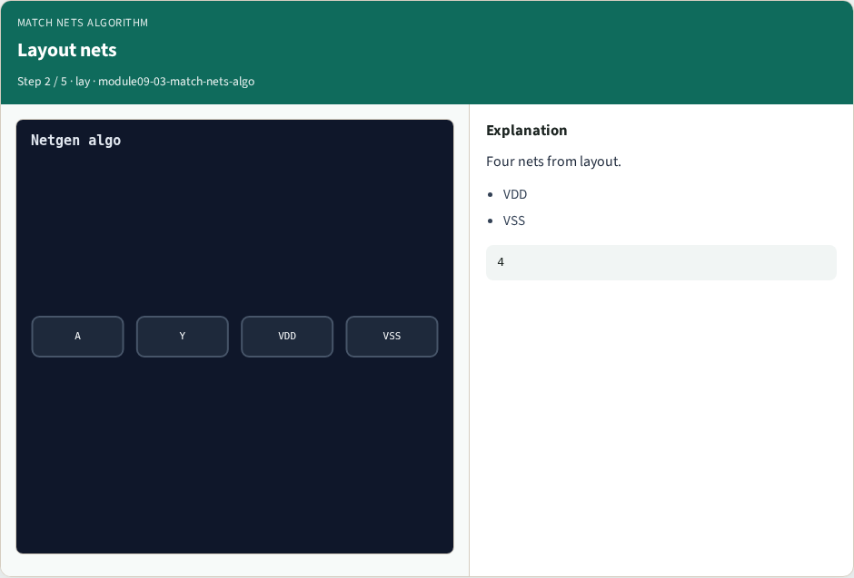
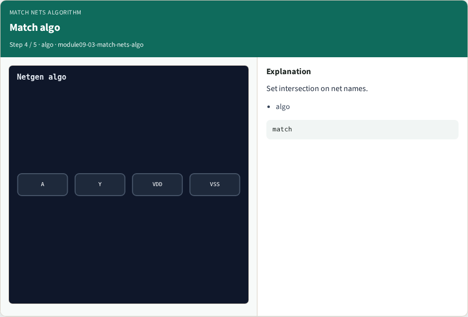

# Match nets algorithm

**Module id:** module09-03-match-nets-algo
**Lab:** match-nets-algo

## Slide 1 — Why algorithms

Match net names between schematic and layout.

## Slide 2 — The idea

GOLDEN: matched_nets=4.

<!-- algorithm-walkthrough -->

## Slide 3 — Schematic nets


Four nets from schematic.

## Slide 4 — Layout nets



Four nets from layout.

## Slide 5 — Intersection


All four names match.

## Slide 6 — Match algo



Set intersection on net names.

## Slide 7 — Golden


GOLDEN: matched_nets=4.

<!-- /algorithm-walkthrough -->


## Slide 8 — Browser lab

Open **match-nets-algo**.

## Slide 9 — Implement track

Run algo_solvers.py and partc_bind.py.

## Slide 10 — Pitfalls

Changing tiny_algo_netgen without updating Part B goldens.

## Slide 11 — Try these

From the common folder, run the Part C self-tests.

```bash
cd courses/learn_netgen/common
python3 algo_solvers.py
python3 partc_bind.py
```

## Slide 12 — Pseudocode

Here is the check in plain steps.

```text
matched_nets=4.
ok if goldens match and bind
```

## Slide 13 — Next

Continue Part C, then internals.
