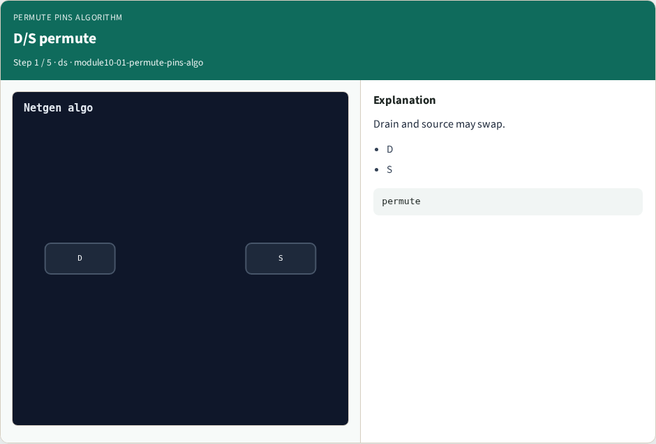
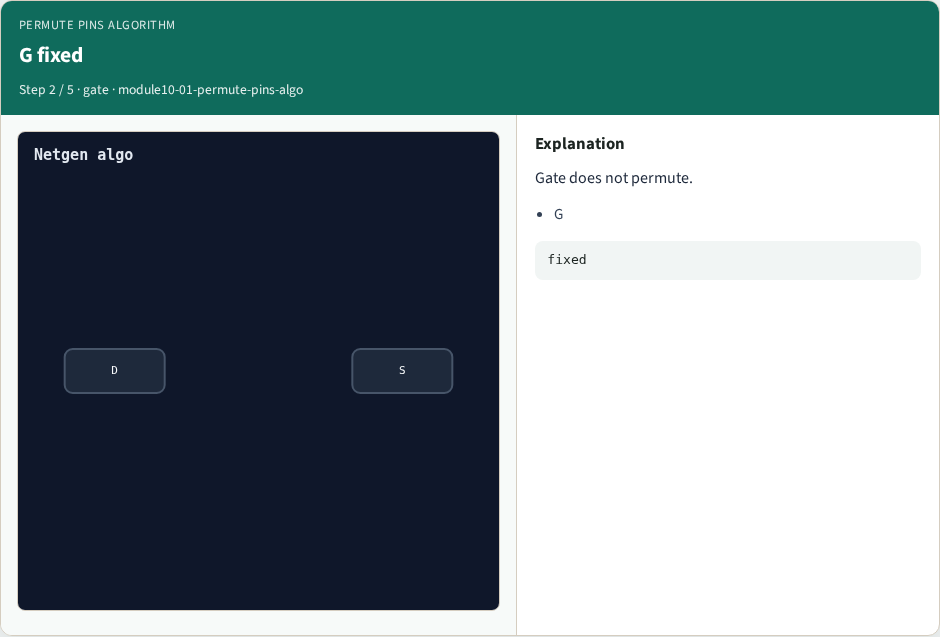
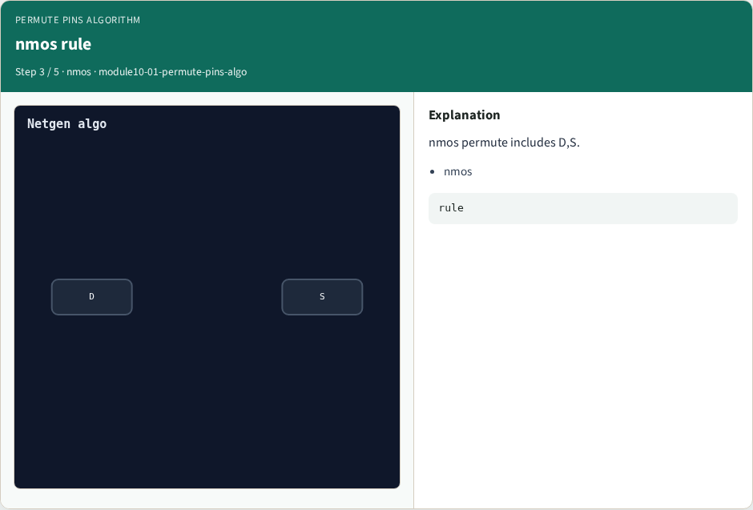

# Permute pins algorithm

**Module id:** module10-01-permute-pins-algo
**Lab:** permute-pins-algo

## Slide 1 — Why algorithms

Permute source/drain within MOSFET class.

## Slide 2 — The idea

GOLDEN: permute_ok=True.

<!-- algorithm-walkthrough -->

## Slide 3 — D/S permute



Drain and source may swap.

## Slide 4 — G fixed



Gate does not permute.

## Slide 5 — nmos rule



nmos permute includes D,S.

## Slide 6 — pmos rule


pmos permute includes D,S.

## Slide 7 — Golden


GOLDEN: permute_ok=True.

<!-- /algorithm-walkthrough -->


## Slide 8 — Browser lab

Open **permute-pins-algo**.

## Slide 9 — Implement track

Run algo_solvers.py and partc_bind.py.

## Slide 10 — Pitfalls

Changing tiny_algo_netgen without updating Part B goldens.

## Slide 11 — Try these

From the common folder, run the Part C self-tests.

```bash
cd courses/learn_netgen/common
python3 algo_solvers.py
python3 partc_bind.py
```

## Slide 12 — Pseudocode

Here is the check in plain steps.

```text
permute_ok=True.
ok if goldens match and bind
```

## Slide 13 — Next

Continue Part C, then internals.
