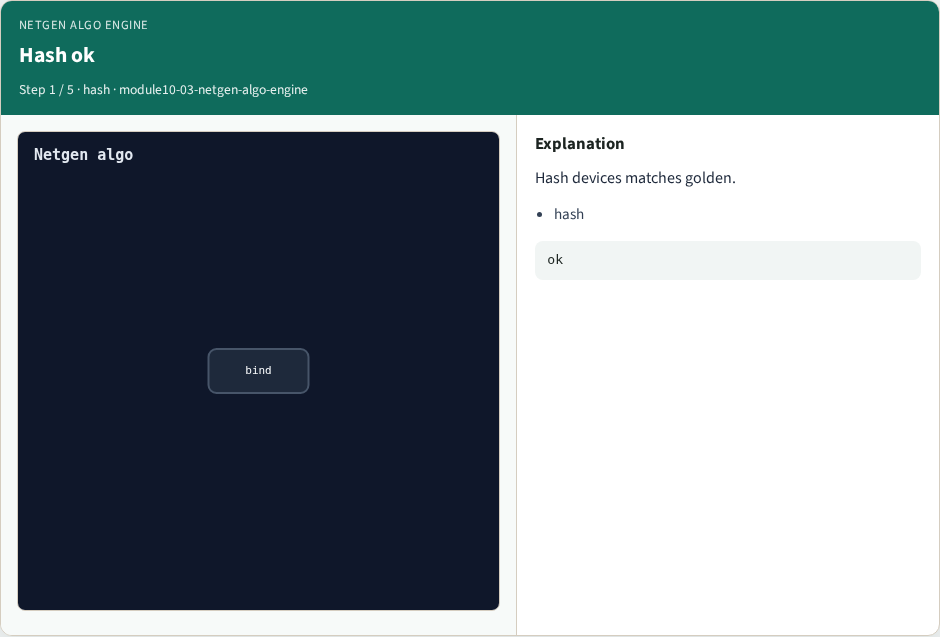
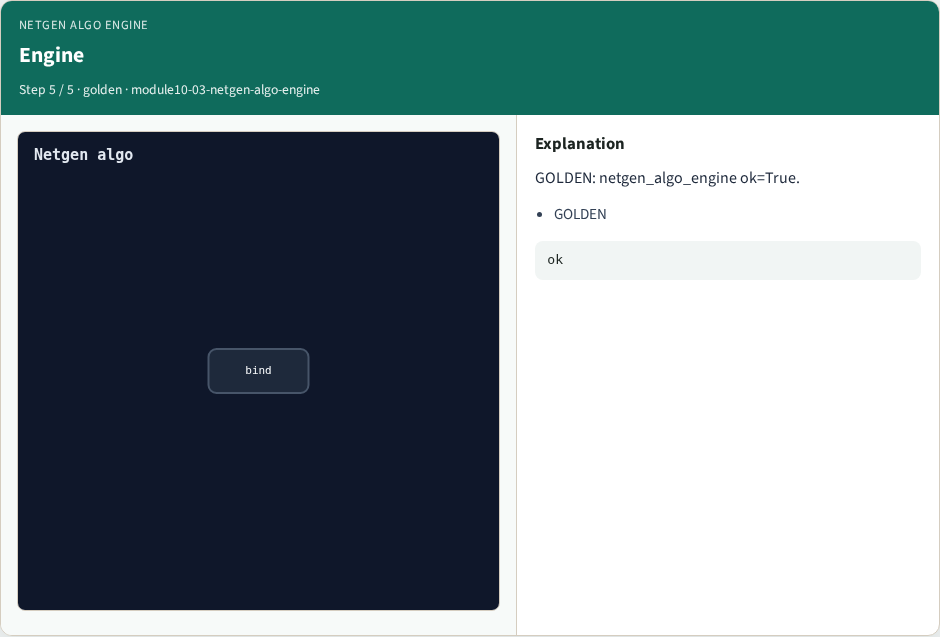

# Netgen algo engine

**Module id:** module10-03-netgen-algo-engine
**Lab:** netgen-algo-engine

## Slide 1 — Why algorithms

Run Part C engine and bind to Part B goldens.

## Slide 2 — The idea

GOLDEN: engine ok; bind matched 2/4 mismatch 0.

<!-- algorithm-walkthrough -->

## Slide 3 — Hash ok



Hash devices matches golden.

## Slide 4 — Match ok


Match nets matches 4.

## Slide 5 — Permute ok


Permute pins passes.

## Slide 6 — Bind Part B


Teaching matched 2/4 ↔ Part B logs.

## Slide 7 — Engine



GOLDEN: netgen_algo_engine ok=True.

<!-- /algorithm-walkthrough -->


## Slide 8 — Browser lab

Open **netgen-algo-engine**.

## Slide 9 — Implement track

Run algo_solvers.py and partc_bind.py.

## Slide 10 — Pitfalls

Changing tiny_algo_netgen without updating Part B goldens.

## Slide 11 — Try these

From the common folder, run the Part C self-tests.

```bash
cd courses/learn_netgen/common
python3 algo_solvers.py
python3 partc_bind.py
```

## Slide 12 — Pseudocode

Here is the check in plain steps.

```text
engine ok; bind matched 2/4 mismatch 0.
ok if goldens match and bind
```

## Slide 13 — Next

Continue Part C, then internals.
