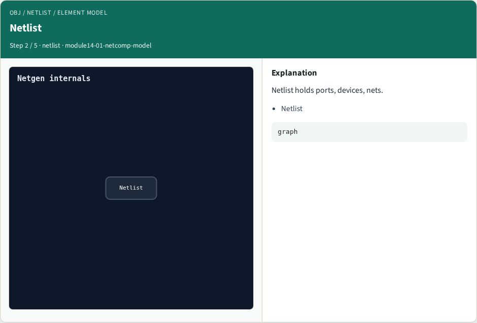
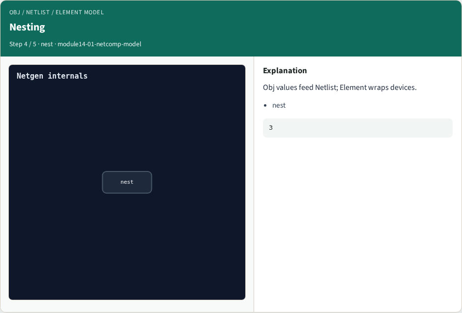

# Obj / Netlist / Element model

**Module id:** module14-01-netcomp-model
**Lab:** netcomp-model

## Slide 1 — Why Netgen internals

Map Obj / Netlist / Element to the Netgen C tree.

## Slide 2 — The idea

GOLDEN: Name the three pillars and how Netlist holds devices.

<!-- algorithm-walkthrough -->

## Slide 3 — Obj


Obj holds Tcl strings, hashes, lists.

## Slide 4 — Netlist



Netlist holds ports, devices, nets.

## Slide 5 — Element


Element holds pins and device properties.

## Slide 6 — Nesting



Obj values feed Netlist; Element wraps devices.

## Slide 7 — Golden


GOLDEN: Obj, Netlist, Element — three pillars.

<!-- /algorithm-walkthrough -->


## Slide 8 — Browser lab

Open **netcomp-model**.

## Slide 9 — Implement track

Call netcomp_model() in internals_solvers.

## Slide 10 — Pitfalls

Treating browser JSON as the C API.

## Slide 11 — Try these

From the common folder, run the internals self-test.

```bash
cd courses/learn_netgen/common
python3 internals_solvers.py
```

## Slide 12 — Pseudocode

Here is the checklist in plain steps.

```text
Name the three pillars and how Netlist holds devices.
ok if goldens match INTERNALS_GOLDENS
```

## Slide 13 — Next

Wrap the Netgen path.
