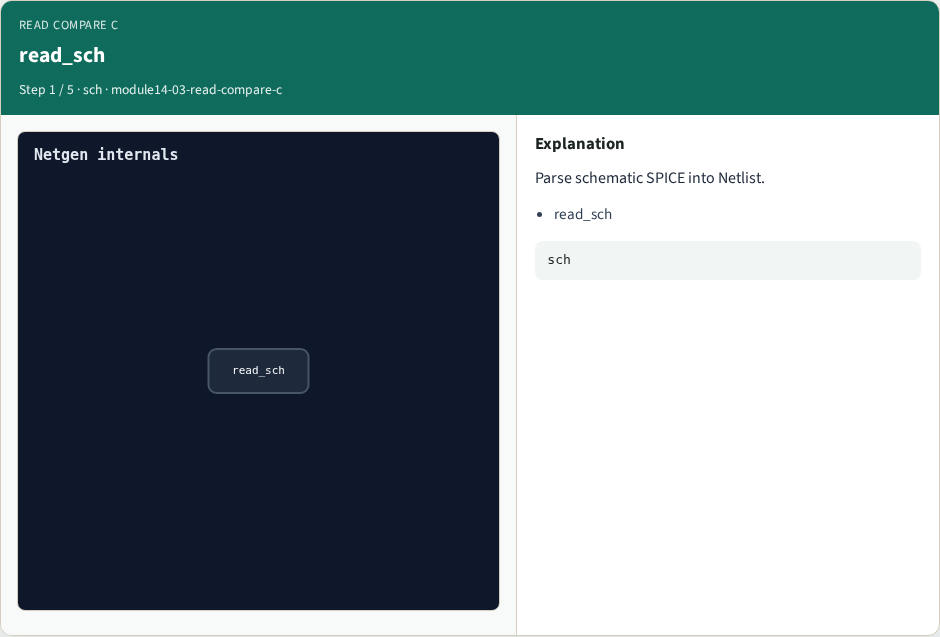
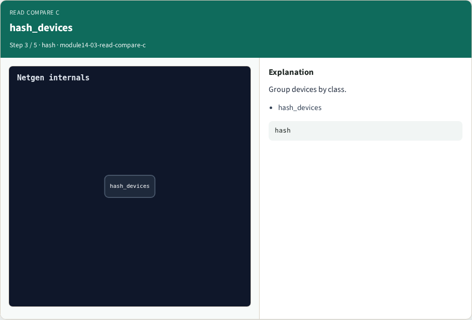
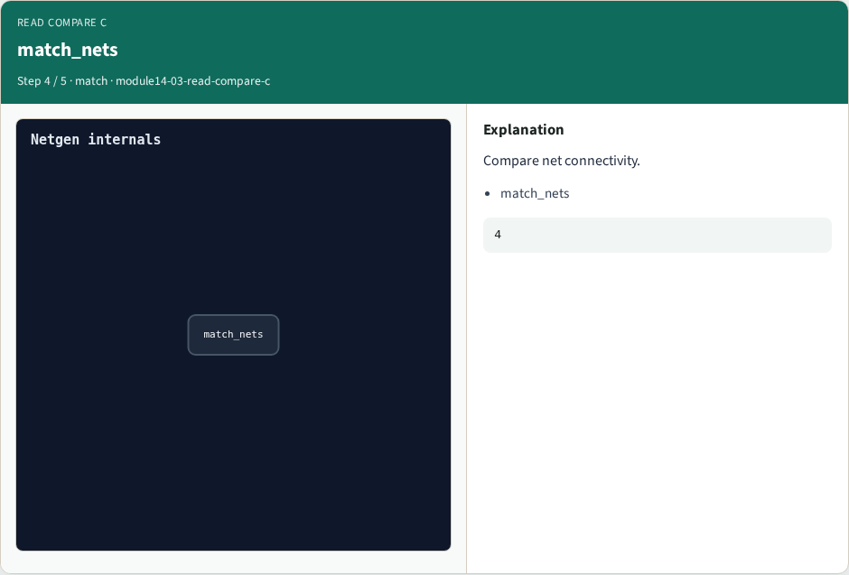

# Read compare C — step-by-step (for slides / transcript)

**Module:** `module14-03-read-compare-c`  
**Lab / algo:** `read-compare-c`  
**Viewer:** `/tools/algorithm-walkthrough/?algo=read-compare-c&step=1`

Use each **Caption** as spoken prose (or a shortened slide note).
Use **Bullets** on the PPT; pair with the PNG in `assets/steps/`.

## Step 1 — read_sch



**Caption (transcript):** Parse schematic SPICE into Netlist.

**Slide bullets:**

- read_sch

**On-screen metrics:**

```
sch
```

## Step 2 — read_lay


**Caption (transcript):** Parse layout SPICE into Netlist.

**Slide bullets:**

- read_lay

**On-screen metrics:**

```
lay
```

## Step 3 — hash_devices



**Caption (transcript):** Group devices by class.

**Slide bullets:**

- hash_devices

**On-screen metrics:**

```
hash
```

## Step 4 — match_nets



**Caption (transcript):** Compare net connectivity.

**Slide bullets:**

- match_nets

**On-screen metrics:**

```
4
```

## Step 5 — Golden


**Caption (transcript):** GOLDEN: matched=2/4 mismatch=0.

**Slide bullets:**

- GOLDEN

**On-screen metrics:**

```
ok
```

