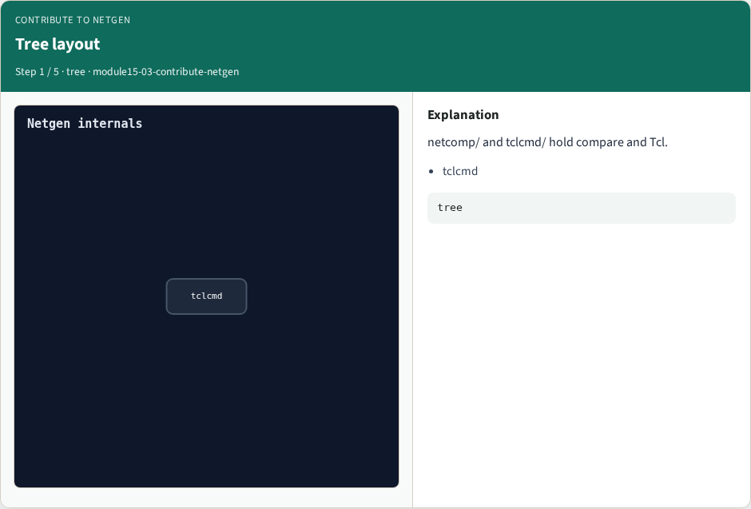
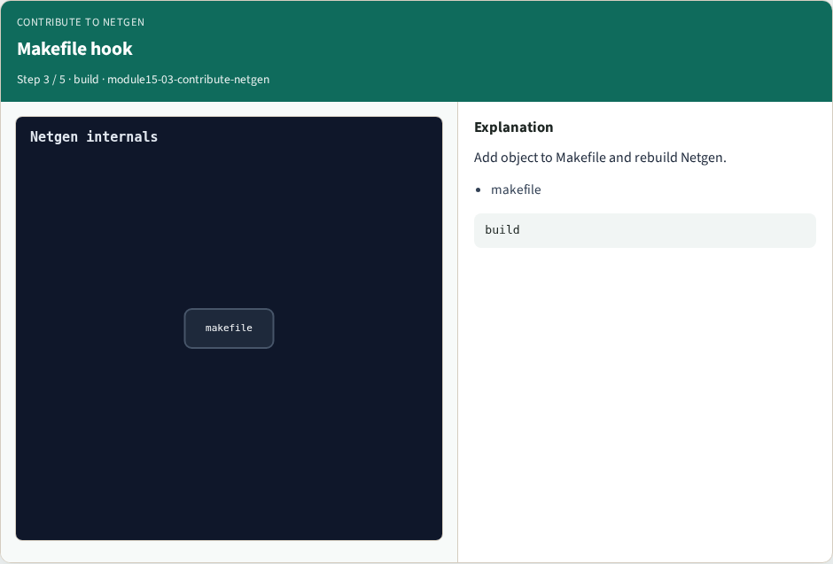

# Why Netgen internals

Know where a new Tcl command lives and the minimal stub to build

---

## The idea
- GOLDEN: tclcmd/cmd_lvs.c + register + Makefile + netgen help lvs

---

## Tree layout


---

## Stub file


---

## Makefile hook


---

## Smoke


---

## Golden


---

## Browser lab
- Open **contribute-netgen**

---

## Implement track
- Call contribute_netgen() in internals_solvers

---

## Pitfalls
- Treating browser JSON as the C API

---

## Try these
- From the common folder, run the internals self-test

---

## Try these — try these

```
cd courses/learn_netgen/common
python3 internals_solvers.py
```

---

## Pseudocode
- Here is the checklist in plain steps

---

## Pseudocode — try these

```
tclcmd/cmd_lvs.c + register + Makefile + netgen help lvs.
ok if goldens match INTERNALS_GOLDENS
```

---

## Next
- Complete the quiz for this part
- Wrap the Netgen path

