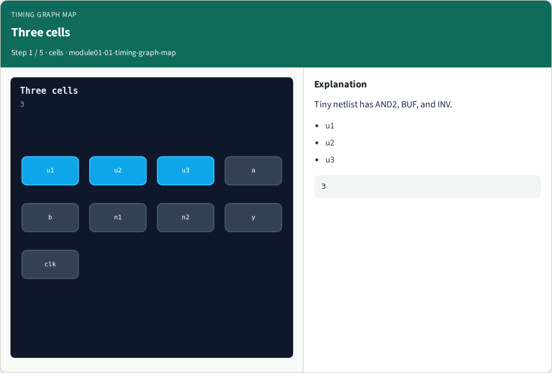
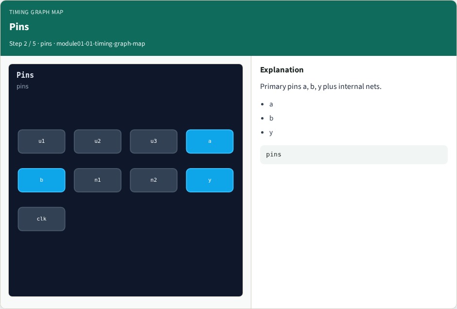
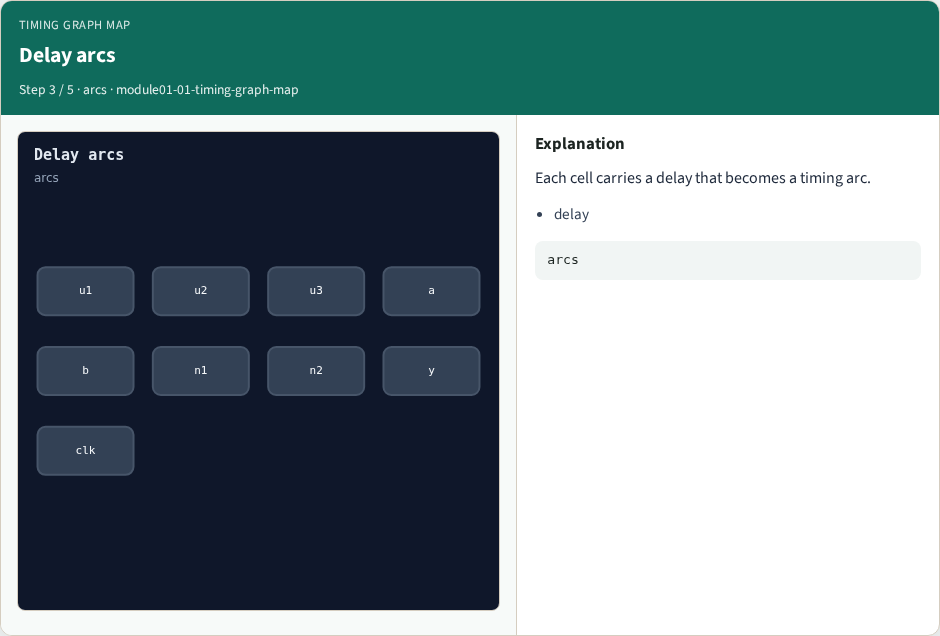
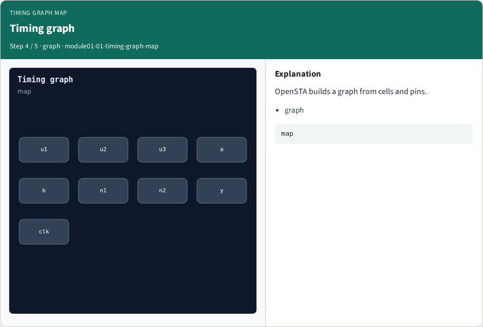
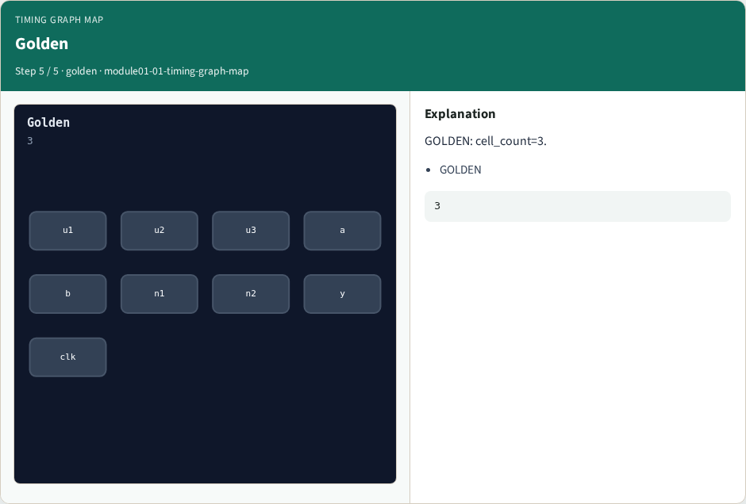

# Why Timing

Map netlist cells to the OpenSTA timing graph

---

## The idea
- GOLDEN: 3 cells u1/u2/u3; graph nodes = cells + pins

---

## Three cells


---

## Pins


---

## Delay arcs


---

## Timing graph


---

## Golden


---

## Browser lab track
- Open **timing-graph-map**
- Run the stage buttons and Check the goldens

---

## Implement track
- From common/, run solvers.py and confirm OPENSTA_MAP_OK

---

## Pitfalls
- Mixing algorithm STA from learn_sta with OpenSTA command names
- Forgetting the clock period when reading slack

---

## Try these
- From the common folder, run the OpenSTA map self-test

---

## Try these — try these

```
cd courses/learn_opensta/common
python3 solvers.py
```

---

## Pseudocode
- Here is the check in plain steps

---

## Pseudocode — try these

```
3 cells u1/u2/u3; graph nodes = cells + pins.
ok if goldens match
```

---

## Next
- Complete the quiz for this part
- Continue the OpenSTA Part A map, then the real CLI track

