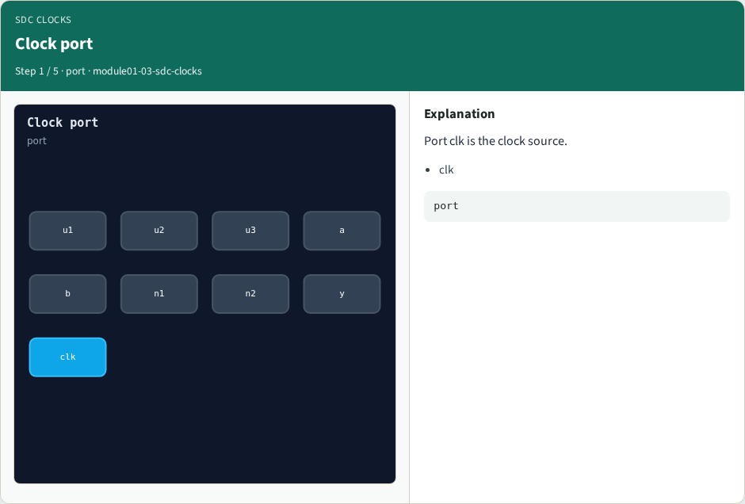
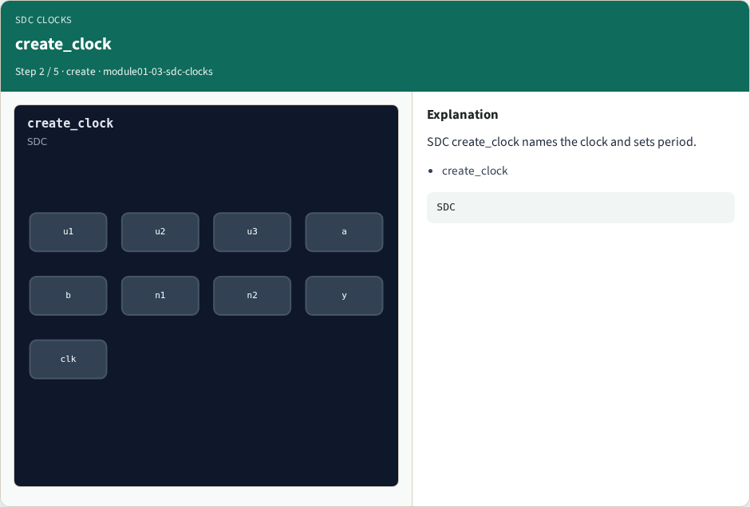
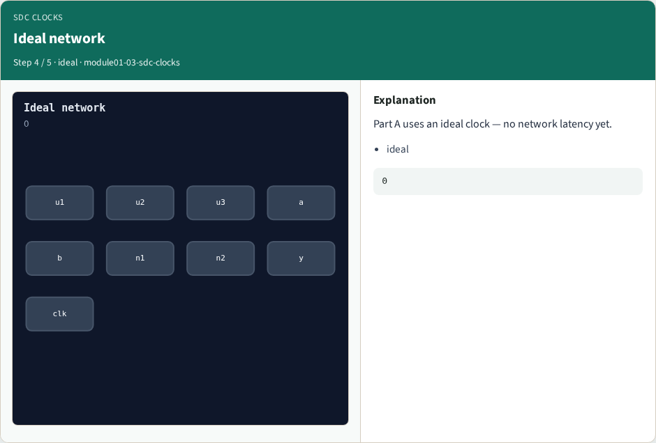
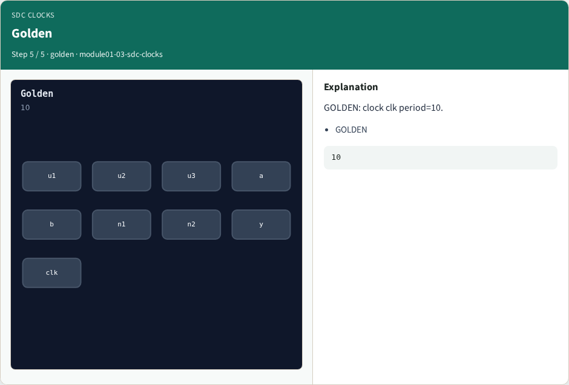

# SDC clocks — step-by-step (for slides / transcript)

**Module:** `module01-03-sdc-clocks`  
**Lab / algo:** `sdc-clocks`  
**Viewer:** `/tools/algorithm-walkthrough/?algo=sdc-clocks&step=1`

Use each **Caption** as spoken prose (or a shortened slide note).
Use **Bullets** on the PPT; pair with the PNG in `assets/steps/`.

## Step 1 — Clock port



**Caption (transcript):** Port clk is the clock source.

**Slide bullets:**

- clk

**On-screen metrics:**

```
port
```

## Step 2 — create_clock



**Caption (transcript):** SDC create_clock names the clock and sets period.

**Slide bullets:**

- create_clock

**On-screen metrics:**

```
SDC
```

## Step 3 — Period 10


**Caption (transcript):** Period is 10 time units on this tiny design.

**Slide bullets:**

- period

**On-screen metrics:**

```
10
```

## Step 4 — Ideal network



**Caption (transcript):** Part A uses an ideal clock — no network latency yet.

**Slide bullets:**

- ideal

**On-screen metrics:**

```
0
```

## Step 5 — Golden



**Caption (transcript):** GOLDEN: clock clk period=10.

**Slide bullets:**

- GOLDEN

**On-screen metrics:**

```
10
```

