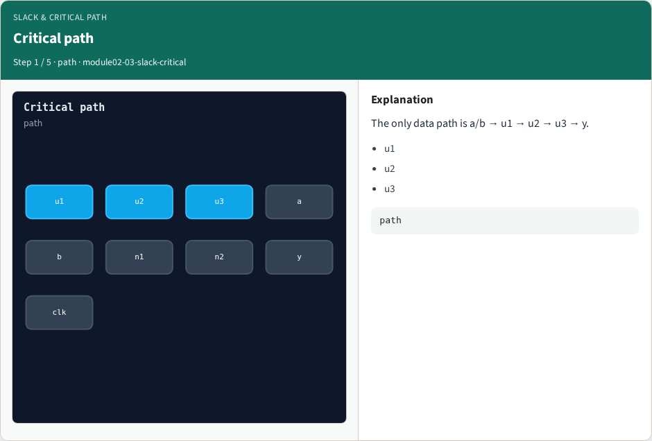
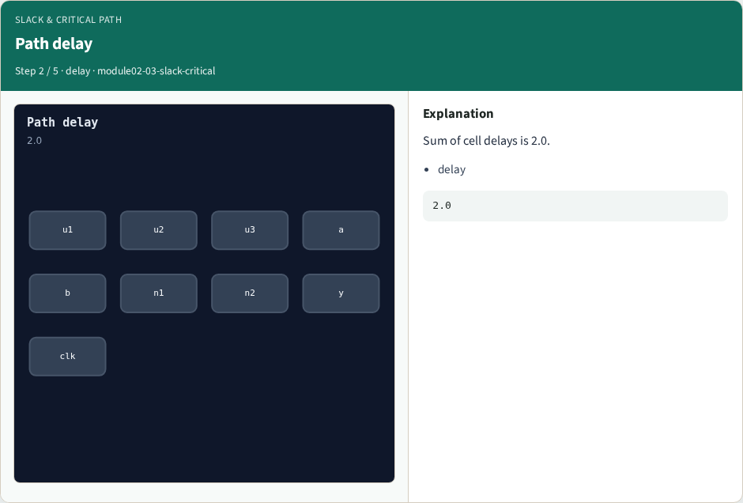
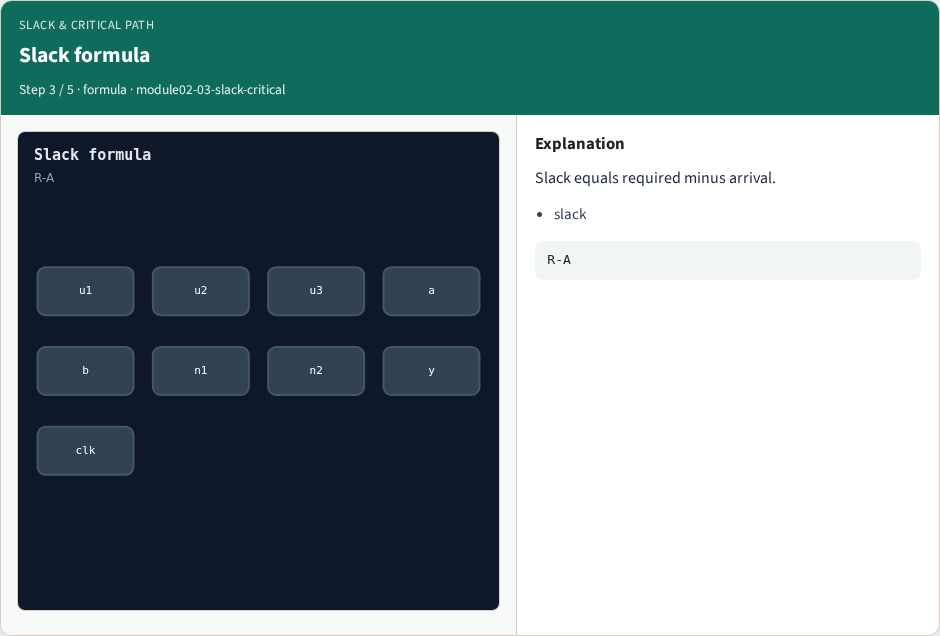
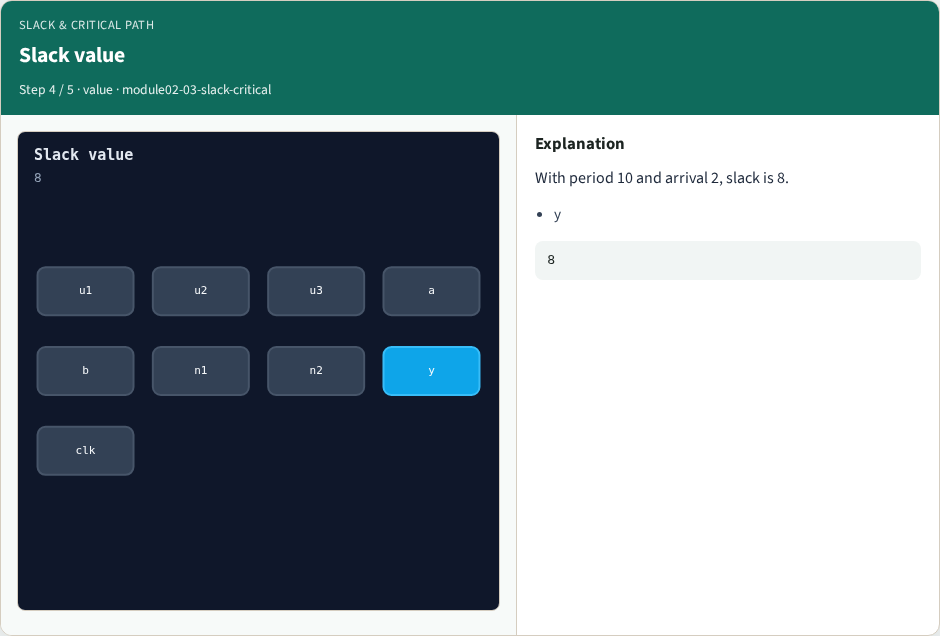
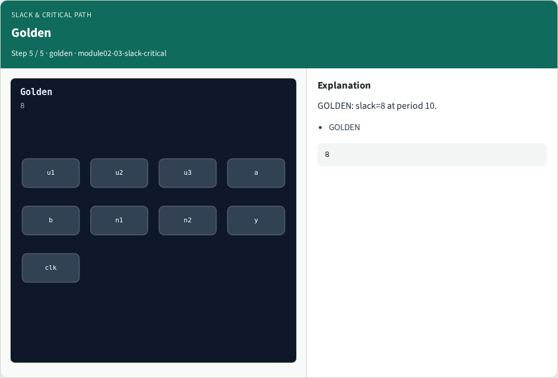

# Slack & critical path — step-by-step (for slides / transcript)

**Module:** `module02-03-slack-critical`  
**Lab / algo:** `slack-critical`  
**Viewer:** `/tools/algorithm-walkthrough/?algo=slack-critical&step=1`

Use each **Caption** as spoken prose (or a shortened slide note).
Use **Bullets** on the PPT; pair with the PNG in `assets/steps/`.

## Step 1 — Critical path



**Caption (transcript):** The only data path is a/b → u1 → u2 → u3 → y.

**Slide bullets:**

- u1
- u2
- u3

**On-screen metrics:**

```
path
```

## Step 2 — Path delay



**Caption (transcript):** Sum of cell delays is 2.0.

**Slide bullets:**

- delay

**On-screen metrics:**

```
2.0
```

## Step 3 — Slack formula



**Caption (transcript):** Slack equals required minus arrival.

**Slide bullets:**

- slack

**On-screen metrics:**

```
R-A
```

## Step 4 — Slack value



**Caption (transcript):** With period 10 and arrival 2, slack is 8.

**Slide bullets:**

- y

**On-screen metrics:**

```
8
```

## Step 5 — Golden



**Caption (transcript):** GOLDEN: slack=8 at period 10.

**Slide bullets:**

- GOLDEN

**On-screen metrics:**

```
8
```

