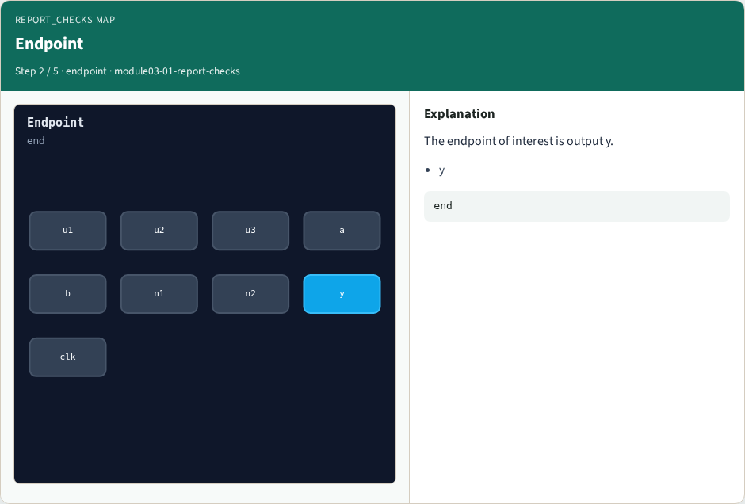
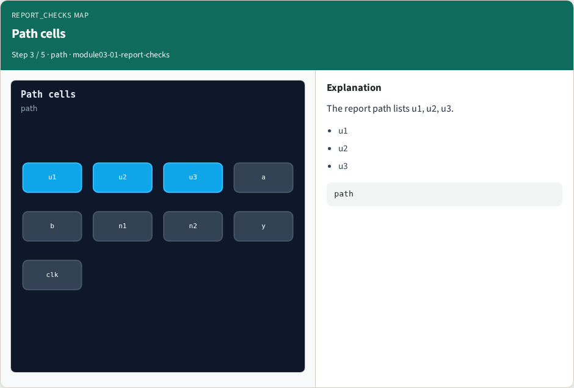
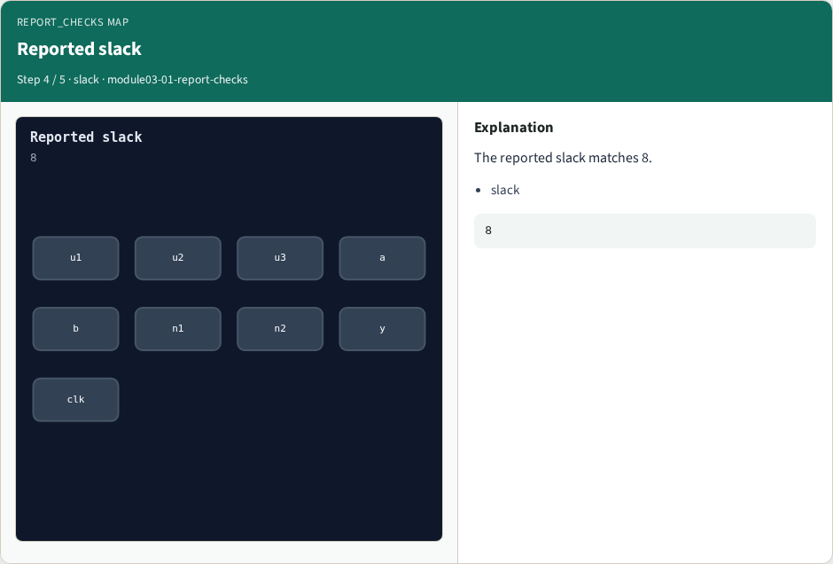
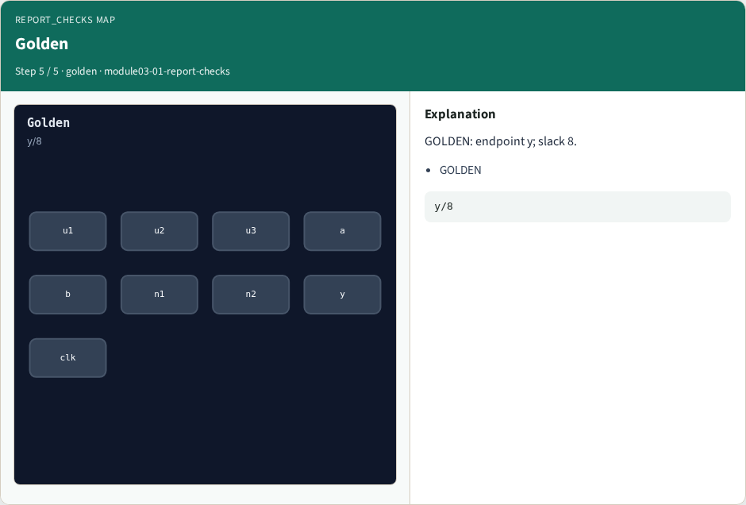

# report_checks map

**Module id:** module03-01-report-checks
**Lab:** report-checks
**Tracks:** A (implement) · B (browser lab)

## Slide 1 — Why report_checks

Read a report_checks-shaped endpoint summary.

## Slide 2 — The idea

GOLDEN: endpoint y; path delay 2; slack 8.

<!-- algorithm-walkthrough -->

## Slide 3 — report_checks


OpenSTA report_checks prints worst paths.

## Slide 4 — Endpoint



The endpoint of interest is output y.

## Slide 5 — Path cells



The report path lists u1, u2, u3.

## Slide 6 — Reported slack



The reported slack matches 8.

## Slide 7 — Golden



GOLDEN: endpoint y; slack 8.

<!-- /algorithm-walkthrough -->


## Slide 8 — Browser lab track

Open **report-checks**. Run the stage buttons and Check the goldens.

## Slide 9 — Implement track

From common/, run solvers.py and confirm OPENSTA_MAP_OK.

## Slide 10 — Pitfalls

Mixing algorithm STA from learn_sta with OpenSTA command names. Forgetting the clock period when reading slack.

## Slide 11 — Try these

From the common folder, run the OpenSTA map self-test.

```bash
cd courses/learn_opensta/common
python3 solvers.py
```

## Slide 12 — Pseudocode

Here is the check in plain steps.

```text
endpoint y; path delay 2; slack 8.
ok if goldens match
```

## Slide 13 — Next

Continue the OpenSTA Part A map, then the real CLI track.
