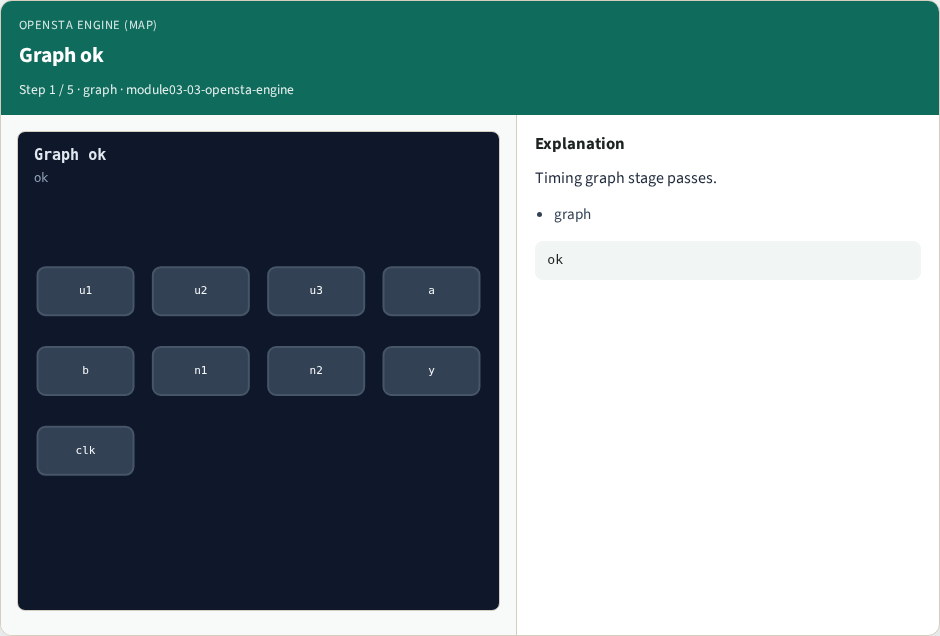
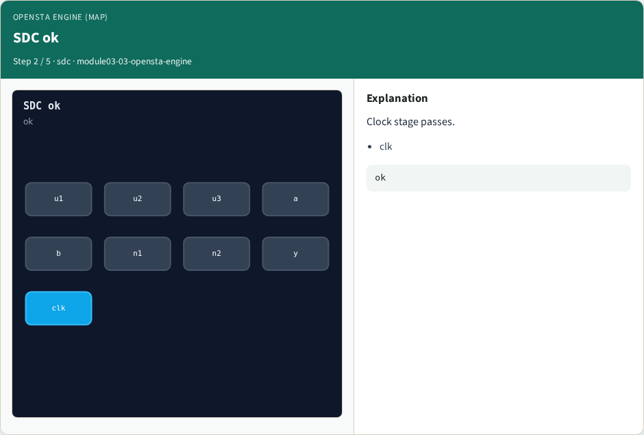
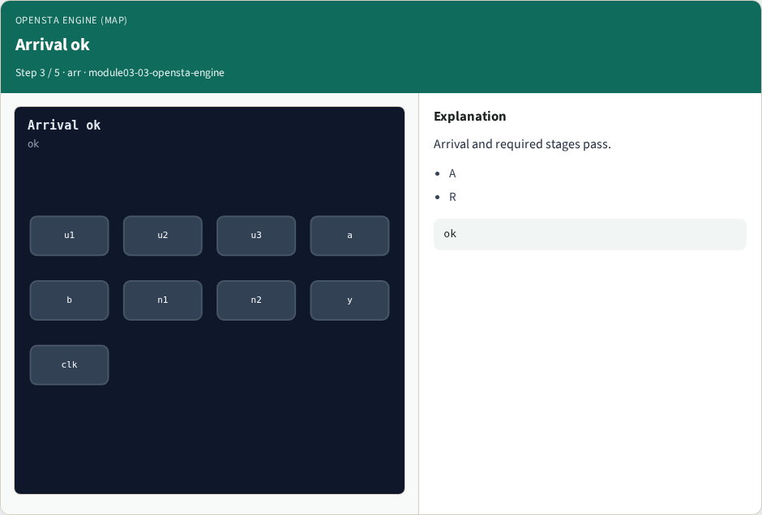
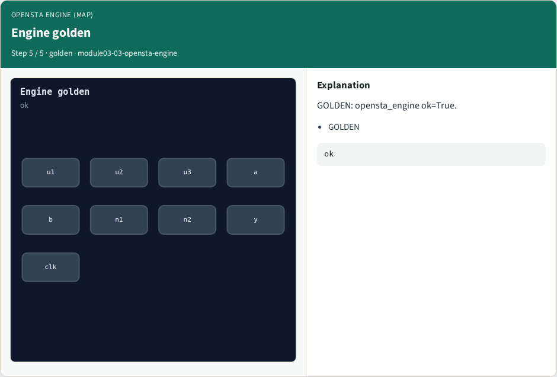

# OpenSTA engine (map) — step-by-step (for slides / transcript)

**Module:** `module03-03-opensta-engine`  
**Lab / algo:** `opensta-engine`  
**Viewer:** `/tools/algorithm-walkthrough/?algo=opensta-engine&step=1`

Use each **Caption** as spoken prose (or a shortened slide note).
Use **Bullets** on the PPT; pair with the PNG in `assets/steps/`.

## Step 1 — Graph ok



**Caption (transcript):** Timing graph stage passes.

**Slide bullets:**

- graph

**On-screen metrics:**

```
ok
```

## Step 2 — SDC ok



**Caption (transcript):** Clock stage passes.

**Slide bullets:**

- clk

**On-screen metrics:**

```
ok
```

## Step 3 — Arrival ok



**Caption (transcript):** Arrival and required stages pass.

**Slide bullets:**

- A
- R

**On-screen metrics:**

```
ok
```

## Step 4 — Slack ok


**Caption (transcript):** Slack and report stages pass.

**Slide bullets:**

- S

**On-screen metrics:**

```
ok
```

## Step 5 — Engine golden



**Caption (transcript):** GOLDEN: opensta_engine ok=True.

**Slide bullets:**

- GOLDEN

**On-screen metrics:**

```
ok
```

