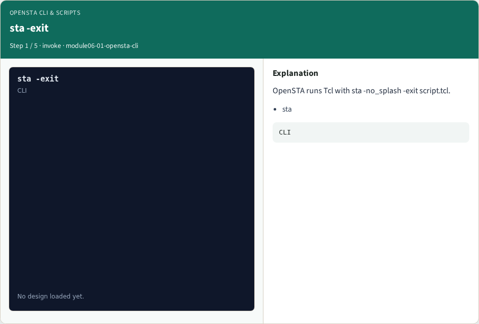
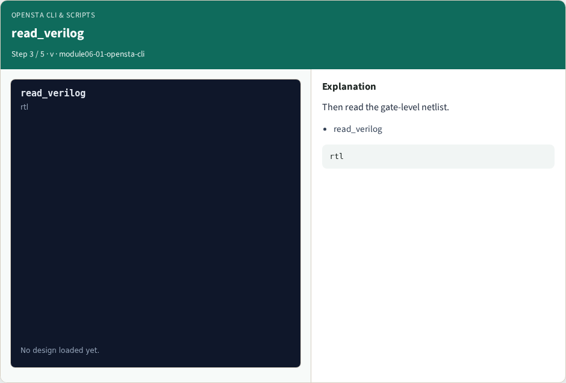

# OpenSTA CLI & scripts — step-by-step (for slides / transcript)

**Module:** `module06-01-opensta-cli`  
**Lab / algo:** `opensta-cli`  
**Viewer:** `/tools/algorithm-walkthrough/?algo=opensta-cli&step=1`

Use each **Caption** as spoken prose (or a shortened slide note).
Use **Bullets** on the PPT; pair with the PNG in `assets/steps/`.

## Step 1 — sta -exit



**Caption (transcript):** OpenSTA runs Tcl with sta -no_splash -exit script.tcl.

**Slide bullets:**

- sta

**On-screen metrics:**

```
CLI
```

## Step 2 — read_liberty


**Caption (transcript):** First load the liberty timing models.

**Slide bullets:**

- read_liberty

**On-screen metrics:**

```
lib
```

## Step 3 — read_verilog



**Caption (transcript):** Then read the gate-level netlist.

**Slide bullets:**

- read_verilog

**On-screen metrics:**

```
rtl
```

## Step 4 — link_design


**Caption (transcript):** link_design binds cell instances to liberty.

**Slide bullets:**

- link_design

**On-screen metrics:**

```
link
```

## Step 5 — Golden


**Caption (transcript):** GOLDEN: recipe prefix liberty→verilog→link.

**Slide bullets:**

- GOLDEN

**On-screen metrics:**

```
3
```

