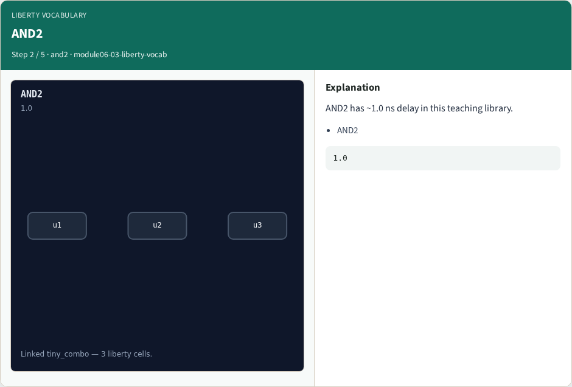
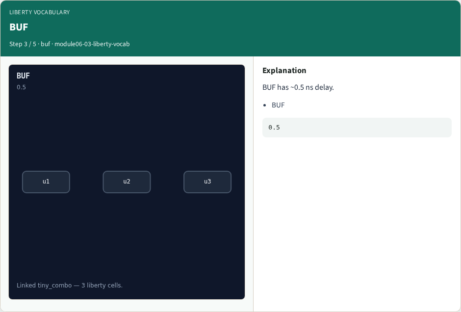

# Liberty vocabulary

**Module id:** module06-03-liberty-vocab
**Lab:** liberty-vocab
**Tracks:** A (implement) · B (browser lab)

## Slide 1 — Why real OpenSTA

Name liberty cells AND2/BUF/INV used by tiny_combo.

## Slide 2 — The idea

GOLDEN: Liberty cells AND2, BUF, INV; linked cells=3.

<!-- algorithm-walkthrough -->

## Slide 3 — Liberty file


tiny_opensta_lib.lib holds AND2, BUF, INV.

## Slide 4 — AND2



AND2 has ~1.0 ns delay in this teaching library.

## Slide 5 — BUF



BUF has ~0.5 ns delay.

## Slide 6 — INV


INV has ~0.5 ns delay.

## Slide 7 — Golden


GOLDEN: liberty cells AND2,BUF,INV.

<!-- /algorithm-walkthrough -->


## Slide 8 — Browser lab track

Open **liberty-vocab**. Build the Tcl recipe or open evidence stages, then Check.

## Slide 9 — Implement track

From common/, run real_solvers.py and confirm REAL_OPENSTA_OK.

## Slide 10 — Pitfalls

Editing goldens by hand without re-running sta. Confusing Part A map JSON with real liberty delays.

## Slide 11 — Try these

From the common folder, run the real OpenSTA self-test.

```bash
cd courses/learn_opensta/common
python3 real_solvers.py
```

## Slide 12 — Pseudocode

Here is the check in plain steps.

```text
Liberty cells AND2, BUF, INV; linked cells=3.
ok if goldens match
```

## Slide 13 — Next

Continue the Part B evidence track, then wrap — algorithms and internals come later.
