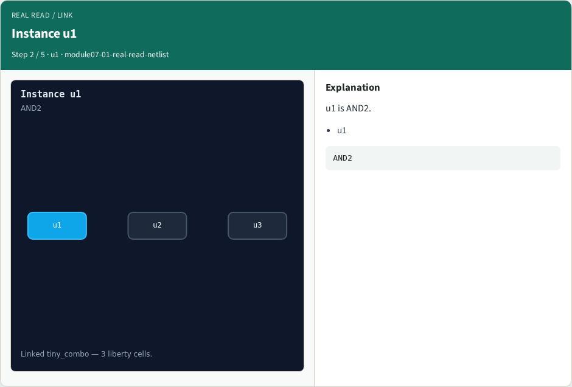
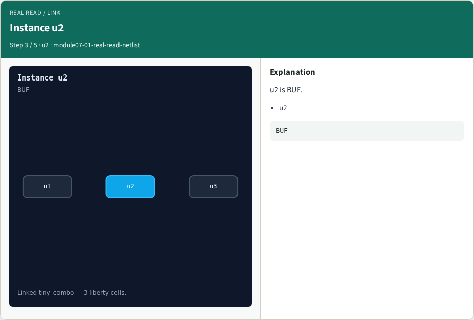
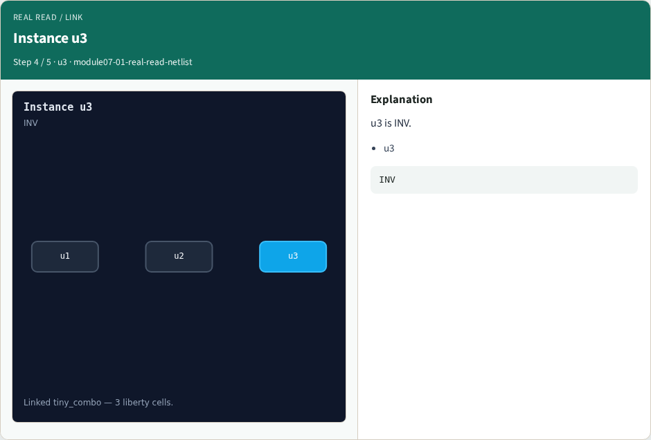
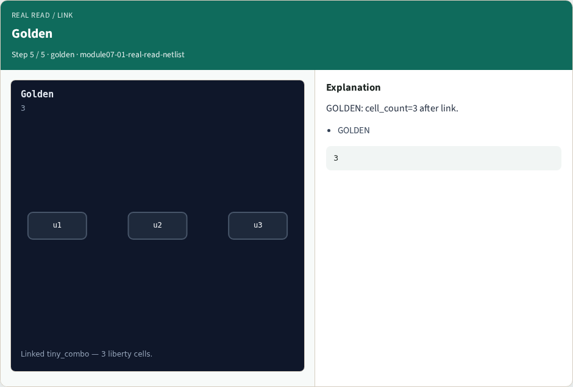

# Why real OpenSTA

Link tiny_combo and see instances u1/u2/u3

---

## The idea
- GOLDEN: top=tiny_combo; cells u1,u2,u3

---

## Top design


---

## Instance u1


---

## Instance u2


---

## Instance u3


---

## Golden


---

## Browser lab track
- Open **real-read-netlist**
- Build the Tcl recipe or open evidence stages, then Check

---

## Implement track
- From common/, run real_solvers.py and confirm REAL_OPENSTA_OK

---

## Pitfalls
- Editing goldens by hand without re-running sta
- Confusing Part A map JSON with real liberty delays

---

## Try these
- From the common folder, run the real OpenSTA self-test

---

## Try these — try these

```
cd courses/learn_opensta/common
python3 real_solvers.py
```

---

## Pseudocode
- Here is the check in plain steps

---

## Pseudocode — try these

```
top=tiny_combo; cells u1,u2,u3.
ok if goldens match
```

---

## Next
- Complete the quiz for this part
- Continue the Part B evidence track, then wrap , algorithms and internals come later

