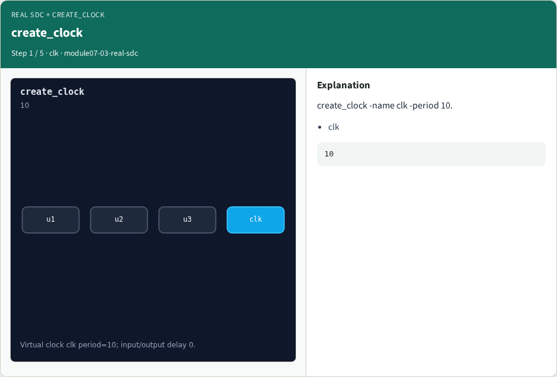
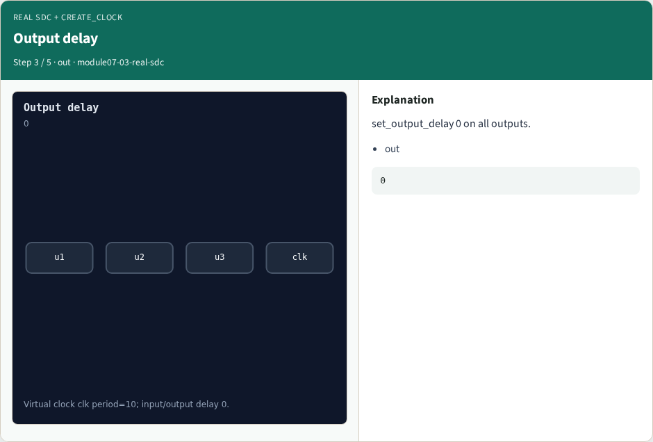

# Why real OpenSTA

Apply create_clock period 10 and I/O delays

---

## The idea
- GOLDEN: clock clk period=10

---

## create_clock


---

## Input delay


---

## Output delay


---

## Ideal network


---

## Golden


---

## Browser lab track
- Open **real-sdc**
- Build the Tcl recipe or open evidence stages, then Check

---

## Implement track
- From common/, run real_solvers.py and confirm REAL_OPENSTA_OK

---

## Pitfalls
- Editing goldens by hand without re-running sta
- Confusing Part A map JSON with real liberty delays

---

## Try these
- From the common folder, run the real OpenSTA self-test

---

## Try these — try these

```
cd courses/learn_opensta/common
python3 real_solvers.py
```

---

## Pseudocode
- Here is the check in plain steps

---

## Pseudocode — try these

```
clock clk period=10.
ok if goldens match
```

---

## Next
- Complete the quiz for this part
- Continue the Part B evidence track, then wrap , algorithms and internals come later

