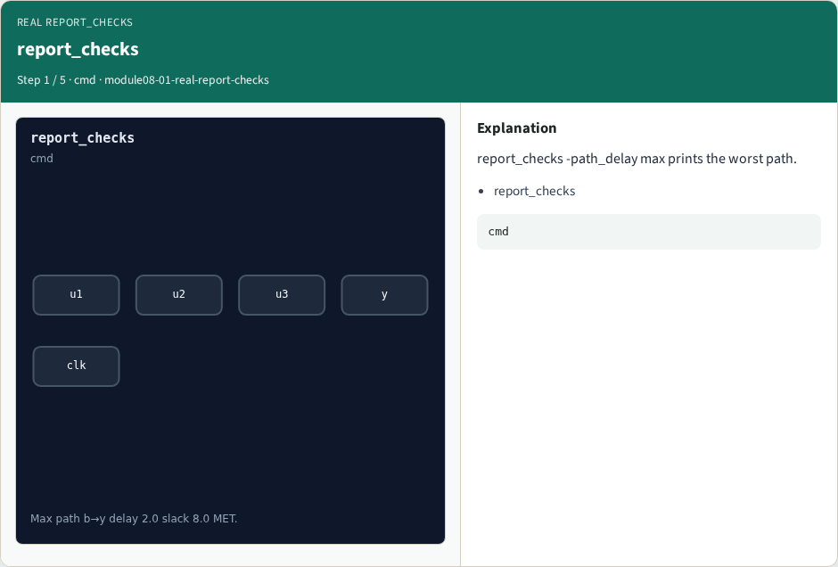
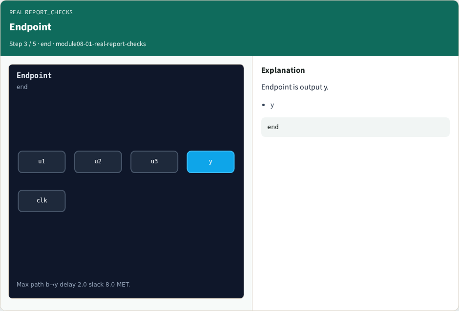

# Why real OpenSTA

Read real report_checks path delay and slack

---

## The idea
- GOLDEN: endpoint y; delay 2.0; slack 8.0 MET

---

## report_checks


---

## Startpoint


---

## Endpoint


---

## Slack MET


---

## Golden


---

## Browser lab track
- Open **real-report-checks**
- Build the Tcl recipe or open evidence stages, then Check

---

## Implement track
- From common/, run real_solvers.py and confirm REAL_OPENSTA_OK

---

## Pitfalls
- Editing goldens by hand without re-running sta
- Confusing Part A map JSON with real liberty delays

---

## Try these
- From the common folder, run the real OpenSTA self-test

---

## Try these — try these

```
cd courses/learn_opensta/common
python3 real_solvers.py
```

---

## Pseudocode
- Here is the check in plain steps

---

## Pseudocode — try these

```
endpoint y; delay 2.0; slack 8.0 MET.
ok if goldens match
```

---

## Next
- Complete the quiz for this part
- Continue the Part B evidence track, then wrap , algorithms and internals come later

