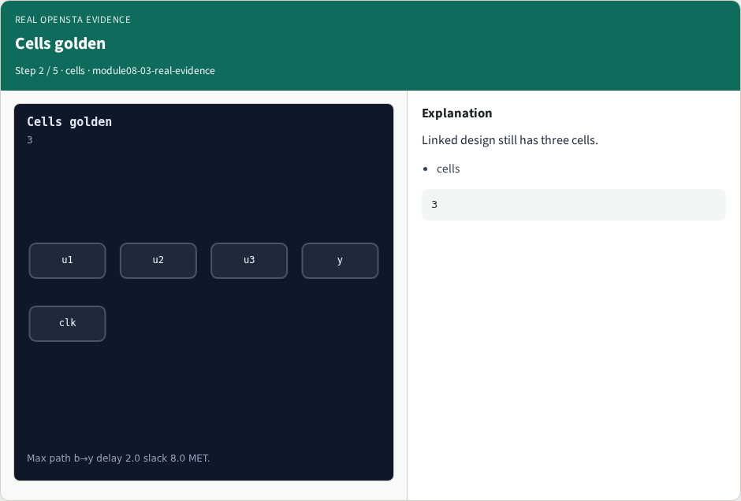
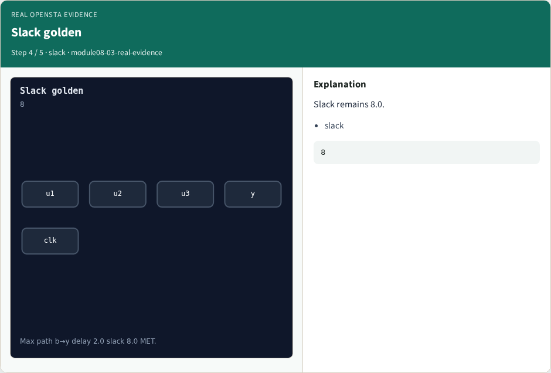

# Real OpenSTA evidence

**Module id:** module08-03-real-evidence
**Lab:** opensta-evidence
**Tracks:** A (implement) · B (browser lab)

## Slide 1 — Why real OpenSTA

Run the full real OpenSTA engine against goldens.

## Slide 2 — The idea

GOLDEN: real_opensta_engine ok=True.

<!-- algorithm-walkthrough -->

## Slide 3 — Full recipe


Golden recipe has seven Tcl commands.

## Slide 4 — Cells golden



Linked design still has three cells.

## Slide 5 — Path golden


Path delay remains 2.0.

## Slide 6 — Slack golden



Slack remains 8.0.

## Slide 7 — Engine


GOLDEN: real_opensta_engine ok=True.

<!-- /algorithm-walkthrough -->


## Slide 8 — Browser lab track

Open **opensta-evidence**. Build the Tcl recipe or open evidence stages, then Check.

## Slide 9 — Implement track

From common/, run real_solvers.py and confirm REAL_OPENSTA_OK.

## Slide 10 — Pitfalls

Editing goldens by hand without re-running sta. Confusing Part A map JSON with real liberty delays.

## Slide 11 — Try these

From the common folder, run the real OpenSTA self-test.

```bash
cd courses/learn_opensta/common
python3 real_solvers.py
```

## Slide 12 — Pseudocode

Here is the check in plain steps.

```text
real_opensta_engine ok=True.
ok if goldens match
```

## Slide 13 — Next

Continue the Part B evidence track, then wrap — algorithms and internals come later.
