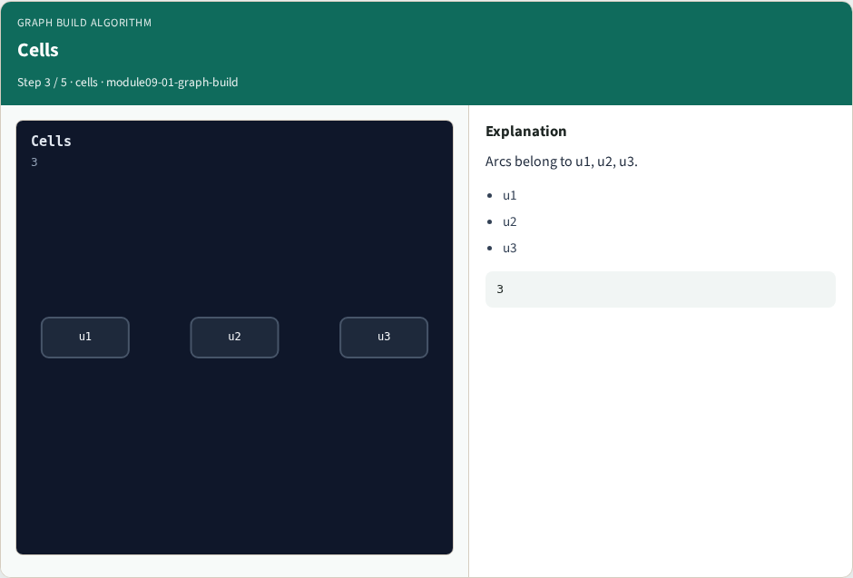
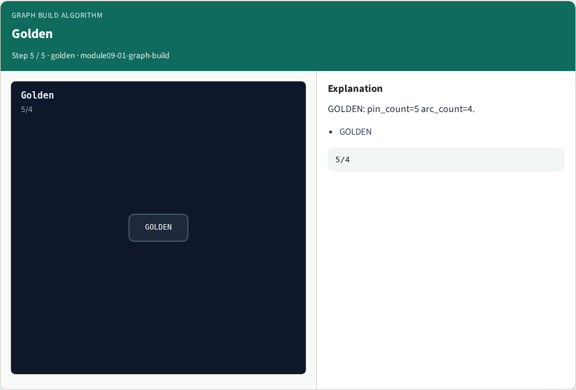

# Graph build algorithm

**Module id:** module09-01-graph-build
**Lab:** graph-build
**Tracks:** A (implement) · B (browser lab)

## Slide 1 — Why algorithms

Build the timing graph from pins and delay arcs.

## Slide 2 — The idea

GOLDEN: 5 pins, 4 arcs; cells u1/u2/u3.

<!-- algorithm-walkthrough -->

## Slide 3 — Pins


Five pins: inputs a/b, nets n1/n2, output y.

## Slide 4 — Arcs


Four delay arcs from liberty-mapped cells.

## Slide 5 — Cells



Arcs belong to u1, u2, u3.

## Slide 6 — Graph


The timing graph is pins plus arcs.

## Slide 7 — Golden



GOLDEN: pin_count=5 arc_count=4.

<!-- /algorithm-walkthrough -->


## Slide 8 — Browser lab track

Open **graph-build**. Run Graph / Levelize / Propagate / Slack / Bind, then Check.

## Slide 9 — Implement track

From common/, run algo_solvers.py and partc_bind.py.

## Slide 10 — Pitfalls

Changing tiny_algo_sta without updating Part B liberty delays. Ignoring the bind side.

## Slide 11 — Try these

From the common folder, run the Part C self-tests.

```bash
cd courses/learn_opensta/common
python3 algo_solvers.py
python3 partc_bind.py
```

## Slide 12 — Pseudocode

Here is the check in plain steps.

```text
5 pins, 4 arcs; cells u1/u2/u3.
ok if goldens match and bind
```

## Slide 13 — Next

Continue Part C, then wrap — internals literacy is next.
