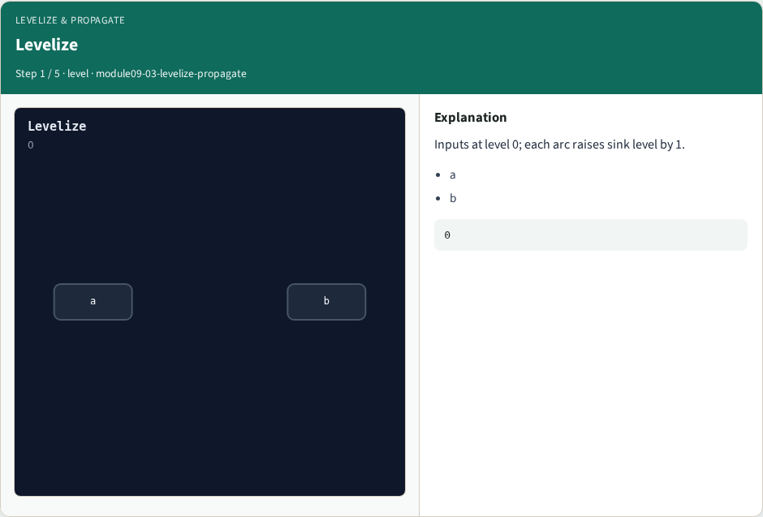
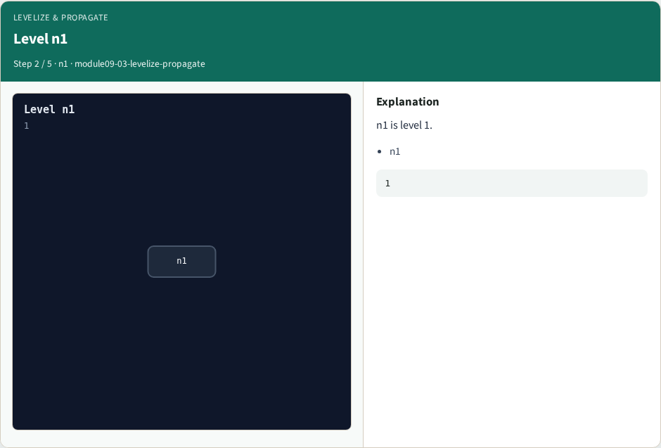
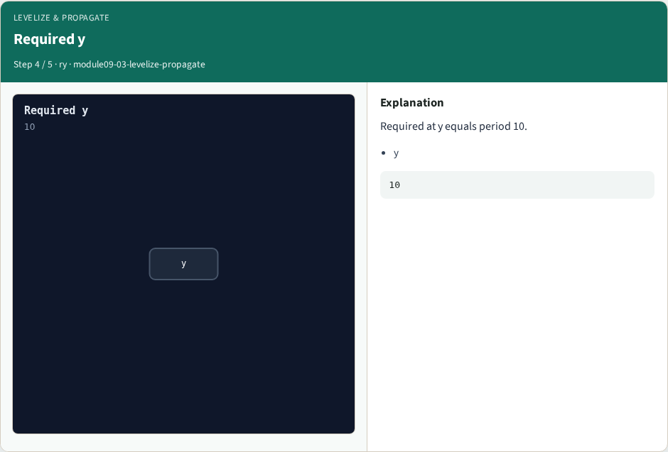
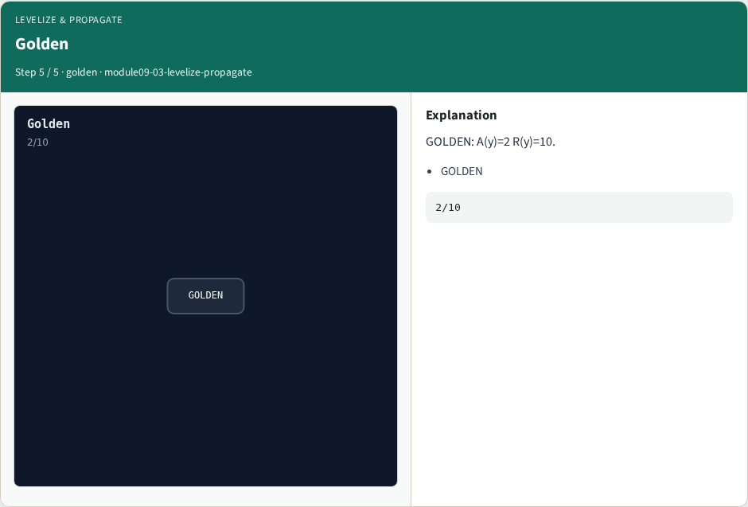

# Levelize & propagate — step-by-step (for slides / transcript)

**Module:** `module09-03-levelize-propagate`  
**Lab / algo:** `levelize-propagate`  
**Viewer:** `/tools/algorithm-walkthrough/?algo=levelize-propagate&step=1`

Use each **Caption** as spoken prose (or a shortened slide note).
Use **Bullets** on the PPT; pair with the PNG in `assets/steps/`.

## Step 1 — Levelize



**Caption (transcript):** Inputs at level 0; each arc raises sink level by 1.

**Slide bullets:**

- a
- b

**On-screen metrics:**

```
0
```

## Step 2 — Level n1



**Caption (transcript):** n1 is level 1.

**Slide bullets:**

- n1

**On-screen metrics:**

```
1
```

## Step 3 — Arrival y


**Caption (transcript):** Forward max arrival reaches y at 2.0.

**Slide bullets:**

- y

**On-screen metrics:**

```
2
```

## Step 4 — Required y



**Caption (transcript):** Required at y equals period 10.

**Slide bullets:**

- y

**On-screen metrics:**

```
10
```

## Step 5 — Golden



**Caption (transcript):** GOLDEN: A(y)=2 R(y)=10.

**Slide bullets:**

- GOLDEN

**On-screen metrics:**

```
2/10
```

