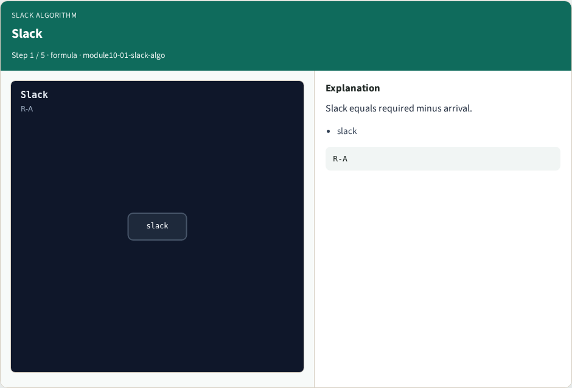
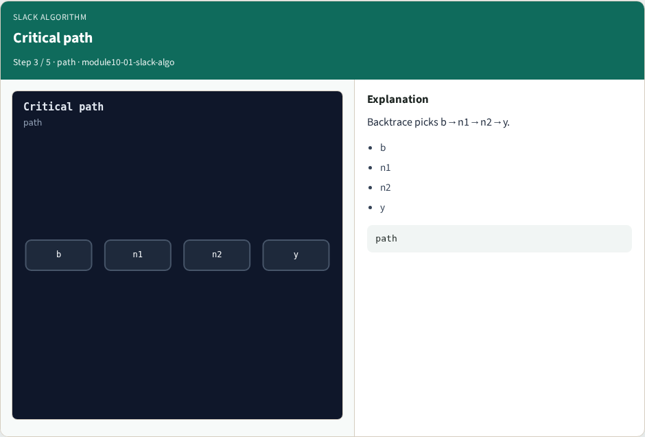
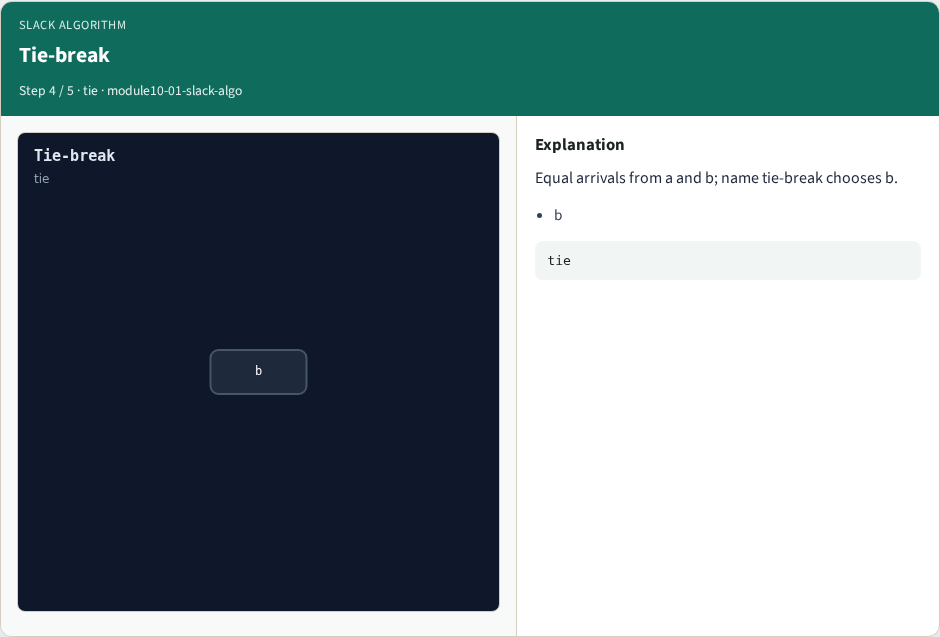

# Slack algorithm — step-by-step (for slides / transcript)

**Module:** `module10-01-slack-algo`  
**Lab / algo:** `slack-algo`  
**Viewer:** `/tools/algorithm-walkthrough/?algo=slack-algo&step=1`

Use each **Caption** as spoken prose (or a shortened slide note).
Use **Bullets** on the PPT; pair with the PNG in `assets/steps/`.

## Step 1 — Slack



**Caption (transcript):** Slack equals required minus arrival.

**Slide bullets:**

- slack

**On-screen metrics:**

```
R-A
```

## Step 2 — Value 8


**Caption (transcript):** With period 10 and arrival 2, slack is 8.

**Slide bullets:**

- y

**On-screen metrics:**

```
8
```

## Step 3 — Critical path



**Caption (transcript):** Backtrace picks b→n1→n2→y.

**Slide bullets:**

- b
- n1
- n2
- y

**On-screen metrics:**

```
path
```

## Step 4 — Tie-break



**Caption (transcript):** Equal arrivals from a and b; name tie-break chooses b.

**Slide bullets:**

- b

**On-screen metrics:**

```
tie
```

## Step 5 — Golden


**Caption (transcript):** GOLDEN: slack=8 path b→n1→n2→y.

**Slide bullets:**

- GOLDEN

**On-screen metrics:**

```
8
```

