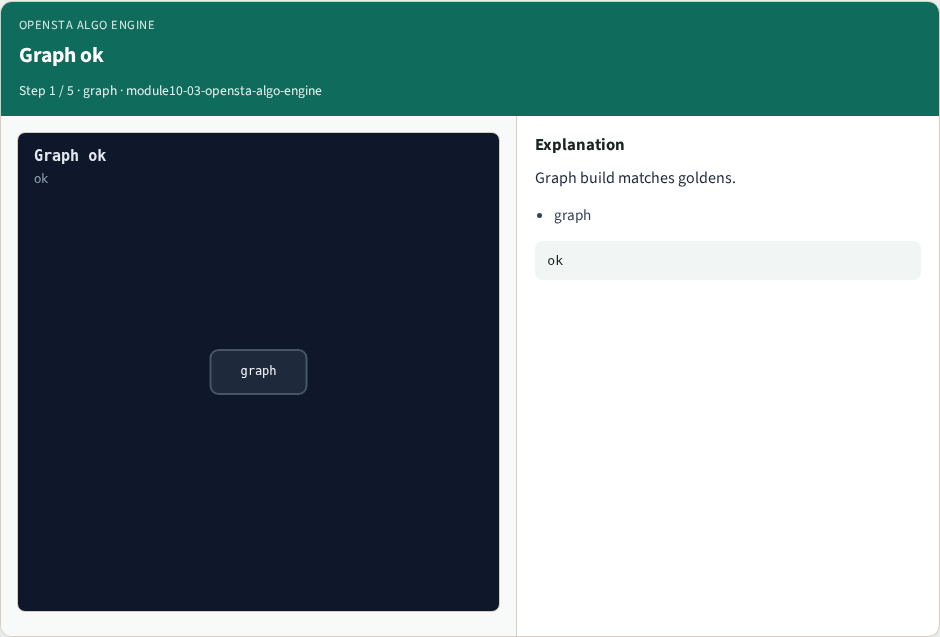
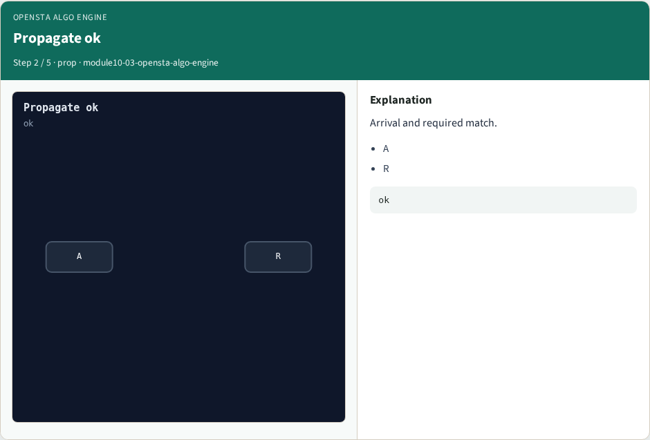
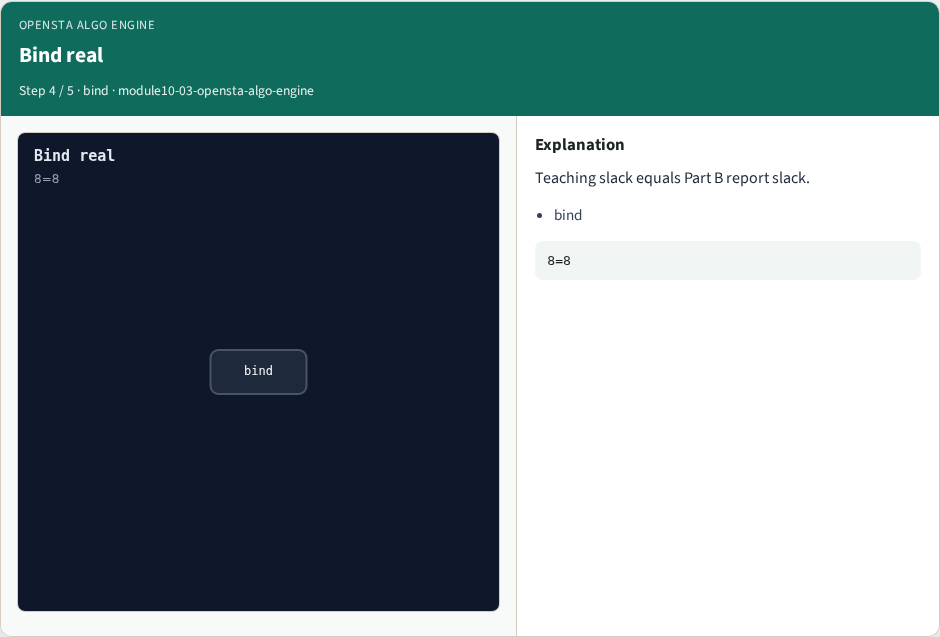
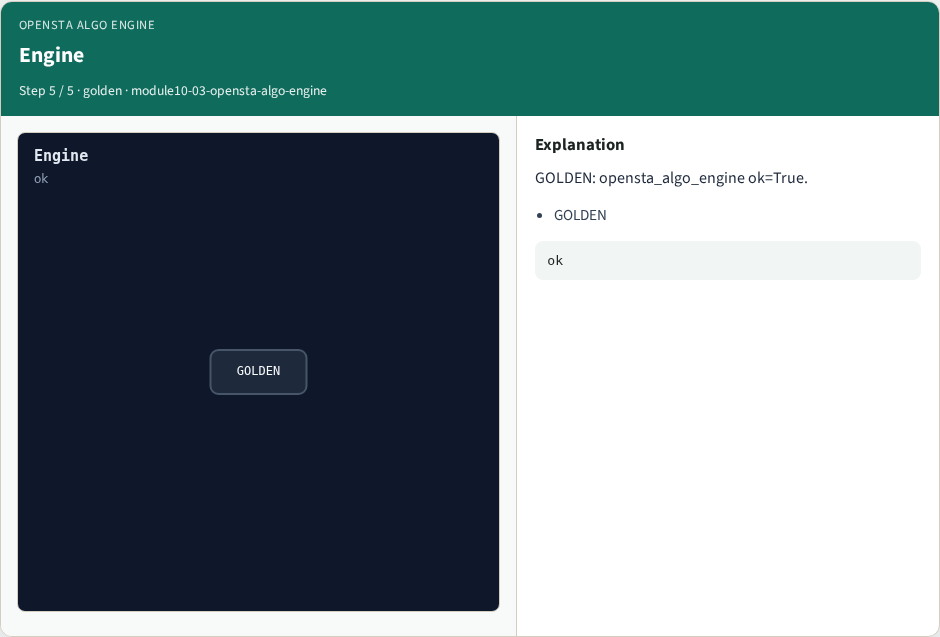

# Why algorithms

Run the full Part C engine and bind to real report goldens

---

## The idea
- GOLDEN: engine ok; bind slack 8↔8

---

## Graph ok


---

## Propagate ok


---

## Slack ok


---

## Bind real


---

## Engine


---

## Browser lab track
- Open **opensta-algo-engine**
- Run Graph / Levelize / Propagate / Slack / Bind, then Check

---

## Implement track
- From common/, run algo_solvers.py and partc_bind.py

---

## Pitfalls
- Changing tiny_algo_sta without updating Part B liberty delays
- Ignoring the bind side

---

## Try these
- From the common folder, run the Part C self-tests

---

## Try these — try these

```
cd courses/learn_opensta/common
python3 algo_solvers.py
python3 partc_bind.py
```

---

## Pseudocode
- Here is the check in plain steps

---

## Pseudocode — try these

```
engine ok; bind slack 8↔8.
ok if goldens match and bind
```

---

## Next
- Complete the quiz for this part
- Continue Part C, then wrap , internals literacy is next

