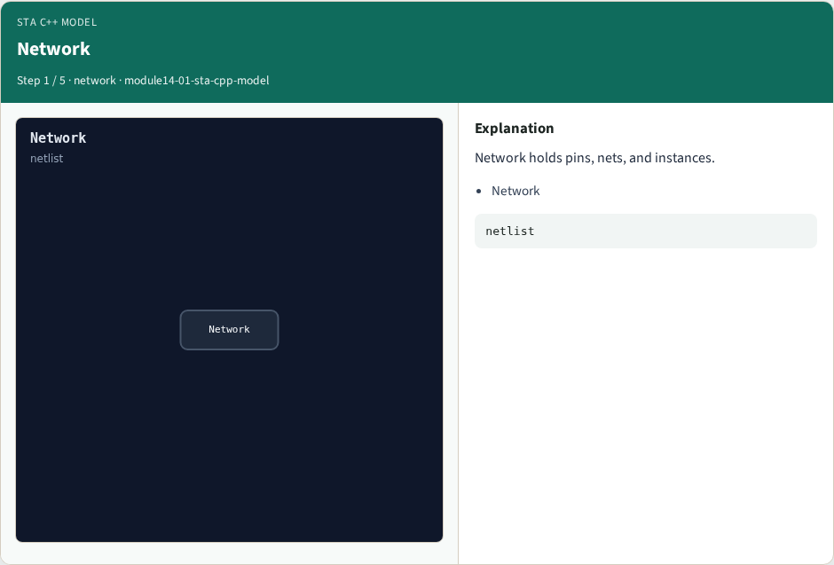
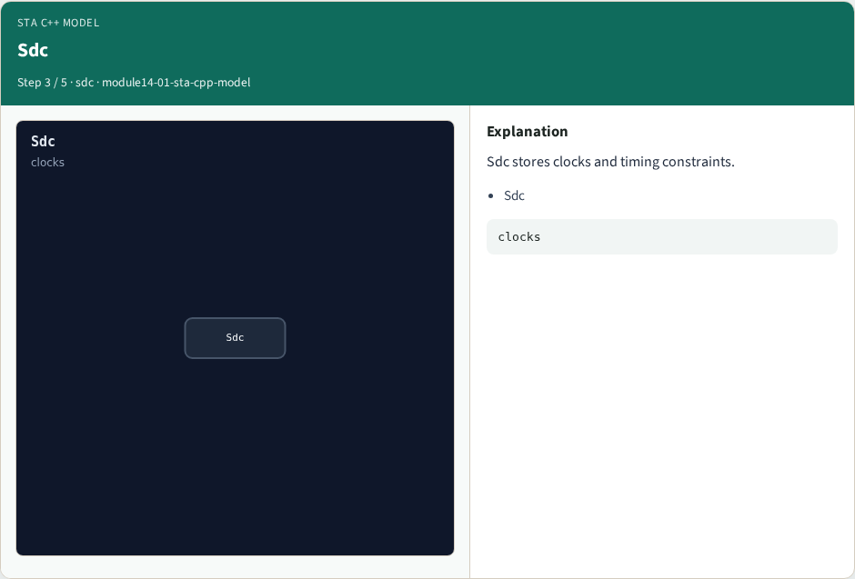
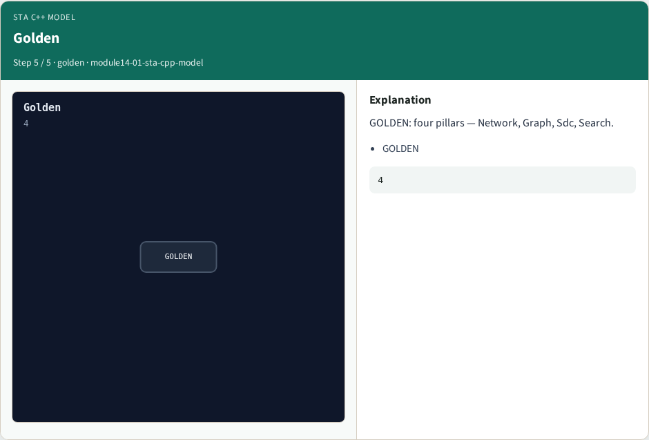

# STA C++ model — step-by-step (for slides / transcript)

**Module:** `module14-01-sta-cpp-model`  
**Lab / algo:** `sta-cpp-model`  
**Viewer:** `/tools/algorithm-walkthrough/?algo=sta-cpp-model&step=1`

Use each **Caption** as spoken prose (or a shortened slide note).
Use **Bullets** on the PPT; pair with the PNG in `assets/steps/`.

## Step 1 — Network



**Caption (transcript):** Network holds pins, nets, and instances.

**Slide bullets:**

- Network

**On-screen metrics:**

```
netlist
```

## Step 2 — Graph


**Caption (transcript):** Graph is the timing vertex/edge view of the netlist.

**Slide bullets:**

- Graph

**On-screen metrics:**

```
timing
```

## Step 3 — Sdc



**Caption (transcript):** Sdc stores clocks and timing constraints.

**Slide bullets:**

- Sdc

**On-screen metrics:**

```
clocks
```

## Step 4 — Search


**Caption (transcript):** Search propagates arrivals and finds paths for reports.

**Slide bullets:**

- Search

**On-screen metrics:**

```
paths
```

## Step 5 — Golden



**Caption (transcript):** GOLDEN: four pillars — Network, Graph, Sdc, Search.

**Slide bullets:**

- GOLDEN

**On-screen metrics:**

```
4
```

