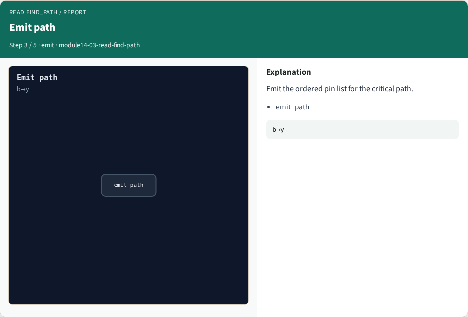
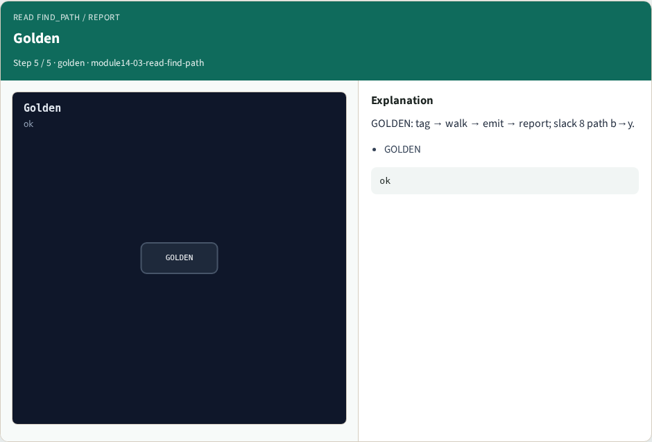

# Why read FindPath

Part C algorithms match moves

---

## The idea
- GOLDEN: tag endpoints

---

## Tag endpoints


---

## Walk back


---

## Emit path


---

## report_checks


---

## Golden


---

## Browser lab track
- Open **read-find-path**
- Step the FindPath pipeline and check

---

## Implement track
- Call read_find_path(); assert stage order and Part B slack bind

---

## Pitfalls
- Expecting FindPath to replace Liberty
- Ignoring the Part B delay and slack goldens

---

## Try these
- From the common folder, call read_find_path and print the stages

---

## Try these — try these

```
cd courses/learn_opensta/common
python3 -c "from internals_solvers import read_find_path; print(read_find_path())"
```

---

## Pseudocode
- Here is the FindPath teaching flow in plain steps

---

## Pseudocode — try these

```
tag_endpoints
walk_back from worst slack
emit_path → [b, n1, n2, y]
report_checks → delay 2, slack 8 MET
```

---

## Next
- Complete the quiz for this part
- Next: contribute a minimal Tcl command of your own

