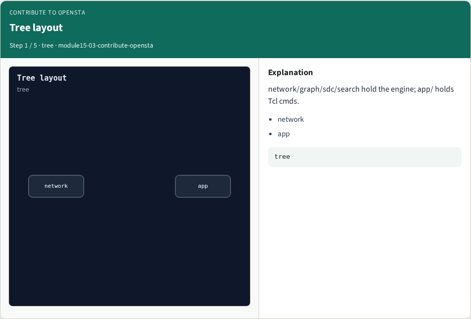
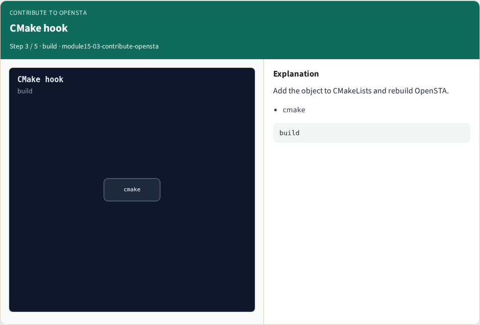
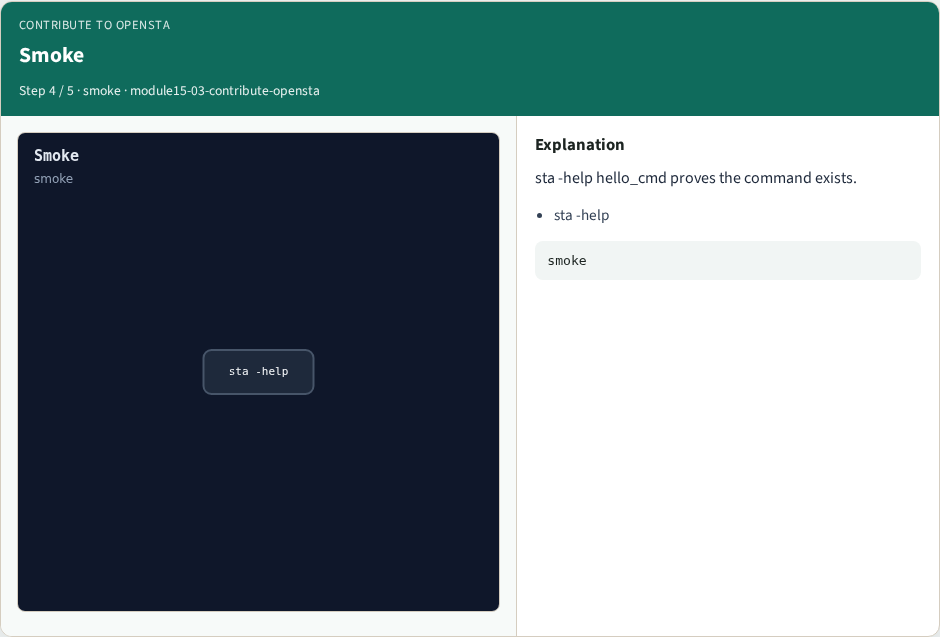
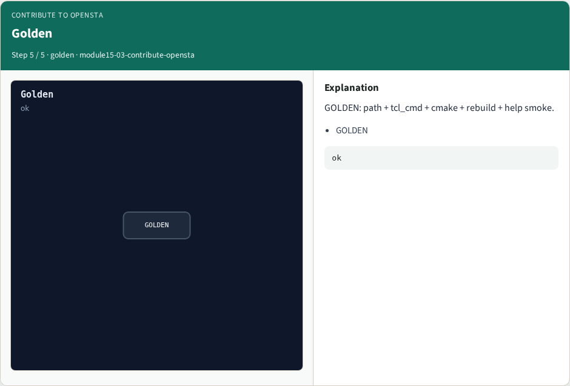

# Why contribute

Reading is not enough

---

## The idea
- Add app/HelloCmd.cc, register the Tcl command, hook CMake, rebuild, sta -help hello_cmd

---

## Tree layout


---

## Stub file


---

## CMake hook


---

## Smoke


---

## Golden


---

## Browser lab track
- Open **contribute-opensta**
- Assemble the contribute checklist and check

---

## Implement track
- Call contribute_opensta(); assert checklist length and smoke cmd

---

## Pitfalls
- Editing only docs
- Forgetting the CMake entry
- Skipping help smoke

---

## Try these
- From the common folder, call contribute_opensta and print the checklist

---

## Try these — try these

```
cd courses/learn_opensta/common
python3 -c "from internals_solvers import contribute_opensta; print(contribute_opensta())"
```

---

## Pseudocode
- Here is the contribute checklist in plain steps

---

## Pseudocode — try these

```
path ← app/HelloCmd.cc
register Tcl cmd hello_cmd
add to CMake; rebuild
smoke ← sta -help hello_cmd
```

---

## Next
- Complete the quiz for this part
- Wrap the OpenSTA path , you can use OpenSTA and open the C++ tree with intent

