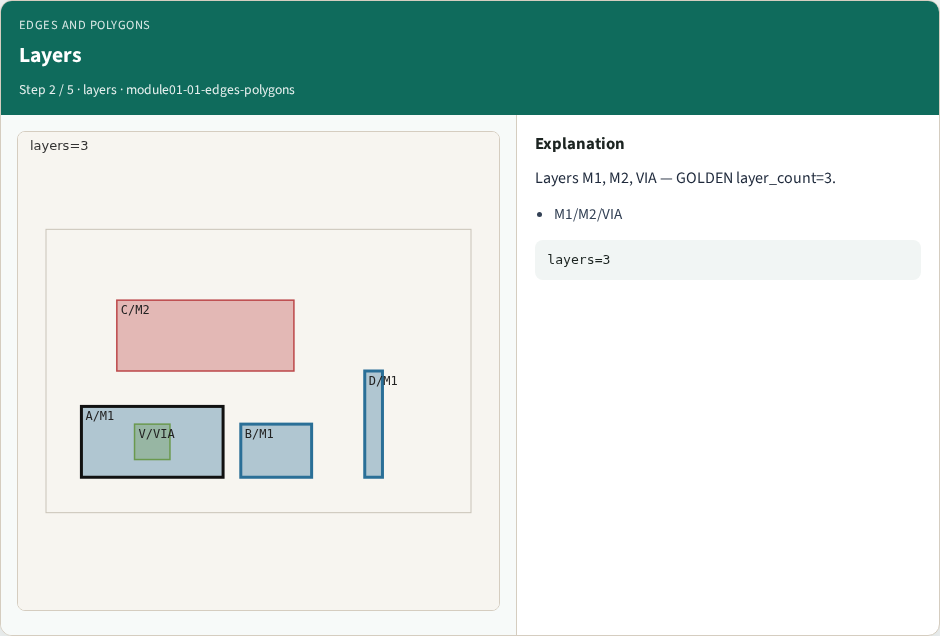
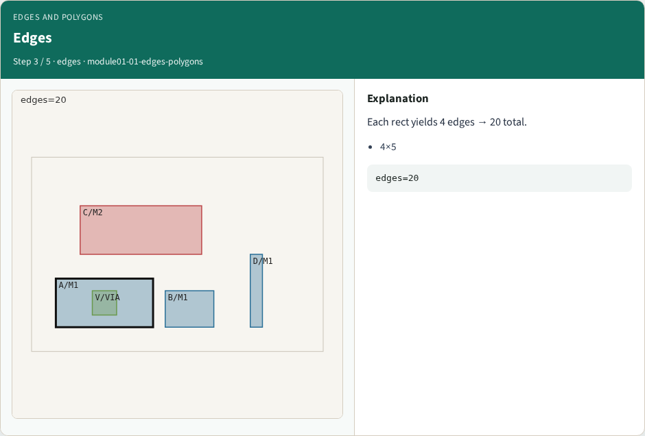
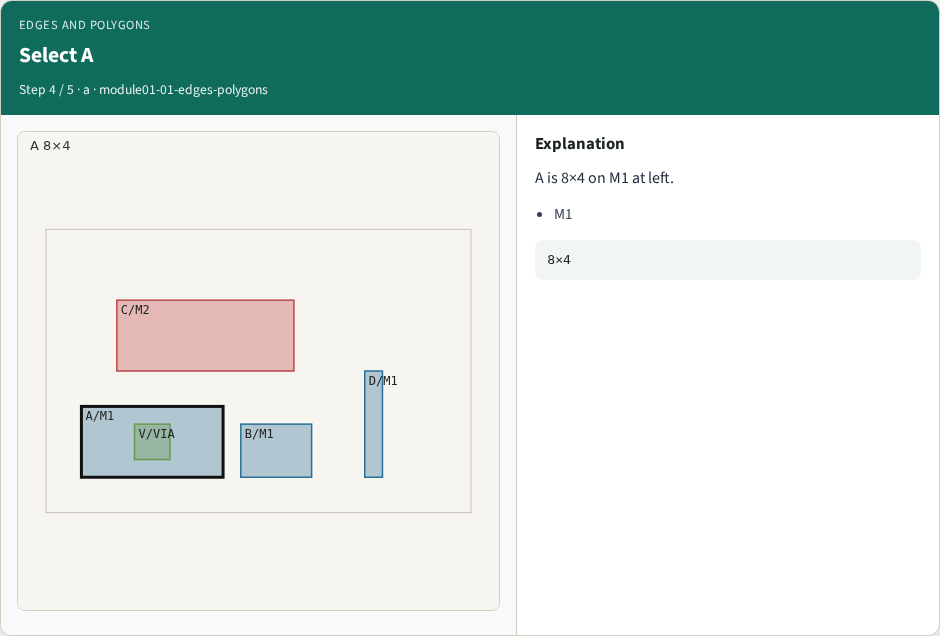
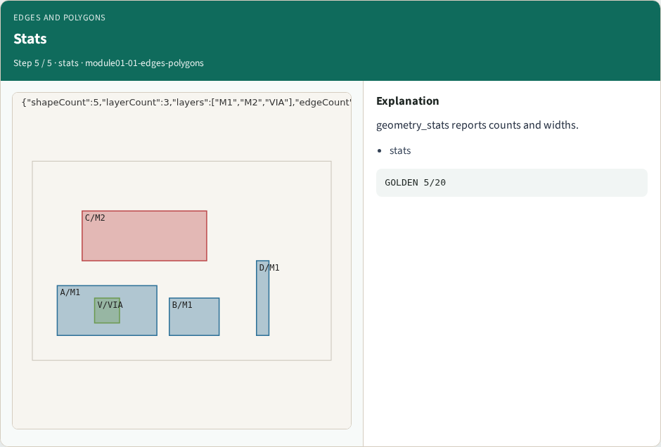
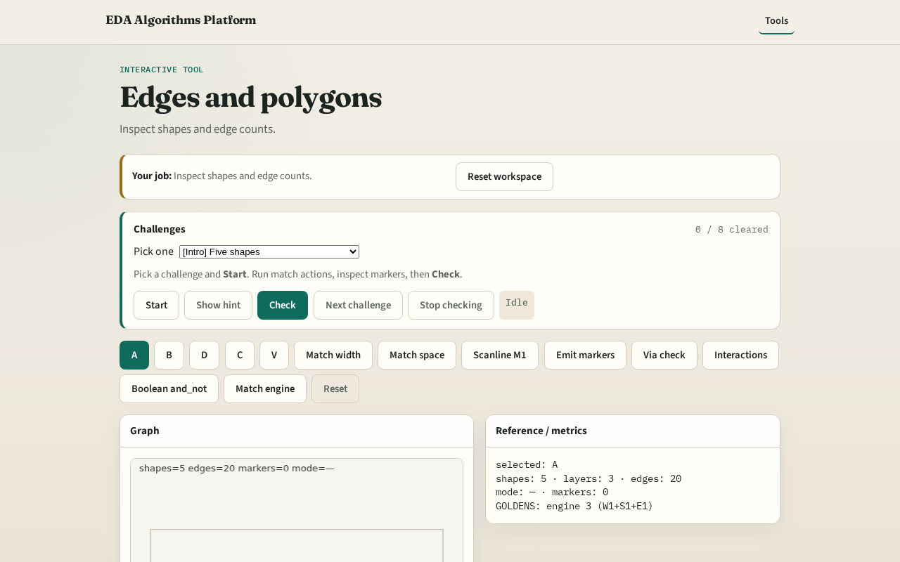

# Why edges

Pattern engines begin with polygons and their edges on named layers

---

## The idea
- GOLDEN: 5 shapes, 3 layers, 20 edges (4 per shape), 3 shapes on M1

---

## Shapes

---

## Layers

---

## Edges

---

## Select A

---

## Stats

---

## Browser lab track

---

## Implement track
- Call geometry_stats(); assert shape_count==5 and edge_count==20

---

## Pitfalls
- Counting only cells
- Mixing chip size with shape count

---

## Your turn
- Next: single-layer edge-pair spacing

