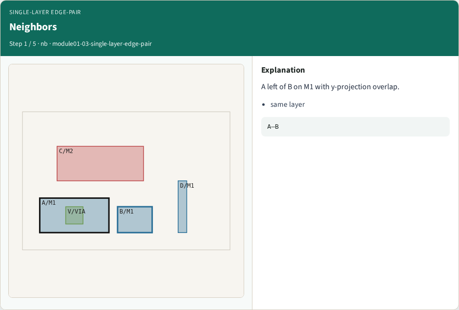
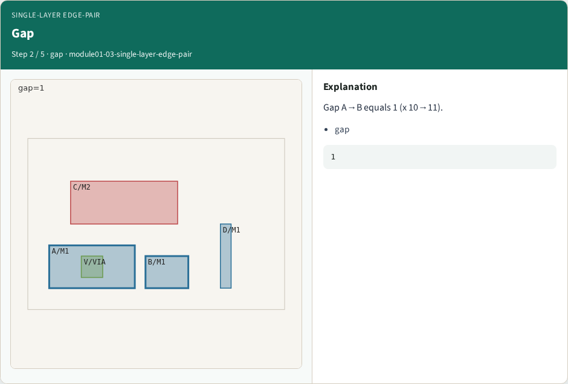
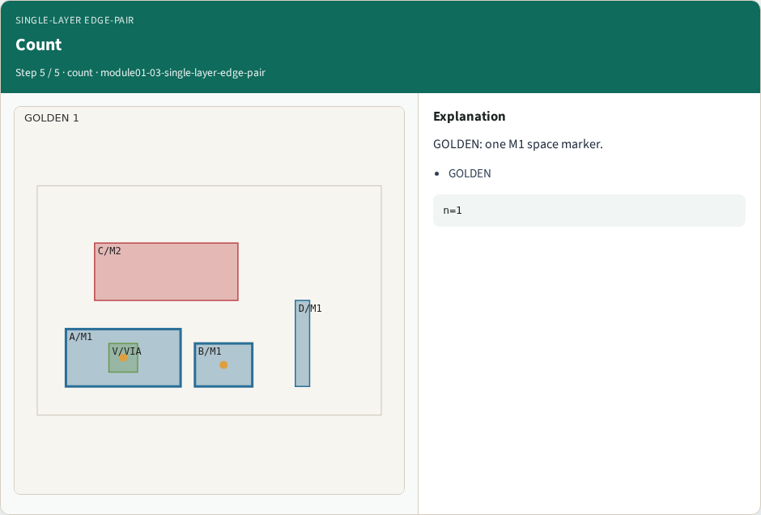

# Single-layer edge-pair (space) — step-by-step (for slides / transcript)

**Module:** `module01-03-single-layer-edge-pair`  
**Lab / algo:** `single-layer-edge-pair`  
**Viewer:** `/tools/algorithm-walkthrough/?algo=single-layer-edge-pair&step=1`

Use each **Caption** as spoken prose (or a shortened slide note).
Use **Bullets** on the PPT; pair with the PNG in `assets/steps/`.

## Step 1 — Neighbors



**Caption (transcript):** A left of B on M1 with y-projection overlap.

**Slide bullets:**

- same layer

**On-screen metrics:**

```
A–B
```

## Step 2 — Gap



**Caption (transcript):** Gap A→B equals 1 (x 10→11).

**Slide bullets:**

- gap

**On-screen metrics:**

```
1
```

## Step 3 — Limit


**Caption (transcript):** min_space[M1]=2.

**Slide bullets:**

- rule

**On-screen metrics:**

```
2
```

## Step 4 — Marker


**Caption (transcript):** Emit space marker on shapes A,B.

**Slide bullets:**

- space

**On-screen metrics:**

```
marker
```

## Step 5 — Count



**Caption (transcript):** GOLDEN: one M1 space marker.

**Slide bullets:**

- GOLDEN

**On-screen metrics:**

```
n=1
```

