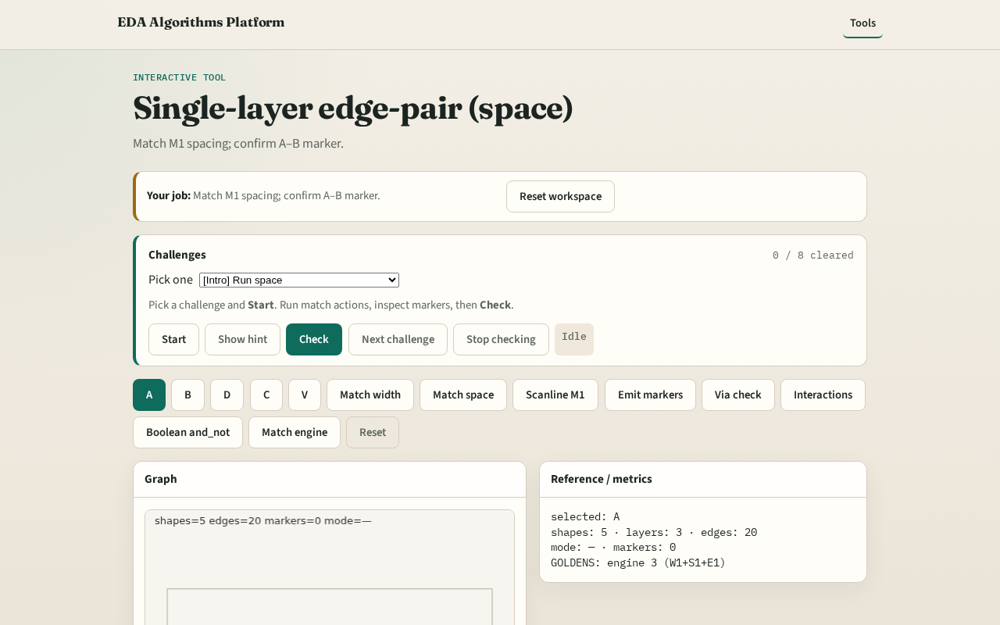

# Single-layer edge-pair (space)

**Module id:** module01-03-single-layer-edge-pair
**Lab:** single-layer-edge-pair
**Tracks:** A (implement) · B (browser lab)

## Slide 1 — Edge pair

Spacing patterns compare facing edges of same-layer shapes with overlapping projections.

## Slide 2 — The idea

On M1, A–B gap is 1 but min_space=2 → one space marker. GOLDEN space_markers=1.

<!-- algorithm-walkthrough -->

## Slide 3 — Neighbors

A left of B on M1 with y-projection overlap.

## Slide 4 — Gap

Gap A→B equals 1 (x 10→11).

## Slide 5 — Limit

min_space[M1]=2.

## Slide 6 — Marker

Emit space marker on shapes A,B.

## Slide 7 — Count

GOLDEN: one M1 space marker.

<!-- /algorithm-walkthrough -->

## Slide 8 — Browser lab track

Open **single-layer-edge-pair**. Run Match space; confirm one A–B marker.

## Slide 9 — Implement track

Call match_space(layer='M1'); assert len==1 and shapes {A,B}.

## Slide 10 — Pitfalls

Matching without projection overlap. Checking different layers as one pair.

## Slide 11 — Your turn

Next: single-layer region / enclosure.
