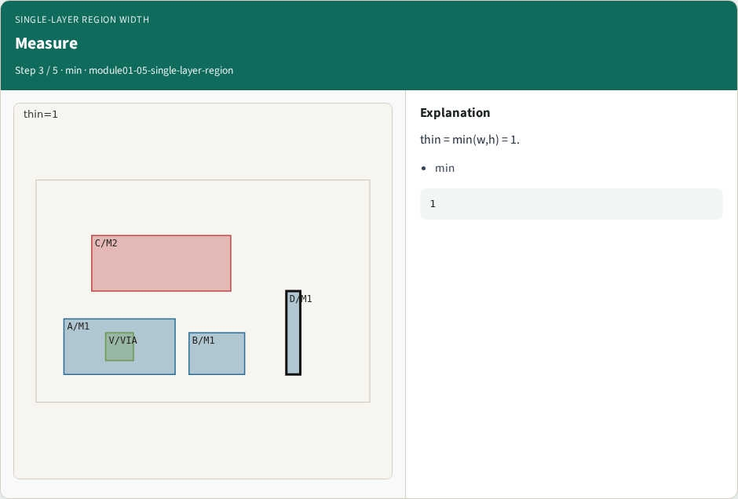
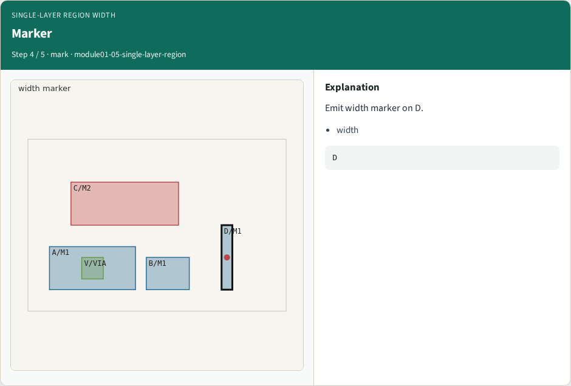
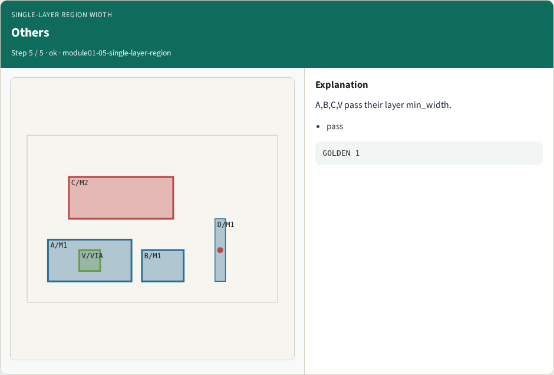
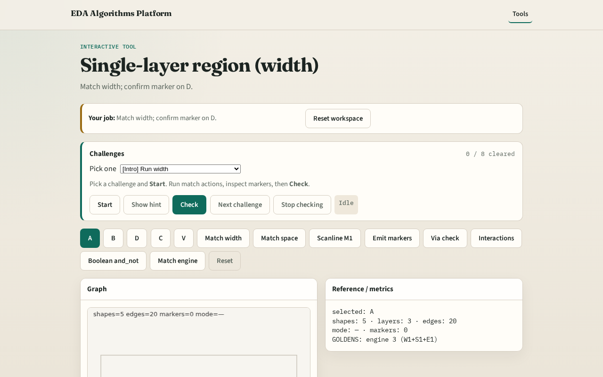

# Region width

Width patterns treat a polygon as a region and measure its smallest extent

---

## The idea
- D is 1×6 on M1; min_width[M1]=3 → width marker
- GOLDEN width_markers=1

---

## Thin D

---

## Min width

---

## Measure

---

## Marker

---

## Others

---

## Browser lab track

---

## Implement track
- Call match_width(); assert one marker on D

---

## Pitfalls
- Using area instead of min(w,h)
- Applying M2 limits to M1

---

## Your turn
- Next: scanline sweep

