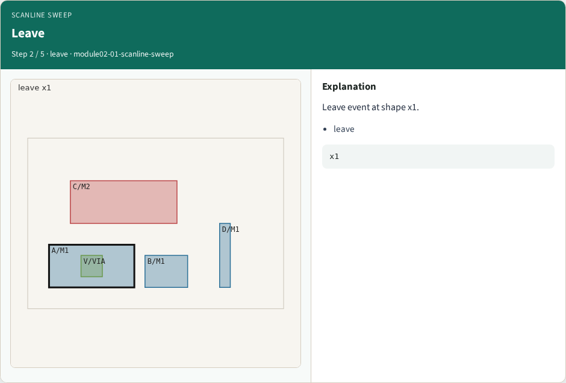
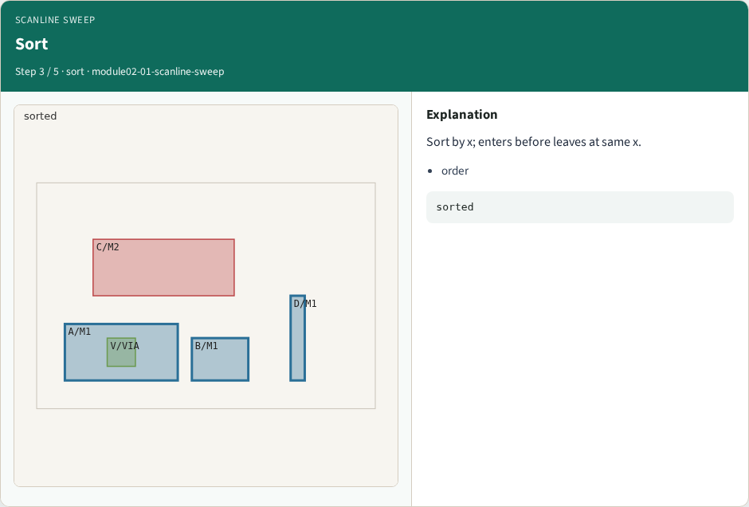
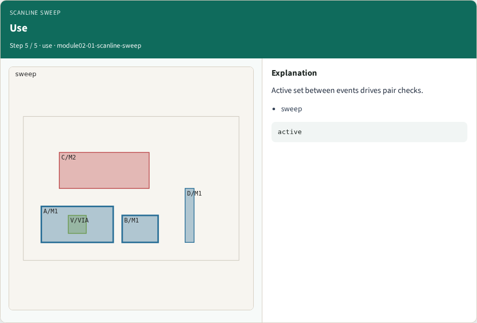
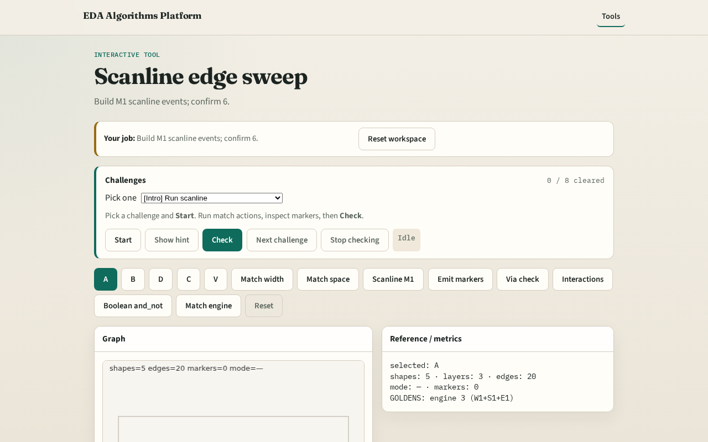

# Scanline edge sweep

**Module id:** module02-01-scanline-sweep
**Lab:** scanline-sweep
**Tracks:** A (implement) · B (browser lab)

## Slide 1 — Scanline

Production matchers often sweep a scanline across edges instead of O(n²) pairs only.

## Slide 2 — The idea

M1 has 3 shapes → 6 events (enter/leave each). Events sort by x then enter-before-leave.

<!-- algorithm-walkthrough -->

## Slide 3 — Enter

Enter event at shape x0.

## Slide 4 — Leave

Leave event at shape x1.

## Slide 5 — Sort

Sort by x; enters before leaves at same x.

## Slide 6 — M1 count

GOLDEN: 6 events on M1.

## Slide 7 — Use

Active set between events drives pair checks.

<!-- /algorithm-walkthrough -->

## Slide 8 — Browser lab track

Open **scanline-sweep**. Run Scanline M1; confirm 6 events.

## Slide 9 — Implement track

Call scanline_events('M1'); assert len==6.

## Slide 10 — Pitfalls

Forgetting leave events. Sorting leaves before enters at same x.

## Slide 11 — Your turn

Next: marker emission.
