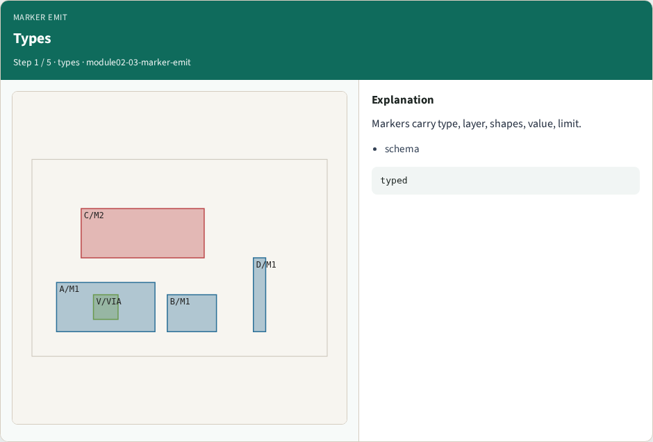
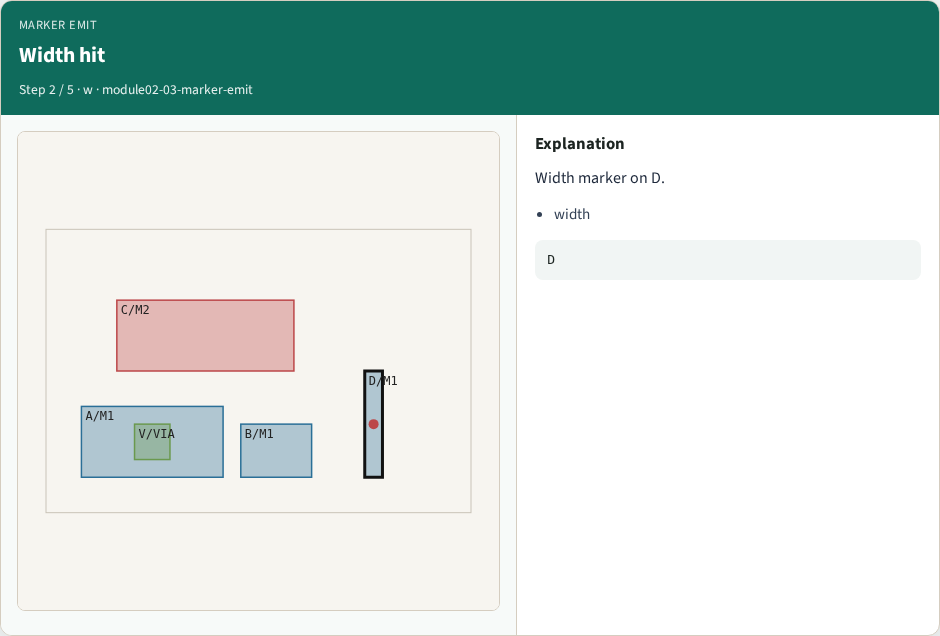
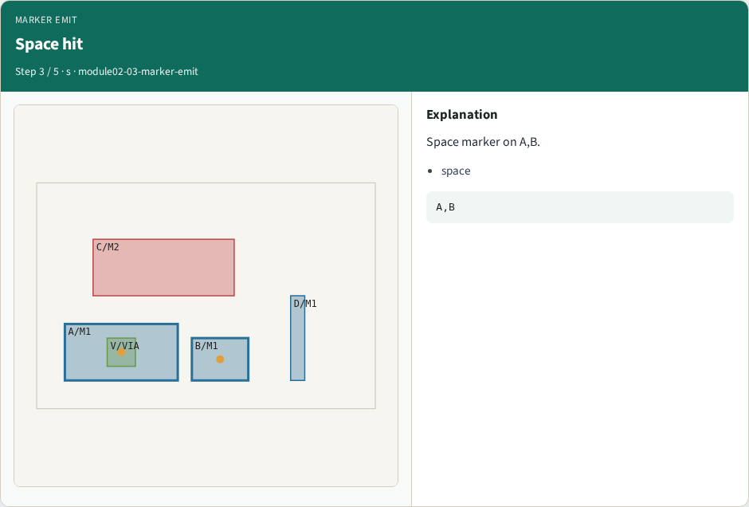
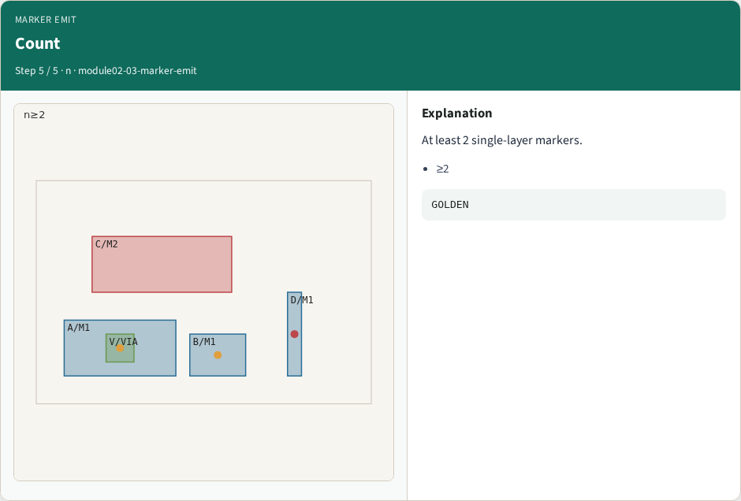
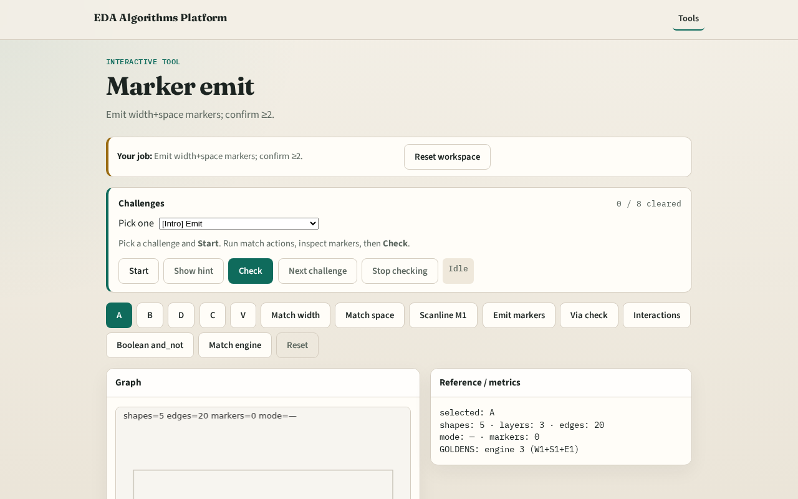

# Marker emit

**Module id:** module02-03-marker-emit
**Lab:** marker-emit
**Tracks:** A (implement) · B (browser lab)

## Slide 1 — Markers

A marker is a typed hit (width/space/…) pointing at shapes — DRC later maps markers to violations.

## Slide 2 — The idea

emit_markers combines width and space → at least 2 markers (D + A–B).

<!-- algorithm-walkthrough -->

## Slide 3 — Types

Markers carry type, layer, shapes, value, limit.

## Slide 4 — Width hit

Width marker on D.

## Slide 5 — Space hit

Space marker on A,B.

## Slide 6 — List

emit_markers returns the combined list.

## Slide 7 — Count

At least 2 single-layer markers.

<!-- /algorithm-walkthrough -->

## Slide 8 — Browser lab track

Open **marker-emit**. Run Emit markers; confirm ≥2 markers.

## Slide 9 — Implement track

Call emit_markers(); assert len >= 2.

## Slide 10 — Pitfalls

Dropping value/limit fields. Mixing multi-layer into emit early.

## Slide 11 — Your turn

Next: multi-layer via enclosure.
