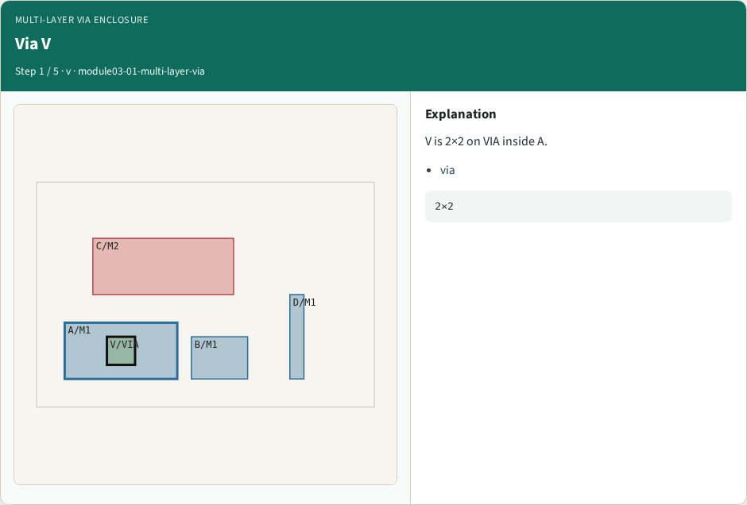
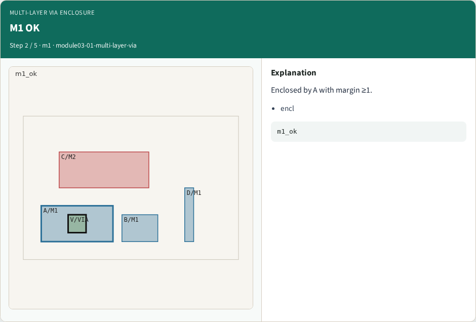
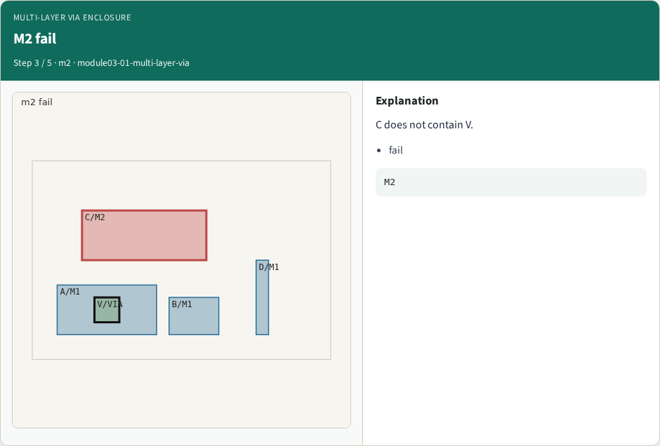
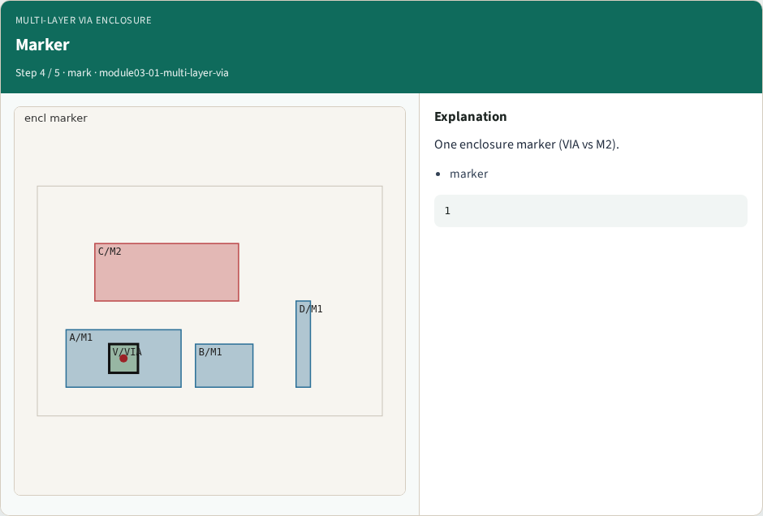
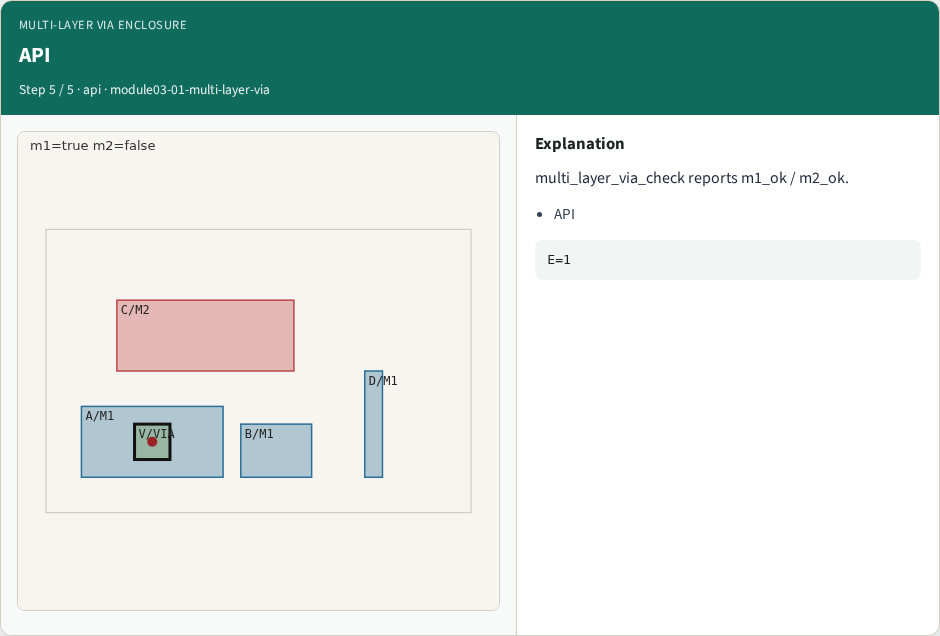

# Multi-layer via enclosure — step-by-step (for slides / transcript)

**Module:** `module03-01-multi-layer-via`  
**Lab / algo:** `multi-layer-via`  
**Viewer:** `/tools/algorithm-walkthrough/?algo=multi-layer-via&step=1`

Use each **Caption** as spoken prose (or a shortened slide note).
Use **Bullets** on the PPT; pair with the PNG in `assets/steps/`.

## Step 1 — Via V



**Caption (transcript):** V is 2×2 on VIA inside A.

**Slide bullets:**

- via

**On-screen metrics:**

```
2×2
```

## Step 2 — M1 OK



**Caption (transcript):** Enclosed by A with margin ≥1.

**Slide bullets:**

- encl

**On-screen metrics:**

```
m1_ok
```

## Step 3 — M2 fail



**Caption (transcript):** C does not contain V.

**Slide bullets:**

- fail

**On-screen metrics:**

```
M2
```

## Step 4 — Marker



**Caption (transcript):** One enclosure marker (VIA vs M2).

**Slide bullets:**

- marker

**On-screen metrics:**

```
1
```

## Step 5 — API



**Caption (transcript):** multi_layer_via_check reports m1_ok / m2_ok.

**Slide bullets:**

- API

**On-screen metrics:**

```
E=1
```

