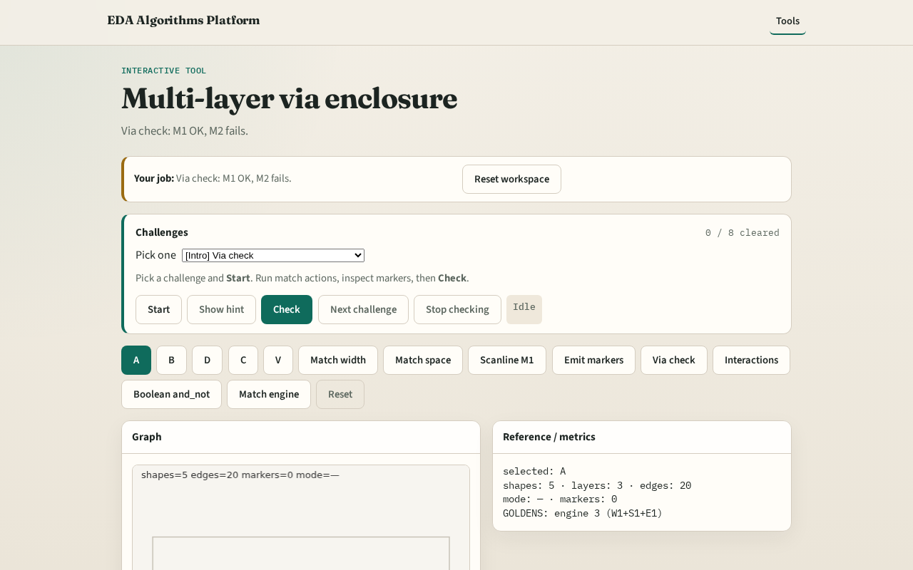

# Multi-layer via enclosure

**Module id:** module03-01-multi-layer-via
**Lab:** multi-layer-via
**Tracks:** A (implement) · B (browser lab)

## Slide 1 — Via enclose

Enclosure is a region pattern across layers: inner VIA must sit inside outer metal with margin.

## Slide 2 — The idea

V inside A on M1 with margins ≥1 → OK. V not inside C on M2 → enclosure marker. GOLDEN enclosure_markers=1.

<!-- algorithm-walkthrough -->

## Slide 3 — Via V

V is 2×2 on VIA inside A.

## Slide 4 — M1 OK

Enclosed by A with margin ≥1.

## Slide 5 — M2 fail

C does not contain V.

## Slide 6 — Marker

One enclosure marker (VIA vs M2).

## Slide 7 — API

multi_layer_via_check reports m1_ok / m2_ok.

<!-- /algorithm-walkthrough -->

## Slide 8 — Browser lab track

Open **multi-layer-via**. Run Via check; confirm m1_ok and one M2 marker.

## Slide 9 — Implement track

Call multi_layer_via_check(); assert m1_ok and enclosure_markers==1.

## Slide 10 — Pitfalls

Requiring same-layer enclosure. Ignoring margin limit.

## Slide 11 — Your turn

Next: multi-layer interactions.
