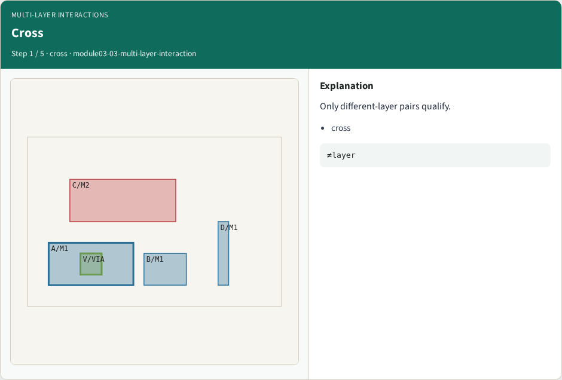
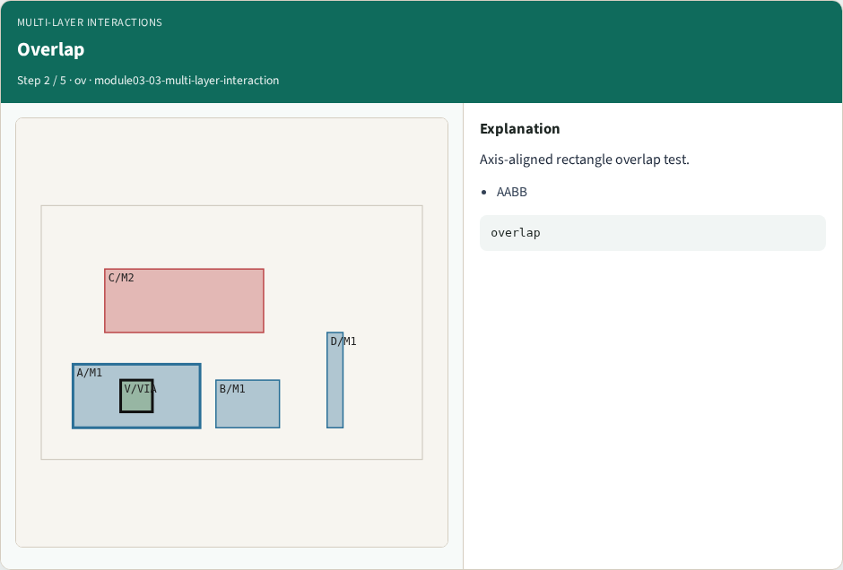
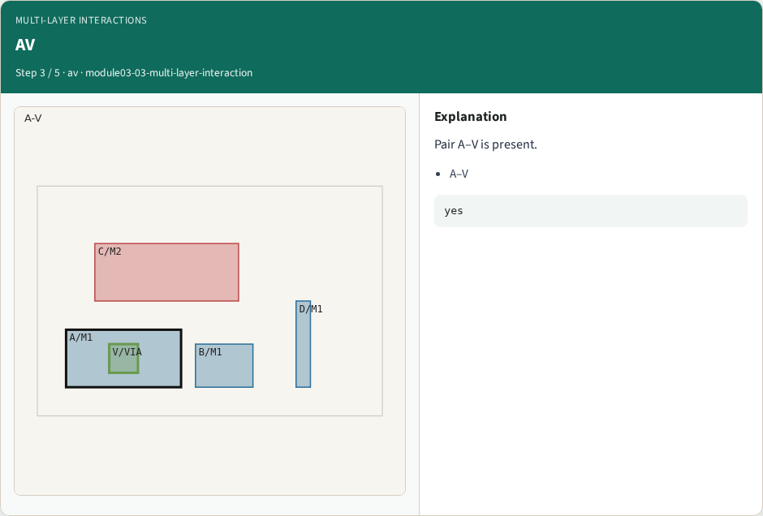
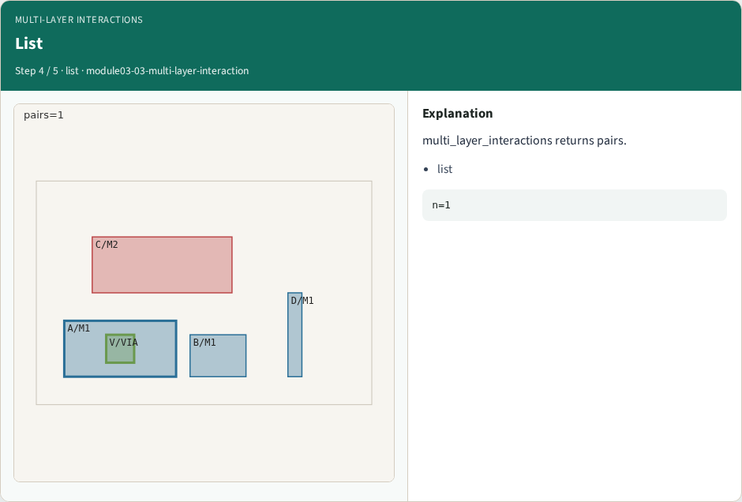
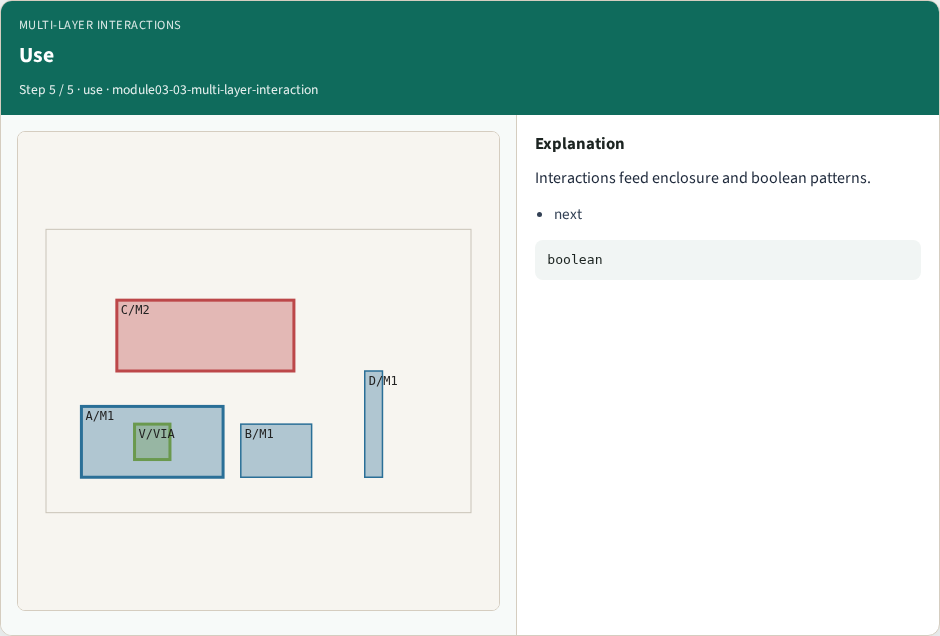
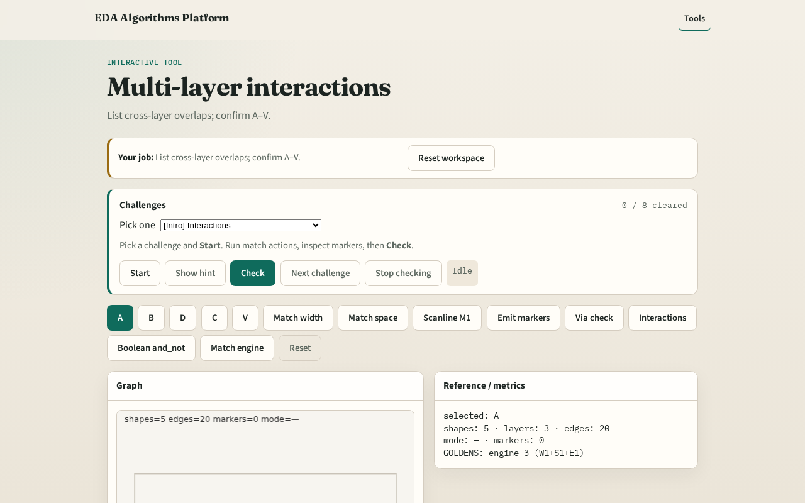

# Multi-layer interactions

**Module id:** module03-03-multi-layer-interaction
**Lab:** multi-layer-interaction
**Tracks:** A (implement) · B (browser lab)

## Slide 1 — Interactions

Interaction patterns find shapes on different layers whose regions overlap — candidates for via/contact checks.

## Slide 2 — The idea

V overlaps A (VIA∩M1). GOLDEN: at least the (A,V) pair.

<!-- algorithm-walkthrough -->

## Slide 3 — Cross

Only different-layer pairs qualify.

## Slide 4 — Overlap

Axis-aligned rectangle overlap test.

## Slide 5 — AV

Pair A–V is present.

## Slide 6 — List

multi_layer_interactions returns pairs.

## Slide 7 — Use

Interactions feed enclosure and boolean patterns.

<!-- /algorithm-walkthrough -->

## Slide 8 — Browser lab track

Open **multi-layer-interaction**. Run Interactions; confirm A–V pair.

## Slide 9 — Implement track

Call multi_layer_interactions(); assert ('A','V') in pairs.

## Slide 10 — Pitfalls

Including same-layer overlaps. Using center distance only.

## Slide 11 — Your turn

Next: layered boolean.
