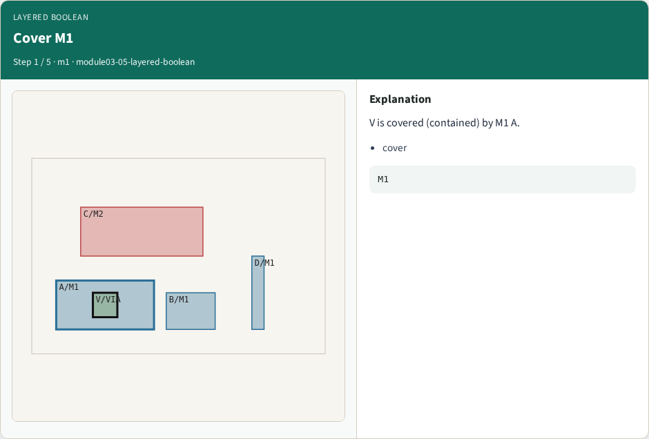
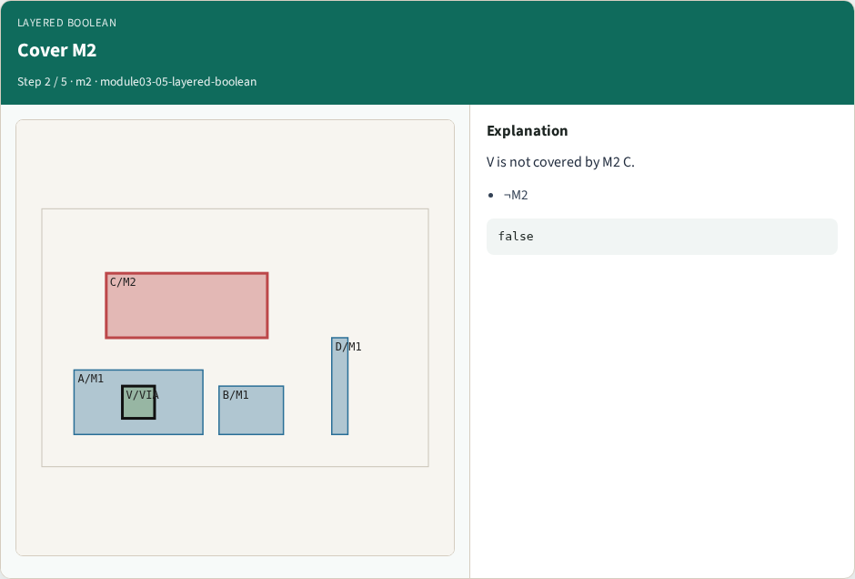
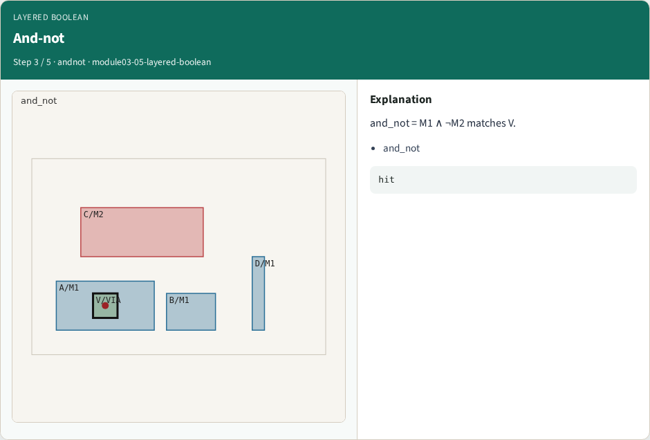
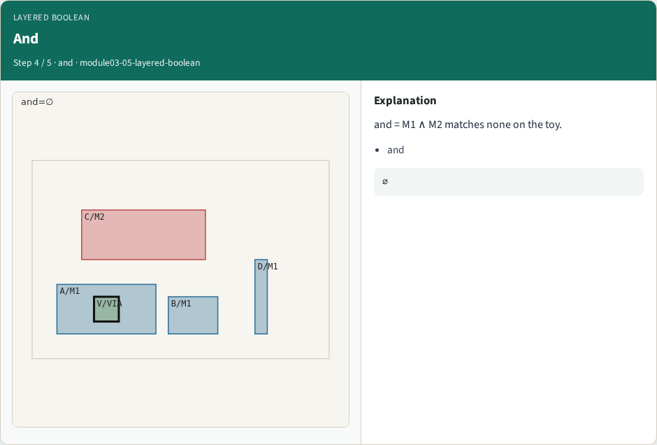
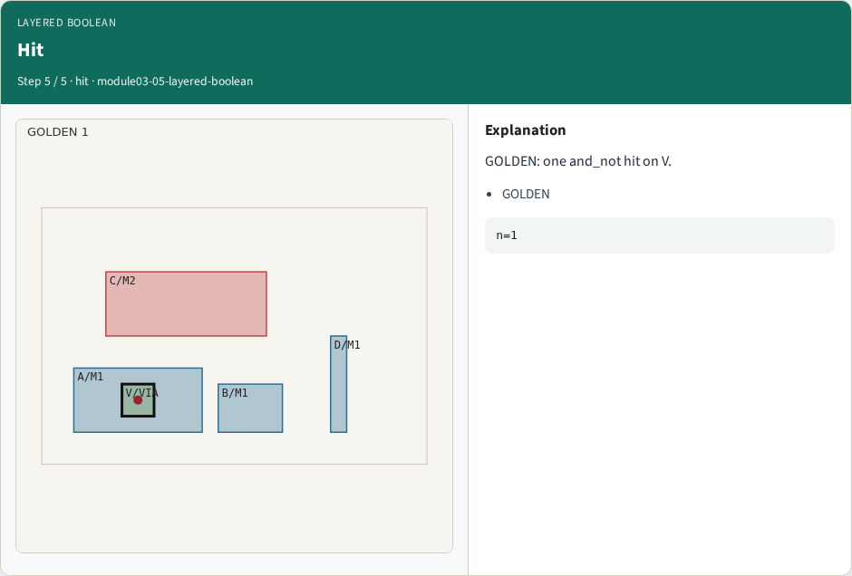
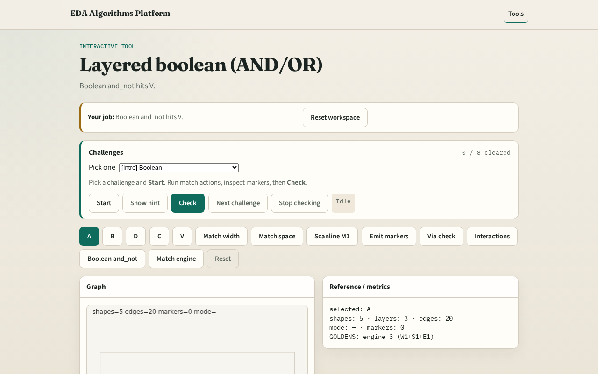

# Layered boolean (AND/OR)

**Module id:** module03-05-layered-boolean
**Lab:** layered-boolean
**Tracks:** A (implement) · B (browser lab)

## Slide 1 — Boolean

Boolean patterns combine coverage predicates across layers (AND / OR / AND-NOT).

## Slide 2 — The idea

V covered by M1 and not by M2 → and_not hit. GOLDEN boolean_and_hits=1.

<!-- algorithm-walkthrough -->

## Slide 3 — Cover M1

V is covered (contained) by M1 A.

## Slide 4 — Cover M2

V is not covered by M2 C.

## Slide 5 — And-not

and_not = M1 ∧ ¬M2 matches V.

## Slide 6 — And

and = M1 ∧ M2 matches none on the toy.

## Slide 7 — Hit

GOLDEN: one and_not hit on V.

<!-- /algorithm-walkthrough -->

## Slide 8 — Browser lab track

Open **layered-boolean**. Run Boolean and_not; confirm hit on V.

## Slide 9 — Implement track

Call layered_boolean('and_not'); assert one hit on V.

## Slide 10 — Pitfalls

Confusing overlap with containment. Swapping AND and AND-NOT.

## Slide 11 — Your turn

Next: full match engine pass.
