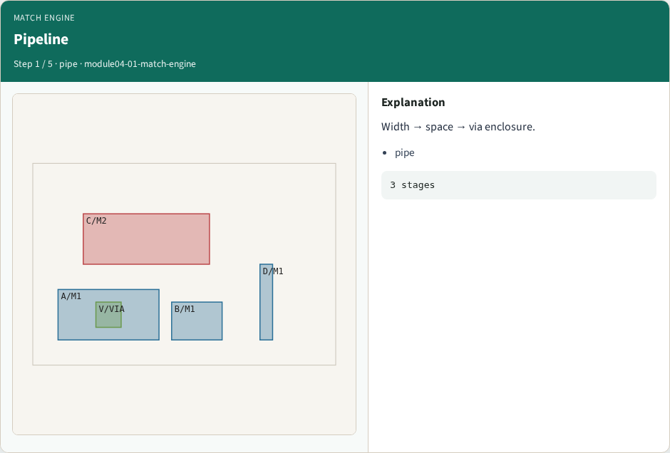
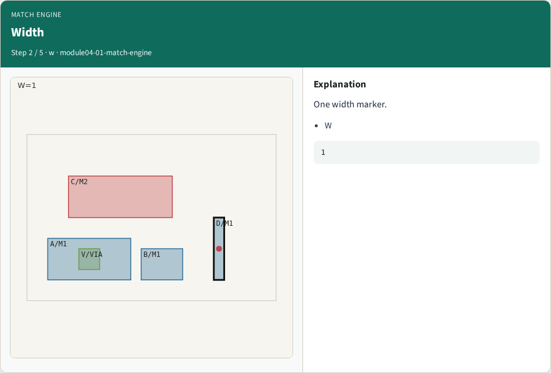
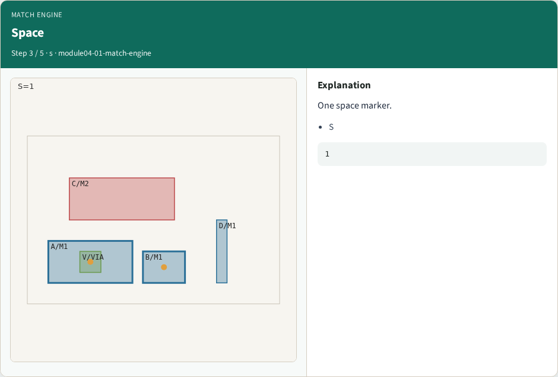
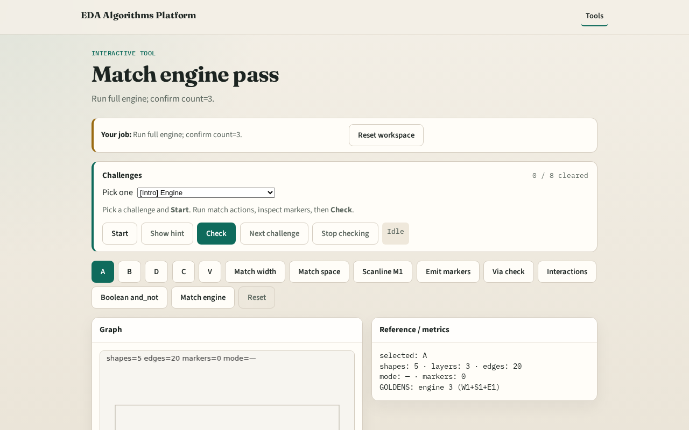

# Engine

A tiny match engine chains single-layer and multi-layer patterns into one marker list

---

## The idea
- GOLDEN match_engine_markers=3 (width 1 + space 1 + enclosure 1)

---

## Pipeline

---

## Width

---

## Space

---

## Encl

---

## Total

---

## Browser lab track

---

## Implement track
- Call match_engine(); assert count==3

---

## Pitfalls
- Stopping after width only
- Double-counting boolean as DRC markers

---

## Your turn
- Next: offline compare, then wrap

