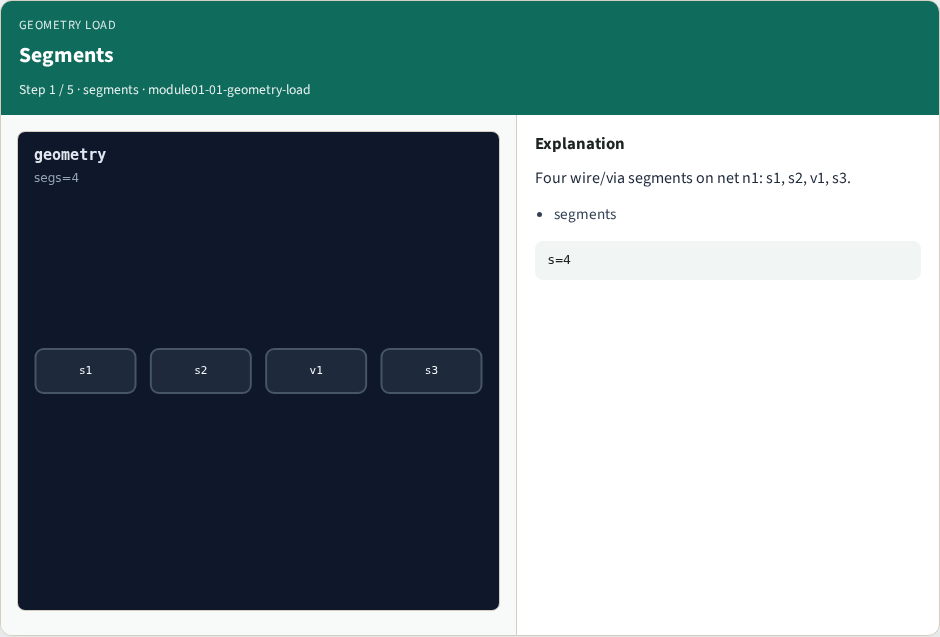
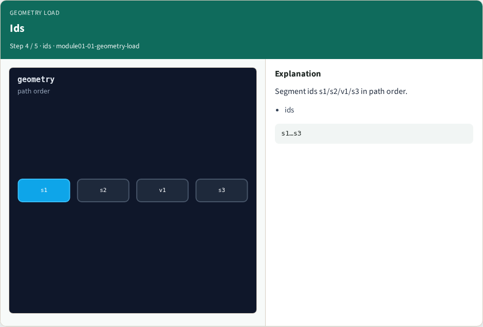
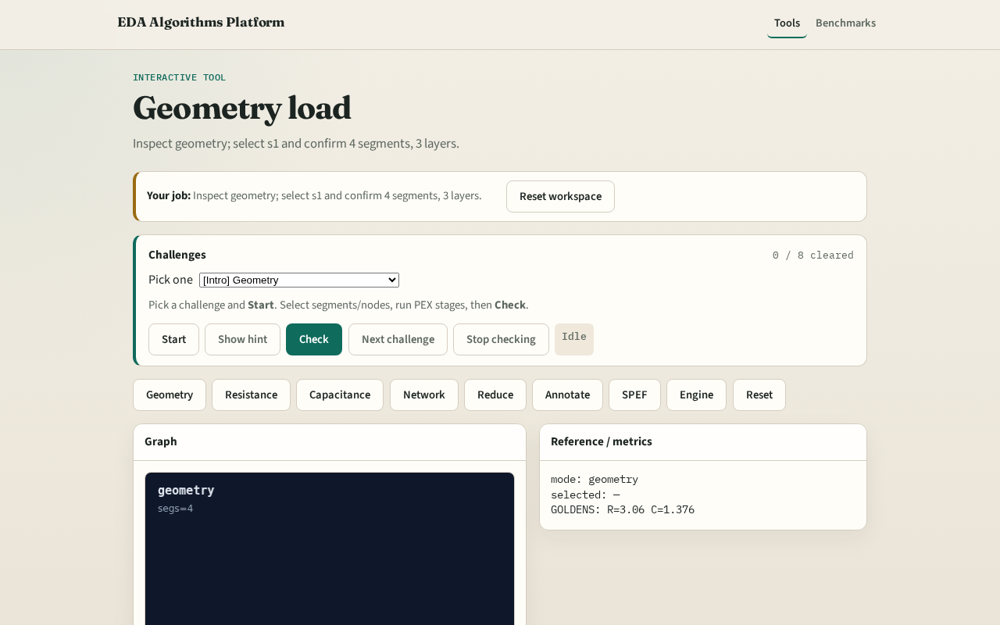

# Geometry load

PEX starts from annotated layout segments , layers, nets, and segment ids

---

## The idea
- GOLDEN: 4 segments, 3 layers

---

## Segments

---

## Layers

---

## Nets

---

## Ids

---

## Golden

---

## Browser lab track

---

## Implement track
- Call load_geometry(); assert segment_count==4 and layer_count==3

---

## Pitfalls
- Counting ports as segments
- Ignoring VIA layer in layer_count

---

## Your turn
- Next: resistance extract

