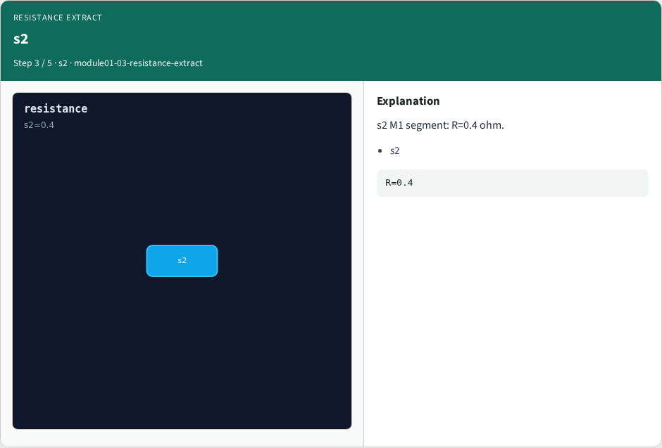
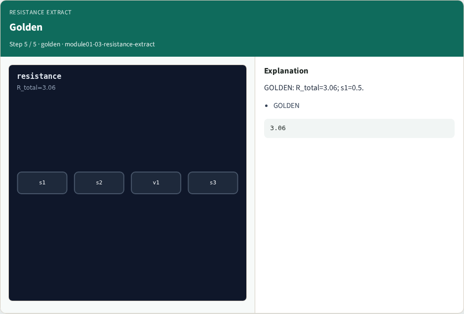
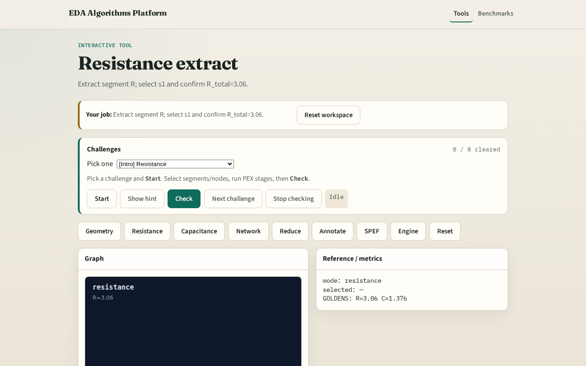

# Resistance extract

**Module id:** module01-03-resistance-extract
**Lab:** resistance-extract
**Tracks:** A (implement) · B (browser lab)

## Slide 1 — Resistance

Resistance extract computes R = rho*L/W for metals; VIA uses lump rho.

## Slide 2 — The idea

GOLDEN: R_total=3.06; s1=0.5.

<!-- algorithm-walkthrough -->

## Slide 3 — Formula

Metal R = rho*L/W; VIA uses lump rho.

## Slide 4 — s1

s1 M1 segment: R=0.5 ohm.

## Slide 5 — s2

s2 M1 segment: R=0.4 ohm.

## Slide 6 — v1

v1 VIA lump: R=2.0 ohm.

## Slide 7 — Golden

GOLDEN: R_total=3.06; s1=0.5.

<!-- /algorithm-walkthrough -->

## Slide 8 — Browser lab track

Open **resistance-extract**. Select s1; confirm R_total=3.06.

## Slide 9 — Implement track

Call extract_resistance(); assert r_total==3.06 and resistors['s1']==0.5.

## Slide 10 — Pitfalls

Using max edge as width. Forgetting VIA lump resistance.

## Slide 11 — Your turn

Next: capacitance extract.
